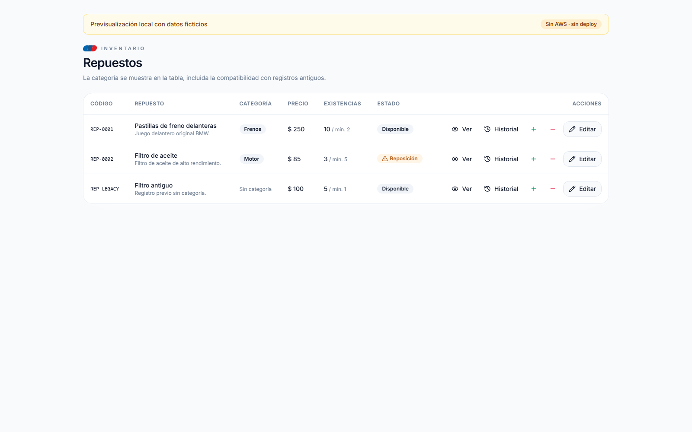
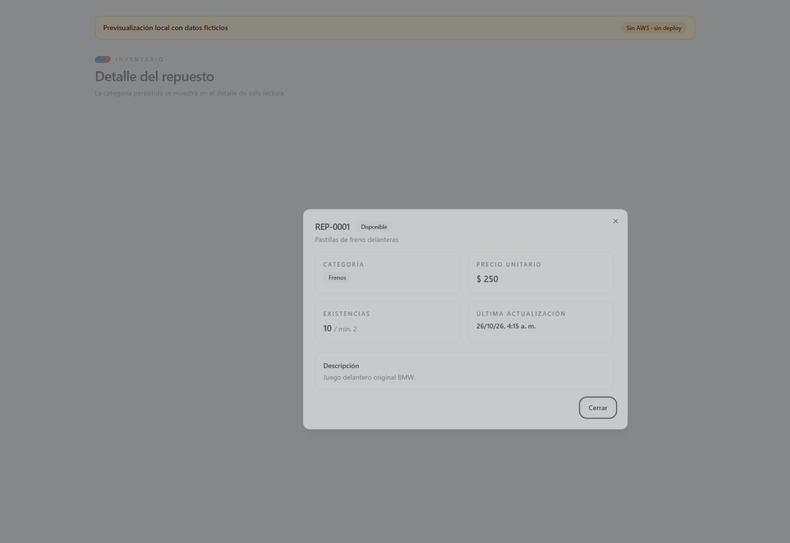
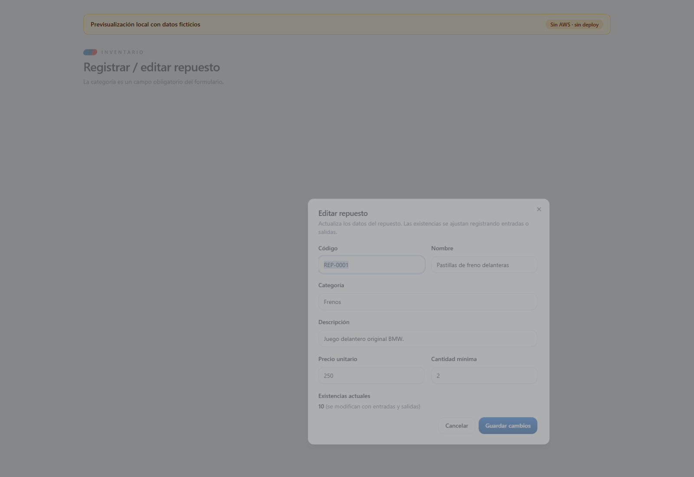
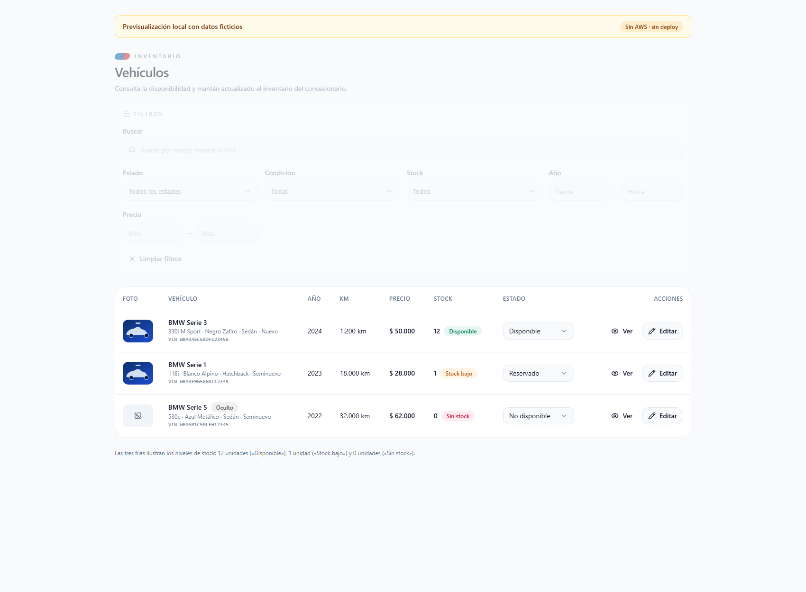
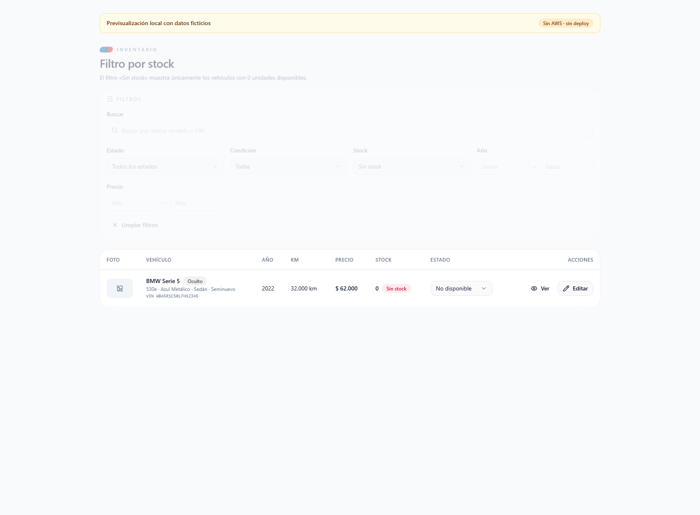
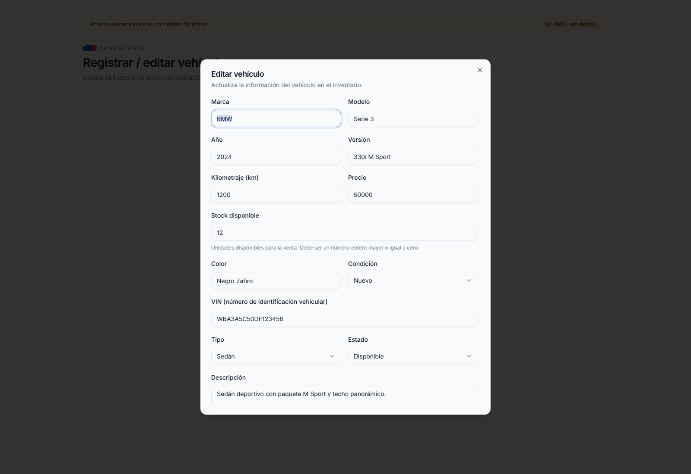
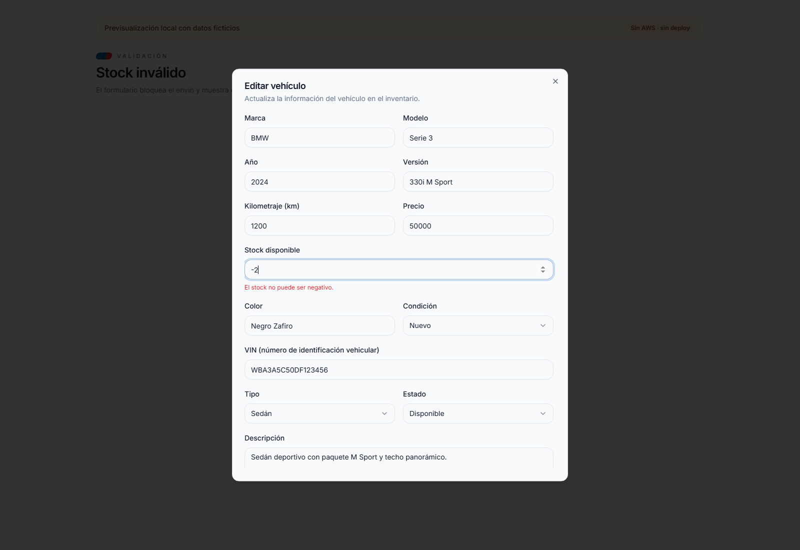
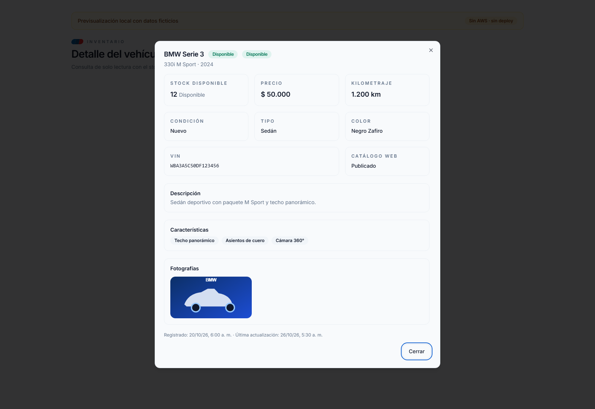
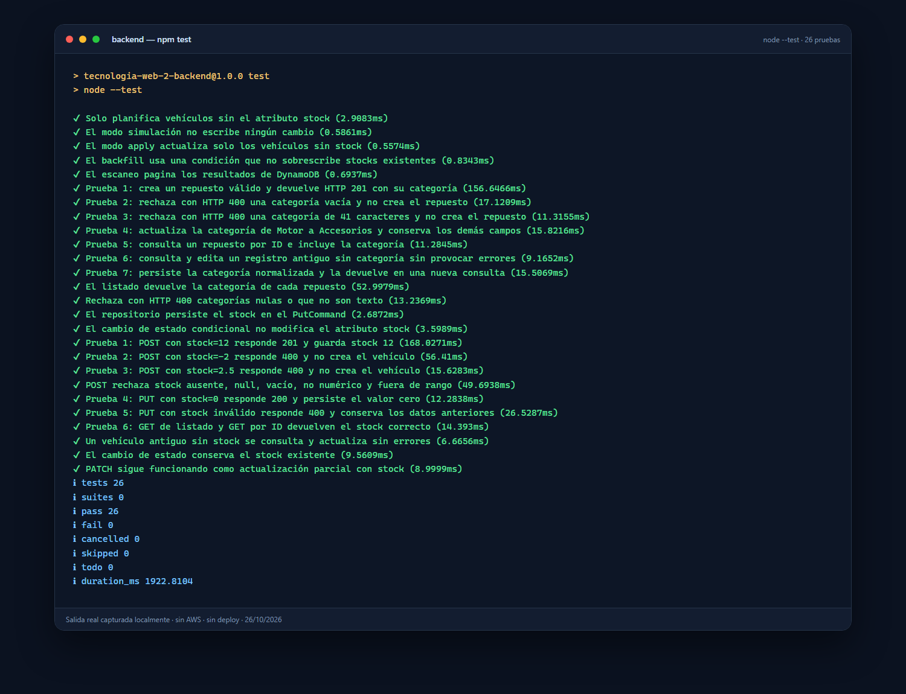
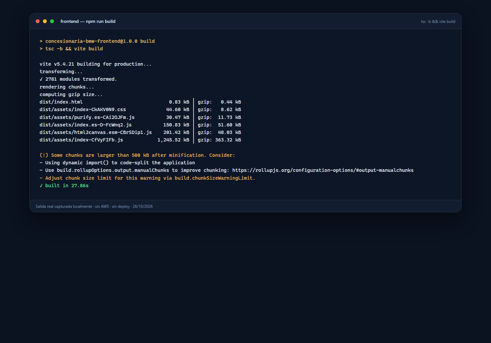

# Examen — Ficha 1 (categoría de repuestos) y Ficha 2 (stock de vehículos)

| Dato | Valor |
| --- | --- |
| Nombre del estudiante | Adam Jesiel Velasco Villanueva |
| Materia | Tecnología Web 2 |
| Hora de inicio | 10:50 |
| Hora de finalización | 13:00 |
| Repositorio (rama `examen`) | <https://github.com/dgschahvqvc17/Concesionaria-BMW/tree/examen> |

**Para que el docente pueda revisarlo y probarlo:**

- **Repositorio:** rama `examen` del enlace de la tabla.
- **Requisitos:** Node.js 18 o superior (probado con `v24.11.1`) y npm.
- **Instalación:** `cd backend && npm install` y `cd frontend && npm install`.
- **Pruebas automáticas (sin AWS):** `cd backend && npm test` → 26 pruebas, 0 fallos.
- **Compilación del frontend:** `cd frontend && npm run build`.
- **Ejecución local:** copiar `backend/.env.example` a `backend/.env` y `frontend/.env.example` a `frontend/.env`, completar los valores reales de AWS y Cognito (no se incluyen por seguridad) y ejecutar `cd backend && npm start` y `cd frontend && npm run dev`.
- **Usuario de prueba:** una cuenta con rol `admin` o `vendedor`, porque los endpoints de vehículos y repuestos lo exigen.
- **Qué revisar:** en Repuestos, crear y editar con categoría y verla en la tabla y el detalle; en Vehículos, crear y editar el stock, aceptar `0`, rechazar `-2` y `2.5` con HTTP 400, y comprobar el badge y el filtro; el backfill se prueba con `cd backend && npm run migrate:stock` (simulación) y `npm run migrate:stock:apply` solo en un entorno AWS autorizado.
- **Evidencias:** capturas y salidas reales en la carpeta `docs/examen/`.

**Proyecto:** Concesionaria BMW
**Rama:** `examen`
**Alcance:** implementación local, sin despliegue en AWS
**Fecha de ejecución:** 26/10/2026

## Índice

1. [Resumen general](#1-resumen-general)
2. [Ficha 1 — Categoría persistente en repuestos](#2-ficha-1--categoría-persistente-en-repuestos)
3. [Ficha 2 — Control de stock en vehículos](#3-ficha-2--control-de-stock-en-vehículos)
4. [Migración / backfill de stock](#4-migración--backfill-de-stock)
5. [Validaciones implementadas](#5-validaciones-implementadas)
6. [Pruebas ejecutadas y resultados reales](#6-pruebas-ejecutadas-y-resultados-reales)
7. [Criterios de aceptación de la Ficha 2](#7-criterios-de-aceptación-de-la-ficha-2)
8. [Cómo ejecutar el proyecto y las pruebas](#8-cómo-ejecutar-el-proyecto-y-las-pruebas)
9. [Respuestas a las preguntas de la defensa](#9-respuestas-a-las-preguntas-de-la-defensa)
10. [Nota sobre las capturas](#10-nota-sobre-las-capturas)

---

## 1. Resumen general

Se implementaron dos fichas sobre módulos que ya existían, sin crear tablas nuevas y sin
modificar la infraestructura:

- **Ficha 1:** atributo obligatorio `categoria` en el inventario de repuestos (HU04).
- **Ficha 2:** atributo obligatorio `stock` (entero ≥ 0) en el inventario de vehículos
  (HU03), con validación en backend y frontend, migración segura para registros antiguos y
  visualización del estado del stock.

Ambas se resolvieron con la arquitectura real del proyecto (`routes → controllers →
services → repositories`), Zod para validar y DynamoDB como base de datos. **No se usó
PostgreSQL, SQL, Docker ni una tabla nueva**, porque el proyecto no tiene esa tecnología.

**Impacto en DynamoDB:** las tablas `Repuestos` y `Vehiculos` no se recrean, no cambian de
esquema y no agregan índices. DynamoDB es *schemaless*: `categoria` y `stock` son atributos
por ítem. Los registros existentes no se sobrescriben; en el caso de los vehículos sin
`stock`, existe un *backfill* condicional que solo asigna `0` cuando el atributo no existe.

No se ejecutó `cdk deploy`, no se hizo commit ni push, y todas las pruebas son locales.

---

## 2. Ficha 1 — Categoría persistente en repuestos

### 2.1 Resumen

Se agregó el atributo obligatorio `categoria` al módulo de repuestos. Se valida con Zod, se
persiste al crear o actualizar, se devuelve en el listado y en la consulta individual, y se
muestra en el formulario, la tabla y el detalle del frontend.

Los registros antiguos sin `categoria` siguen funcionando: se consultan y actualizan sin
errores y **no se les asigna una categoría inventada**.

### 2.2 Archivos creados y modificados

#### Backend

| Archivo | Tipo | Cambio |
| --- | --- | --- |
| `backend/src/validation/repuestoSchemas.js` | Modificado | Esquema `categoria`: texto obligatorio al crear, opcional al actualizar, `trim`, mínimo 1 y máximo 40 caracteres. |
| `backend/src/services/repuestoService.js` | Modificado | `createRepuesto` guarda `categoria`. La actualización conserva los demás campos y solo cambia lo enviado. |
| `backend/package.json` | Modificado | Script local `npm test` con el runner nativo de Node (`node --test`). |
| `backend/tests/repuestoCategoria.test.js` | **Creado** | 9 pruebas locales de los escenarios solicitados, con repositorio simulado en memoria. |

No fue necesario modificar:

- `backend/src/repositories/repuestoRepository.js`: `save()` ya escribe el ítem completo con
  `PutCommand`, por lo que `categoria` se persiste automáticamente.
- `backend/src/controllers/repuestoController.js`: ya valida con Zod y delega en el servicio.
- `backend/src/routes/repuestoRoutes.js`: las rutas y permisos no cambian.
- `infra/`: DynamoDB no requiere migración para agregar un atributo.

#### Frontend

| Archivo | Tipo | Cambio |
| --- | --- | --- |
| `frontend/src/types/repuesto.ts` | Modificado | `categoria?: string` en `Repuesto` (compatibilidad con datos antiguos), obligatoria en `CreateRepuestoInput` y opcional en `UpdateRepuestoInput`. |
| `frontend/src/components/inventory/RepuestoFormDialog.tsx` | Modificado | Campo obligatorio «Categoría», validación Zod espejo del backend, `maxLength=40` y envío del valor. |
| `frontend/src/components/inventory/RepuestosTable.tsx` | Modificado | Columna «Categoría» con `Badge`; muestra «Sin categoría» en registros antiguos. Acción «Ver» para abrir el detalle. |
| `frontend/src/components/inventory/RepuestoDetalleDialog.tsx` | **Creado** | Diálogo de solo lectura con código, nombre, categoría, precio, existencias, mínimo, estado y última actualización. |
| `frontend/src/pages/RepuestosPage.tsx` | Modificado | Abre el detalle consultando `GET /api/repuestos/:id`, integra el diálogo y permite buscar por categoría. |
| `frontend/src/hooks/useRepuestos.ts` | Modificado | Nuevo método `obtener(repuestoId)` para el detalle. |
| `frontend/src/components/inventory/RepuestosFiltros.tsx` | Modificado | Texto de ayuda del buscador actualizado a «código, nombre o categoría». |

No se crearon páginas ni rutas nuevas, no se duplicaron formularios y no se agregaron
dependencias.

### 2.3 Cómo se guarda y consulta la categoría

#### Crear (`POST /api/repuestos`)

El controlador valida el cuerpo con `createRepuestoSchema`. Si `categoria` es válida,
`repuestoService.createRepuesto` la incluye en el objeto que se envía a
`repuestoRepository.save`, que ejecuta un `PutCommand` en la tabla `Repuestos`.

Ejemplo de respuesta (HTTP 201):

```json
{
  "message": "Repuesto registrado correctamente.",
  "repuesto": {
    "repuestoId": "…",
    "codigo": "REP-0001",
    "nombre": "Pastillas de freno",
    "categoria": "Frenos",
    "precio": 250,
    "cantidad": 10,
    "cantidadMinima": 2,
    "requiereReposicion": false
  }
}
```

#### Actualizar (`PATCH /api/repuestos/:repuestoId`)

`updateRepuestoSchema` acepta `categoria` como opcional. Si se envía, se valida y se
normaliza con `trim`; el servicio mezcla los cambios sobre el registro actual
(`{ ...actual, ...changes }`), de modo que no se borran ni sobrescriben los demás
atributos. Si no se envía, la categoría existente queda intacta.

Esto permite que un registro antiguo se actualice (por ejemplo, solo el precio) sin exigir
categoría.

#### Consultar (`GET /api/repuestos` y `GET /api/repuestos/:repuestoId`)

Ambos endpoints devuelven el ítem de DynamoDB con spread (`toResponse`). Si el atributo
`categoria` existe, aparece en la respuesta. Si el registro es antiguo y no lo tiene, la
respuesta sigue siendo válida y el frontend muestra «Sin categoría».

#### Detalle en el frontend

La tabla incluye la columna «Categoría» y el botón «Ver». Al abrirlo, el hook `obtener`
consulta `GET /api/repuestos/:id`, por lo que el detalle muestra el valor realmente
persistido después de crear o editar.

### 2.4 Impacto real en DynamoDB (sin cambios de esquema)

Este cambio **no altera la estructura de la tabla ni los datos existentes**. DynamoDB es
una base de datos *schemaless*: los atributos se guardan por ítem y no requieren declararse
en la tabla. Por eso `categoria` es simplemente un atributo nuevo que tendrán los repuestos
creados o actualizados con ese dato.

#### Elementos que se mantienen sin cambios

| Elemento | Antes | Después |
| --- | --- | --- |
| Tabla | `Repuestos` | La misma tabla `Repuestos` |
| Clave primaria | `repuestoId` (string) | Igual |
| Índice secundario | `codigo-index` (string) | Igual |
| Modo de facturación | `PAY_PER_REQUEST` | Igual |
| Política de eliminación | `DESTROY` | Igual |
| Definición en CDK | `infra/lib/repuestos-stack.ts` | Sin cambios |
| Variables de entorno | `REPUESTOS_TABLE_NAME` | Sin cambios |

#### Registro antiguo (permanece intacto)

Un repuesto creado antes de este requisito no tiene `categoria` y **no se modifica** solo
por desplegar o ejecutar el nuevo código. Ejemplo:

```json
{
  "repuestoId": "uuid-del-registro-antiguo",
  "codigo": "REP-LEGACY",
  "nombre": "Filtro antiguo",
  "precio": 100,
  "cantidad": 5,
  "cantidadMinima": 1,
  "createdAt": "2026-01-10T10:00:00.000Z",
  "updatedAt": "2026-01-10T10:00:00.000Z",
  "createdBy": null,
  "updatedBy": null
}
```

- Se puede consultar normalmente.
- Se puede editar (por ejemplo, cambiar solo el precio) sin que la operación falle.
- Si se edita sin enviar `categoria`, el ítem sigue sin ese atributo.
- Si el usuario decide asignarle una categoría, el mismo registro se actualiza y pasa a
  tener `categoria`, conservando todos los demás atributos.

#### Registro nuevo o actualizado con categoría

```json
{
  "repuestoId": "uuid-nuevo",
  "codigo": "REP-0001",
  "nombre": "Pastillas de freno",
  "categoria": "Frenos",
  "descripcion": "Juego delantero",
  "precio": 250,
  "cantidad": 10,
  "cantidadMinima": 2,
  "createdAt": "2026-10-26T12:00:00.000Z",
  "updatedAt": "2026-10-26T12:00:00.000Z",
  "createdBy": "sub-del-usuario",
  "updatedBy": "sub-del-usuario"
}
```

#### Por qué no se pierden los atributos existentes

El servicio de actualización mantiene el patrón que ya tenía el proyecto:

1. Lee el ítem completo con `findById` (`GetCommand`).
2. Mezcla los cambios sobre el registro actual: `{ ...actual, ...changes }`.
3. Guarda el ítem completo con `save` (`PutCommand`).

Por eso, al actualizar la categoría se envían también los atributos que ya existían
(`codigo`, `nombre`, `precio`, `cantidad`, `createdAt`, etc.). No se introdujo ninguna
operación de borrado ni de reemplazo parcial que pudiera dejar el ítem incompleto.

#### Cuándo se verá el atributo en la tabla real

- Al crear un repuesto desde la API/frontend: el ítem se guarda con `categoria`.
- Al actualizar la categoría de un repuesto: el ítem existente recibe el nuevo valor.
- Los registros que nunca se vuelvan a tocar permanecen exactamente como estaban.

#### Verificación opcional en un entorno AWS

Estos comandos **no se ejecutaron** en esta práctica y solo sirven como guía para una
validación posterior con credenciales reales. Se debe usar el nombre físico real de la
tabla (el valor de `REPUESTOS_TABLE_NAME` en el `.env` o en `infra/cdk-outputs.json`):

```bash
aws dynamodb describe-table --table-name <nombre-real-de-la-tabla> --region us-east-2
aws dynamodb get-item --table-name <nombre-real-de-la-tabla> \
  --key '{"repuestoId":{"S":"<repuestoId>"}}' --region us-east-2
```

### 2.5 Validaciones de la Ficha 1

| Caso | Resultado |
| --- | --- |
| `categoria` ausente | HTTP 400 `VALIDATION_ERROR` |
| `categoria: null` | HTTP 400 |
| `categoria` no es string (p. ej. número) | HTTP 400 |
| `categoria` vacía o solo espacios | HTTP 400 |
| `categoria` con más de 40 caracteres | HTTP 400 |
| Espacios al inicio/fin | Se eliminan antes de guardar |
| `PATCH` sin `categoria` | No modifica la categoría existente |
| `PATCH` de un registro antiguo sin categoría | Funciona sin errores |

Los errores mantienen el formato del proyecto:

```json
{
  "error": "Datos inválidos.",
  "code": "VALIDATION_ERROR",
  "details": [{ "field": "categoria", "message": "La categoría es obligatoria." }]
}
```

En el frontend: campo obligatorio con mensaje «La categoría es obligatoria.», límite de 40
caracteres, bloqueo del envío si falla la validación, errores por campo con
`getFieldErrors` y «Sin categoría» para registros antiguos (sin rellenar un valor por
defecto).

### 2.6 Evidencia visual de la Ficha 1

> **Cómo se obtuvieron estas capturas:** se levantó Vite en local y se usó una página
> temporal de previsualización que monta los **componentes reales** del frontend con datos
> ficticios. Esa página no tiene login, no llama a la API, no consulta Cognito ni DynamoDB y
> no se despliega. Después de tomar las capturas fue eliminada. Los datos de las imágenes
> son de ejemplo; no son registros reales de AWS.



*Figura 1. Tabla de repuestos: categoría persistida («Frenos», «Motor») y compatibilidad con
un registro antiguo que muestra «Sin categoría».*



*Figura 2. Diálogo de detalle de solo lectura con la categoría, el precio y las existencias.*



*Figura 3. Formulario de edición con el campo obligatorio «Categoría».*

---

## 3. Ficha 2 — Control de stock en vehículos

### 3.1 Resumen

Se incorporó `stock` como atributo obligatorio del inventario de vehículos: entero mayor o
igual a cero, persistido en la tabla DynamoDB `Vehiculos` y validado en el backend
(Zod + invariantes del servicio) y en el frontend (formulario con Zod).

El listado y el detalle devuelven el stock; el frontend lo muestra en la tabla, en el
formulario y en un nuevo diálogo de detalle, con tres estados visuales:

| Stock | Estado visual |
| --- | --- |
| `0` | **Sin stock** (rojo) |
| `1` | **Stock bajo** (ámbar) |
| `≥ 2` | **Disponible** (verde) |

El umbral de «stock bajo» está centralizado en `STOCK_BAJO_VEHICULO` (valor `1`) en
`frontend/src/lib/vehiculos.ts`, para poder ajustarlo en un solo lugar.

> **Decisión sobre repuestos:** en `Repuestos` ya existe `cantidad` como stock, con
> movimientos atómicos de entrada/salida y `cantidadMinima`. No se duplicó el concepto con
> un campo `stock`; la Ficha 2 aplica el atributo `stock` a los **vehículos**.

### 3.2 Archivos creados y modificados

#### Backend

| Archivo | Tipo | Cambio |
| --- | --- | --- |
| `backend/src/validation/vehiculoSchemas.js` | Modificado | `stockSchema` (entero ≥ 0, máximo 1.000.000) en creación y actualización; rechaza `null`, vacío, decimales, negativos y texto no numérico. |
| `backend/src/services/vehiculoService.js` | Modificado | Persiste y normaliza `stock` al crear y actualizar; lo incluye en las respuestas de listado y detalle. |
| `backend/src/routes/vehiculoRoutes.js` | Modificado | Agrega `PUT /api/vehiculos/:vehiculoId` como alias de `PATCH` (mismos permisos `admin`/`vendedor`). |
| `backend/scripts/backfill-vehiculo-stock.js` | **Creado** | Migración/backfill con modo simulación por defecto y escritura condicional con `--apply`. |
| `backend/package.json` | Modificado | Scripts `migrate:stock` (simulación) y `migrate:stock:apply` (aplicar). |
| `backend/tests/vehiculoStock.test.js` | **Creado** | 10 pruebas de endpoints, validación y persistencia con repositorio en memoria. |
| `backend/tests/vehiculoRepository.test.js` | **Creado** | 2 pruebas que inspeccionan los comandos reales de DynamoDB (`PutCommand` y `UpdateCommand`). |
| `backend/tests/backfillStock.test.js` | **Creado** | 5 pruebas de planificación, simulación, aplicación y paginación del backfill. |

No fue necesario modificar:

- `backend/src/repositories/vehiculoRepository.js`: `save()` ya escribe el ítem completo
  con `PutCommand`, por lo que `stock` se persiste automáticamente.
- `backend/src/controllers/vehiculoController.js`: ya valida con Zod y delega en el
  servicio.
- `infra/`: DynamoDB no requiere migración de esquema para agregar un atributo.

#### Frontend

| Archivo | Tipo | Cambio |
| --- | --- | --- |
| `frontend/src/types/vehiculo.ts` | Modificado | `stock: number` en `Vehiculo` y en `CreateVehiculoInput`. |
| `frontend/src/lib/vehiculos.ts` | Modificado | Helpers `nivelStock`, `formatStock`, etiquetas/estilos de nivel, umbral `STOCK_BAJO_VEHICULO` y `formatFecha`. |
| `frontend/src/components/inventory/VehiculoFormDialog.tsx` | Modificado | Campo «Stock disponible» obligatorio, entero ≥ 0, con ayuda accesible y error por campo. |
| `frontend/src/components/inventory/VehiculosTable.tsx` | Modificado | Columna «Stock» con cantidad y badge de nivel; acción «Ver» siempre disponible y «Editar» según permisos. |
| `frontend/src/components/inventory/VehiculoDetalleDialog.tsx` | **Creado** | Detalle de solo lectura con stock, precio, km, condición, tipo, color, VIN, catálogo, fotos, documentos y fechas. |
| `frontend/src/components/inventory/InventarioFiltros.tsx` | Modificado | Nuevo filtro por nivel de stock (`Sin stock`, `Stock bajo`, `Disponible`). |
| `frontend/src/hooks/useVehiculos.ts` | Modificado | Nuevo método `obtener(vehiculoId)` que consulta el detalle real. |
| `frontend/src/pages/InventoryPage.tsx` | Modificado | Integra el diálogo de detalle, consulta `GET /api/vehiculos/:id` y filtra por stock. |

No se crearon páginas ni rutas nuevas, no se duplicaron formularios y no se agregaron
dependencias.

### 3.3 Contrato y endpoints modificados

| Método | Ruta | Permiso | Cambio |
| --- | --- | --- | --- |
| `POST` | `/api/vehiculos` | `admin`, `vendedor` | Exige `stock` válido; responde **201** con el vehículo creado. |
| `PUT` | `/api/vehiculos/:vehiculoId` | `admin`, `vendedor` | **Nuevo alias** de actualización parcial; responde **200**. |
| `PATCH` | `/api/vehiculos/:vehiculoId` | `admin`, `vendedor` | Se mantiene por compatibilidad; acepta `stock` opcional. |
| `GET` | `/api/vehiculos` | usuario autenticado | Incluye `stock` en cada vehículo. |
| `GET` | `/api/vehiculos/:vehiculoId` | usuario autenticado | Incluye `stock` en el detalle. |

`PUT` se implementó con el mismo controlador que `PATCH`, por lo que ambos aceptan
actualizaciones parciales. Se eligió así para no romper el frontend ni los clientes que ya
usaban `PATCH`, y para cumplir el contrato solicitado (`PUT` → 200).

Ejemplo de creación (HTTP 201):

```json
{
  "message": "Vehículo registrado correctamente.",
  "vehiculo": {
    "vehiculoId": "…",
    "marca": "BMW",
    "modelo": "Serie 3",
    "anio": 2024,
    "version": "330i M Sport",
    "kilometraje": 1200,
    "stock": 12,
    "precio": 50000,
    "estado": "disponible",
    "publicado": true
  }
}
```

Ejemplo de actualización (HTTP 200):

```json
{
  "message": "Vehículo actualizado correctamente.",
  "vehiculo": {
    "vehiculoId": "…",
    "stock": 0
  }
}
```

### 3.4 Comportamiento con registros antiguos

Un vehículo creado antes de este requisito no tiene el atributo `stock`.

- **Lectura:** `toResponse` normaliza el valor con `normalizarStock`: si no es un entero
  ≥ 0, devuelve `0`. Por eso el listado y el detalle nunca muestran `undefined`.
- **Actualización:** si se edita otro campo sin enviar `stock`, el servicio conserva el
  stock existente o lo normaliza a `0` si el registro era antiguo.
- **Persistencia:** la normalización al leer **no escribe** en DynamoDB. Para dejar el
  atributo guardado en los registros antiguos existe el backfill condicional de la
  sección 4.

### 3.5 Impacto real en DynamoDB (sin cambios de esquema)

| Elemento | Antes | Después |
| --- | --- | --- |
| Tabla | `Vehiculos` | La misma tabla `Vehiculos` |
| Clave primaria | `vehiculoId` (string) | Igual |
| Índices secundarios | `vin-index`, etc. | Sin cambios |
| Modo de facturación | `PAY_PER_REQUEST` | Igual |
| Política de eliminación | `DESTROY` | Igual |
| Definición en CDK | `infra/` | Sin cambios |
| Variables de entorno | `VEHICULOS_TABLE_NAME` | Sin cambios |

### 3.6 Evidencia visual de la Ficha 2

> Las capturas usan la misma previsualización temporal descrita en la sección 2.6: los
> componentes y estilos son los del proyecto, pero los vehículos son ficticios. No se
> consultó AWS ni el backend real.



*Figura 4. Tabla de vehículos con la columna Stock: 12 unidades («Disponible»), 1 unidad
(«Stock bajo») y 0 unidades («Sin stock»), además del filtro por nivel.*



*Figura 5. Filtro «Sin stock» aplicado: solo se muestra el vehículo con 0 unidades.*



*Figura 6. Formulario de edición con el campo obligatorio «Stock disponible» y su texto de
ayuda.*



*Figura 7. El formulario bloquea un stock negativo y muestra el error «El stock no puede ser
negativo.» antes de enviar.*



*Figura 8. Diálogo de detalle con el stock persistido, su nivel, precio, kilometraje, VIN y
demás datos.*

### 3.7 Código implementado (extractos)

#### Validación del stock en el backend

`backend/src/validation/vehiculoSchemas.js`:

```js
const stockSchema = z.preprocess(
  (value) => {
    if (typeof value === 'string' && value.trim() !== '') {
      const numero = Number(value);
      return Number.isNaN(numero) ? value : numero;
    }
    return value;
  },
  z
    .number({
      required_error: 'El stock es obligatorio.',
      invalid_type_error: 'El stock debe ser un número entero.',
    })
    .int('El stock debe ser un número entero.')
    .min(0, 'El stock no puede ser negativo.')
    .max(1000000, 'El stock no puede superar 1.000.000.')
);
```

Se usa en el esquema de creación y en el de actualización:

```js
const vehiculoBase = {
  // …
  stock: stockSchema,
  // …
};

const updateVehiculoSchema = z.object({
  // …
  stock: vehiculoBase.stock.optional(),
  // …
});
```

#### Normalización y persistencia en el servicio

`backend/src/services/vehiculoService.js`:

```js
function normalizarStock(stock) {
  return Number.isInteger(stock) && stock >= 0 ? stock : 0;
}

async function toResponse(vehiculo) {
  return {
    ...vehiculo,
    stock: normalizarStock(vehiculo.stock),
    // fotos/documentos con URLs prefirmadas…
  };
}

// Al crear:
const vehiculo = {
  // …
  stock: normalizarStock(input.stock),
  // …
};

// Al actualizar:
const actualizado = {
  ...actual,
  ...changes,
  stock: normalizarStock(changes.stock ?? actual.stock),
  // …
};
```

El repositorio existente ya guarda el ítem completo con `PutCommand`, por lo que no hizo
falta modificarlo:

```js
async function save(vehiculo) {
  await documentClient.send(new PutCommand({ TableName: tableName, Item: vehiculo }));
  return vehiculo;
}
```

#### Alias `PUT` de la ruta

`backend/src/routes/vehiculoRoutes.js`:

```js
const puedeGestionar = requireRole('admin', 'vendedor');

router.get('/:vehiculoId', vehiculoController.getOne);
router.patch('/:vehiculoId', puedeGestionar, vehiculoController.update);

// Alias compatible con la ficha: misma actualización parcial que PATCH.
router.put('/:vehiculoId', puedeGestionar, vehiculoController.update);
```

#### Backfill condicional

`backend/scripts/backfill-vehiculo-stock.js`:

```js
function necesitaStock(vehiculo) {
  return Boolean(vehiculo && vehiculo.vehiculoId && vehiculo.stock === undefined);
}

const comando = new UpdateCommand({
  TableName: tableName,
  Key: { vehiculoId: vehiculo.vehiculoId },
  UpdateExpression: 'SET stock = :stock',
  ConditionExpression: 'attribute_exists(vehiculoId) AND attribute_not_exists(stock)',
  ExpressionAttributeValues: { ':stock': STOCK_INICIAL },
});
```

#### Niveles de stock en el frontend

`frontend/src/lib/vehiculos.ts`:

```ts
export type NivelStock = 'sin_stock' | 'bajo' | 'disponible';

export const STOCK_BAJO_VEHICULO = 1;

export function nivelStock(stock: number): NivelStock {
  if (!Number.isFinite(stock) || stock <= 0) return 'sin_stock';
  if (stock <= STOCK_BAJO_VEHICULO) return 'bajo';
  return 'disponible';
}

export const NIVEL_STOCK_LABELS: Record<NivelStock, string> = {
  sin_stock: 'Sin stock',
  bajo: 'Stock bajo',
  disponible: 'Disponible',
};
```

#### Campo del formulario

`frontend/src/components/inventory/VehiculoFormDialog.tsx`:

```tsx
stock: z
  .number({
    required_error: 'El stock es obligatorio.',
    invalid_type_error: 'El stock debe ser un número entero.',
  })
  .int('El stock debe ser un número entero.')
  .min(0, 'El stock no puede ser negativo.')
  .max(1000000, 'El stock no puede superar 1.000.000.'),

// …

<div className="space-y-2 sm:col-span-2">
  <Label htmlFor="stock">Stock disponible</Label>
  <Input
    id="stock"
    type="number"
    min={0}
    step={1}
    inputMode="numeric"
    aria-invalid={Boolean(fieldError('stock'))}
    aria-describedby={fieldError('stock') ? 'stock-error' : 'stock-help'}
    {...register('stock', { valueAsNumber: true })}
  />
  {fieldError('stock') ? (
    <p id="stock-error" className="text-xs text-destructive">{fieldError('stock')}</p>
  ) : (
    <p id="stock-help" className="text-xs text-muted-foreground">
      Unidades disponibles para la venta. Debe ser un número entero mayor o igual a cero.
    </p>
  )}
</div>
```

#### Columna y badge en la tabla

`frontend/src/components/inventory/VehiculosTable.tsx`:

```tsx
<TableCell>
  <div className="flex items-center gap-2">
    <span className="font-medium">{formatStock(vehiculo.stock)}</span>
    <Badge className={NIVEL_STOCK_STYLES[nivelStock(vehiculo.stock)]}>
      {NIVEL_STOCK_LABELS[nivelStock(vehiculo.stock)]}
    </Badge>
  </div>
</TableCell>
```

---

## 4. Migración / backfill de stock

### 4.1 Por qué existe

DynamoDB no exige declarar atributos, así que la aplicación funciona con vehículos sin
`stock` (se normalizan a `0` al leer). Sin embargo, para que el dato quede **persistido** en
los registros antiguos se creó un backfill explícito.

### 4.2 Garantías de seguridad

- **Modo simulación por defecto:** `npm run migrate:stock` solo cuenta los vehículos que
  necesitan el atributo y no escribe nada.
- **Aplicación explícita:** `npm run migrate:stock:apply` escribe `stock = 0`.
- **Nunca sobrescribe un stock existente:** cada escritura usa la condición

  ```text
  attribute_exists(vehiculoId) AND attribute_not_exists(stock)
  ```

  Si el ítem ya tiene `stock` (incluido `0`), la condición falla y el valor real se
  conserva.
- **Paginación:** el escaneo recorre todas las páginas con `LastEvaluatedKey`.
- **Sin cambios de esquema:** solo se ejecutan `UpdateCommand` sobre ítems existentes.

### 4.3 Comandos

```bash
cd backend

# 1) Simulación: no escribe nada
npm run migrate:stock

# 2) Aplicar el backfill (asigna stock = 0 solo donde falta)
npm run migrate:stock:apply
```

Salida esperada en simulación:

```text
Vehículos revisados: N
Vehículos sin stock: M
Modo simulación: no se escribió nada. Ejecuta con --apply para asignar stock = 0 a los vehículos sin stock.
```

Salida esperada al aplicar:

```text
Vehículos revisados: N
Vehículos sin stock: M
Vehículos actualizados: M
```

> **No se ejecutó el backfill contra AWS** en esta práctica porque no hay credenciales ni
> entorno desplegado disponibles. Su lógica está cubierta por 5 pruebas locales, incluida la
> inspección de la condición anti-sobrescritura.

### 4.4 Relación con PostgreSQL

El enunciado original mencionaba una migración SQL. **Ese supuesto no aplica a este
proyecto**, que usa DynamoDB: no hay `ALTER TABLE`, ni `NOT NULL` de SQL, ni tabla de
migraciones. El equivalente implementado es:

1. Validación obligatoria con Zod en la capa de entrada.
2. Invariante en el servicio (`normalizarStock`).
3. Backfill condicional e idempotente para datos preexistentes.
4. Pruebas que verifican que los valores inválidos no crean ni modifican registros.

---

## 5. Validaciones implementadas

### 5.1 Ficha 2 — Backend

| Caso | Resultado |
| --- | --- |
| `stock: 12` | Aceptado; HTTP 201 al crear, HTTP 200 al actualizar |
| `stock: 0` | Aceptado y persistido como `0` |
| `stock` negativo (p. ej. `-2`) | HTTP 400 `VALIDATION_ERROR`, sin crear/modificar |
| `stock` decimal (p. ej. `2.5`) | HTTP 400, sin crear/modificar |
| `stock` ausente en `POST` | HTTP 400 |
| `stock: null` | HTTP 400 |
| `stock: ""` (vacío) | HTTP 400 |
| `stock` no numérico (p. ej. `"abc"`) | HTTP 400 |
| `stock` > 1.000.000 | HTTP 400 |
| `PUT` con stock inválido | HTTP 400 y el registro conserva su stock y `updatedAt` anteriores |
| `PATCH` de estado sin `stock` | Conserva el stock existente |
| Vehículo antiguo sin `stock` | Se consulta como `0` y se puede editar sin errores |

Formato de error (el mismo del proyecto):

```json
{
  "error": "Datos inválidos.",
  "code": "VALIDATION_ERROR",
  "details": [{ "field": "stock", "message": "El stock no puede ser negativo." }]
}
```

El esquema `stockSchema` acepta cadenas numéricas (por ejemplo `"12"`) y las convierte a
número, pero **no** usa `z.coerce` directo: eso convertiría `null` o `""` en `0`. El
`preprocess` solo transforma cadenas no vacías; el resto se valida como número y se rechaza.

### 5.2 Ficha 2 — Frontend

- Campo numérico obligatorio «Stock disponible» (`step=1`, `min=0`, `inputMode="numeric"`).
- Validación Zod espejo: entero, ≥ 0, ≤ 1.000.000.
- Mensajes de error por campo, `aria-invalid` y `aria-describedby`.
- Texto de ayuda: «Unidades disponibles para la venta. Debe ser un número entero mayor o
  igual a cero.».
- La tabla muestra la cantidad y el badge de nivel; el detalle muestra el mismo estado.
- El filtro por stock permite ver «Sin stock», «Stock bajo» o «Disponible».
- El diálogo de detalle consulta el dato real con `GET /api/vehiculos/:id`.

---

## 6. Pruebas ejecutadas y resultados reales

### 6.1 Entorno

- Node.js `v24.11.1`
- Runner nativo `node:test` (sin dependencias nuevas)
- Express ya presente en el proyecto
- Repositorio simulado en memoria **solo durante las pruebas**
- Sin llamadas a AWS

### 6.2 Comando

```bash
cd backend
npm test
```

### 6.3 Resultado real (26 pruebas)

```text
> tecnologia-web-2-backend@1.0.0 test
> node --test

✔ Solo planifica vehículos sin el atributo stock (2.9083ms)
✔ El modo simulación no escribe ningún cambio (0.5861ms)
✔ El modo apply actualiza solo los vehículos sin stock (0.5574ms)
✔ El backfill usa una condición que no sobrescribe stocks existentes (0.8343ms)
✔ El escaneo pagina los resultados de DynamoDB (0.6937ms)
✔ Prueba 1: crea un repuesto válido y devuelve HTTP 201 con su categoría (156.6466ms)
✔ Prueba 2: rechaza con HTTP 400 una categoría vacía y no crea el repuesto (17.1209ms)
✔ Prueba 3: rechaza con HTTP 400 una categoría de 41 caracteres y no crea el repuesto (11.3155ms)
✔ Prueba 4: actualiza la categoría de Motor a Accesorios y conserva los demás campos (15.8216ms)
✔ Prueba 5: consulta un repuesto por ID e incluye la categoría (11.2845ms)
✔ Prueba 6: consulta y edita un registro antiguo sin categoría sin provocar errores (9.1652ms)
✔ Prueba 7: persiste la categoría normalizada y la devuelve en una nueva consulta (15.5069ms)
✔ El listado devuelve la categoría de cada repuesto (52.9979ms)
✔ Rechaza con HTTP 400 categorías nulas o que no son texto (13.2369ms)
✔ El repositorio persiste el stock en el PutCommand (2.6872ms)
✔ El cambio de estado condicional no modifica el atributo stock (3.5989ms)
✔ Prueba 1: POST con stock=12 responde 201 y guarda stock 12 (168.0271ms)
✔ Prueba 2: POST con stock=-2 responde 400 y no crea el vehículo (56.41ms)
✔ Prueba 3: POST con stock=2.5 responde 400 y no crea el vehículo (15.6283ms)
✔ POST rechaza stock ausente, null, vacío, no numérico y fuera de rango (49.6938ms)
✔ Prueba 4: PUT con stock=0 responde 200 y persiste el valor cero (12.2838ms)
✔ Prueba 5: PUT con stock inválido responde 400 y conserva los datos anteriores (26.5287ms)
✔ Prueba 6: GET de listado y GET por ID devuelven el stock correcto (14.393ms)
✔ Un vehículo antiguo sin stock se consulta y actualiza sin errores (6.6656ms)
✔ El cambio de estado conserva el stock existente (9.5609ms)
✔ PATCH sigue funcionando como actualización parcial con stock (8.9999ms)
ℹ tests 26
ℹ suites 0
ℹ pass 26
ℹ fail 0
ℹ cancelled 0
ℹ skipped 0
ℹ todo 0
ℹ duration_ms 1922.8104
```



*Figura 9. Captura de la ejecución real de `npm test`: 26 pruebas, 26 correctas, 0 fallos
(`duration_ms 1922.8104`).*

La suite se volvió a ejecutar al cierre de la documentación con el mismo resultado: **26/26
pruebas correctas y 0 fallos**. Los tiempos exactos varían en cada corrida; lo relevante es
que no hay pruebas fallidas.

### 6.4 Escenarios obligatorios de la Ficha 2

| # | Escenario | Resultado real |
| --- | --- | --- |
| 1 | `POST` con `stock: 12` | HTTP **201**, vehículo guardado con `stock: 12` |
| 2 | `POST` con `stock: -2` | HTTP **400**, sin crear registros |
| 3 | `POST` con `stock: 2.5` | HTTP **400**, sin crear registros |
| 4 | `PUT` con `stock: 0` | HTTP **200**, persistido como `0` |
| 5 | `PUT` con stock inválido | HTTP **400**, stock y `updatedAt` anteriores intactos |
| 6 | `GET` de listado y detalle | HTTP **200** con el stock correcto en ambos |
| 7 | Persistencia de comandos | `PutCommand` incluye `stock`; `UpdateCommand` de estado no toca `stock` |
| 8 | Backfill seguro | Solo ítems sin `stock`; condición `attribute_not_exists(stock)` |

### 6.5 Verificación del frontend

```bash
cd frontend
npm run build
```

Resultado real: `tsc -b && vite build` finalizó correctamente (`✓ built in 27.86s`).
Vite mostró únicamente la advertencia informativa de tamaño de chunk (> 500 kB), que no es
un error y ya existía por el tamaño de las dependencias.



*Figura 10. Captura de la ejecución real de `npm run build`: TypeScript y Vite finalizan
correctamente; solo aparece la advertencia ya existente por el tamaño de los chunks.*

El build se repitió al cierre (`✓ built in 29.26s`) con el mismo resultado: compilación
correcta y únicamente la advertencia informativa de tamaño de chunk.

No se ejecutó `npm run lint` porque, según `Rules/frontend.md`, ESLint no está instalado en
el proyecto.

### 6.6 Limitación de las pruebas

Las pruebas validan la lógica de aplicación, los comandos que se enviarían a DynamoDB y el
backfill, pero **no** contra una tabla real. No se ejecutaron pruebas contra AWS para no usar
credenciales ni generar recursos. La verificación end-to-end con DynamoDB real requiere un
entorno AWS configurado y no se ejecutó en esta práctica.

---

## 7. Criterios de aceptación de la Ficha 2

| # | Criterio | Estado |
| --- | --- | --- |
| 1 | `stock` es obligatorio al crear y se guarda como entero ≥ 0 | Cumplido (Zod backend + formulario) |
| 2 | Se acepta `0` como valor válido | Cumplido y probado (`PUT stock=0`) |
| 3 | Se rechazan negativos, decimales, texto, `null`, vacío y fuera de rango | Cumplido y probado (HTTP 400) |
| 4 | Un `POST` inválido no crea registros | Cumplido y probado |
| 5 | Un `PUT` inválido no modifica el registro anterior | Cumplido y probado (stock y `updatedAt` intactos) |
| 6 | `POST` → 201 y `PUT` → 200 | Cumplido y probado |
| 7 | `GET` listado y detalle incluyen `stock` | Cumplido y probado |
| 8 | Existe migración/backfill sin sobrescribir stock real | Cumplido (script condicional + 5 pruebas) |
| 9 | El stock se muestra en formulario, tabla y detalle | Cumplido (campo, columna/badge y diálogo) |
| 10 | Se respetan roles y permisos existentes | Cumplido (`admin`/`vendedor` para mutaciones; lectura autenticada) |
| 11 | No se rompe el inventario ni los módulos existentes | Cumplido: 26 pruebas y build correcto |

---

## 8. Cómo ejecutar el proyecto y las pruebas

### 8.1 Pruebas backend (no requieren AWS)

```bash
cd backend
npm test
```

### 8.2 Backfill de stock

```bash
cd backend
npm run migrate:stock          # simulación
npm run migrate:stock:apply    # aplicar (requiere .env real)
```

### 8.3 Compilar el frontend

```bash
cd frontend
npm run build
```

### 8.4 Verificación rápida del backend

```bash
cd backend
node --check server.js
```

### 8.5 Ejecución local completa

1. Configurar `backend/.env` y el frontend según los `.env.example` existentes.
2. Levantar el backend (`cd backend; npm start`).
3. Levantar el frontend (`cd frontend; npm run dev`).
4. Entrar como `admin` o `vendedor`.
5. Ir a **Inventario → Vehículos**.

### 8.6 Verificación manual sugerida de la Ficha 2

1. Registrar un vehículo con stock `12`: debe aparecer «Disponible».
2. Intentar registrarlo con `-2`, `2.5` o vacío: el formulario debe bloquear el envío.
3. Editar el stock a `0`: debe mostrarse «Sin stock» en la tabla y en «Ver».
4. Editar el stock a `1`: debe mostrarse «Stock bajo».
5. Consultar el detalle: debe mostrar el stock persistido y el resto de los datos.
6. Usar el filtro por stock para ver solo «Sin stock», «Stock bajo» o «Disponible».
7. Probar un vehículo antiguo sin `stock`: debe verse `0` sin errores.

---

## 9. Respuestas a las preguntas de la defensa

> Aclaro que en este proyecto no hay SQL ni PostgreSQL: la base de datos es **DynamoDB**.
> Por eso respondo cada pregunta con la equivalencia real en DynamoDB.

### 9.1 Pregunta 1 — Ruta que recibe la solicitud y conexión con el controlador

Para la Ficha 2 la ruta que modifiqué es:

```text
PUT /api/vehiculos/:vehiculoId
```

Está declarada en `backend/src/routes/vehiculoRoutes.js`:

```js
const puedeGestionar = requireRole('admin', 'vendedor');

router.get('/:vehiculoId', vehiculoController.getOne);
router.patch('/:vehiculoId', puedeGestionar, vehiculoController.update);

// Alias compatible con la ficha: misma actualización parcial que PATCH.
router.put('/:vehiculoId', puedeGestionar, vehiculoController.update);
```

La conexión con el controlador es directa: Express asocia el método y la ruta con
`vehiculoController.update`, y antes de ejecutarlo pasa por el middleware `puedeGestionar`
(`requireRole('admin', 'vendedor')`), que comprueba que el usuario tenga rol de administrador
o vendedor. El controlador recibe `req.params.vehiculoId` y `req.body`, valida el cuerpo con
Zod y delega en el servicio:

```js
// backend/src/controllers/vehiculoController.js
const update = asyncHandler(async (req, res) => {
  const data = validate(updateVehiculoSchema, req.body);
  const vehiculo = await vehiculoService.updateVehiculo(req.params.vehiculoId, data, req.auth);
  res.json({ message: 'Vehículo actualizado correctamente.', vehiculo });
});
```

El recorrido completo de una petición es este:

```text
PUT /api/vehiculos/:id
  → vehiculoRoutes.js (router.put)
  → requireRole('admin', 'vendedor')
  → vehiculoController.update
  → validate(updateVehiculoSchema, req.body)
  → vehiculoService.updateVehiculo
  → vehiculoRepository.findById / save
  → respuesta HTTP 200
```

Dejé `PATCH` apuntando al mismo controlador para no romper la compatibilidad; ambos son
actualizaciones parciales.

### 9.2 Pregunta 2 — Función del servicio y por qué la consulta no está en la ruta

La función que implementé es `updateVehiculo`, en
`backend/src/services/vehiculoService.js`, y ahí concentré las reglas de negocio: leo el
vehículo actual con `vehiculoRepository.findById` y, si no existe, lanzo `NotFoundError`;
cuando cambia el VIN verifico que no quede duplicado; gestiono las fotografías y los
documentos; mezclo los cambios con los datos anteriores sin perder nada; normalizo el stock;
y al final persisto con `vehiculoRepository.save`.

```js
async function updateVehiculo(vehiculoId, changes, actor) {
  const actual = await vehiculoRepository.findById(vehiculoId);
  if (!actual) throw new NotFoundError('El vehículo no existe.');

  // Validaciones de VIN, archivos y documentos…

  const actualizado = {
    ...actual,
    ...changes,
    stock: normalizarStock(changes.stock ?? actual.stock),
    updatedAt: new Date().toISOString(),
    updatedBy: actor?.sub ?? null,
  };

  const guardado = await vehiculoRepository.save(actualizado);
  return toResponse(guardado);
}
```

No puse el acceso a datos dentro de la ruta porque cada capa tiene una responsabilidad: la
ruta declara el endpoint y los permisos, el controlador adapta HTTP, el servicio contiene las
reglas de negocio y el repositorio encapsula DynamoDB. Si la operación de base de datos
estuviera en la ruta, se mezclarían responsabilidades, se duplicaría lógica y sería mucho más
difícil probar y cambiar el acceso a datos.

En este proyecto no hay una consulta SQL; el equivalente está en el repositorio:

```js
// backend/src/repositories/vehiculoRepository.js
async function findById(vehiculoId) {
  const result = await documentClient.send(
    new GetCommand({ TableName: tableName, Key: { vehiculoId } })
  );
  return result.Item ?? null;
}

async function save(vehiculo) {
  await documentClient.send(new PutCommand({ TableName: tableName, Item: vehiculo }));
  return vehiculo;
}
```

La ruta no conoce `GetCommand`, `PutCommand` ni el nombre de la tabla; solo el repositorio
habla con DynamoDB.

### 9.3 Pregunta 3 — Una línea de mi cambio y qué ocurriría si la elimino o la altero

La línea que señalo es la 175 de `backend/src/services/vehiculoService.js`, dentro de
`updateVehiculo`:

```js
stock: normalizarStock(changes.stock ?? actual.stock),
```

Esa línea es la que garantiza que el stock quede guardado como un entero mayor o igual a
cero. Toma el stock nuevo si el usuario lo envió y, si no, conserva el que ya tenía el
vehículo; después lo pasa por `normalizarStock`, que devuelve `0` cuando el valor no es un
entero válido. Gracias a ella, un vehículo antiguo sin el atributo `stock` se actualiza sin
errores y queda con `0`, y editar el color o el precio no borra las existencias.

Si la eliminara, el objeto `actualizado` quedaría armado solo con `...actual` y `...changes`.
Mientras la petición no envíe `stock`, el valor anterior se conservaría por el spread, pero
un registro antiguo que no tenga el atributo seguiría sin él después de cualquier edición, y
cualquier valor inválido que llegara al servicio sin pasar por Zod (por ejemplo, desde otra
función interna) se guardaría tal cual, con el riesgo de dejar un stock negativo o decimal en
la base.

Si la alterara, también cambiaría el comportamiento. Por ejemplo, si la cambiara por
`stock: changes.stock`, cualquier actualización que no incluya el stock dejaría el campo en
`undefined` y el `PutCommand` reemplazaría el ítem sin ese atributo, así que se perdería el
stock. Si la cambiara por `stock: 0`, cada edición del vehículo reiniciaría las existencias a
cero. Por eso la línea combina el valor nuevo con el anterior y además lo normaliza.

### 9.4 Pregunta 4 — Dato inválido, respuesta HTTP y lugar de validación

Por ejemplo, si envío `PUT /api/vehiculos/:vehiculoId` con `stock: -2`, la respuesta real que
obtuve y que también comprobé en las pruebas es:

```http
HTTP/1.1 400 Bad Request
Content-Type: application/json
```

```json
{
  "error": "Datos inválidos.",
  "code": "VALIDATION_ERROR",
  "details": [
    {
      "field": "stock",
      "message": "El stock no puede ser negativo."
    }
  ]
}
```

La validación ocurre en dos capas. En el backend, `vehiculoController.update` ejecuta
`validate(updateVehiculoSchema, req.body)` antes de llamar al servicio, y ese esquema incluye
`stock: stockSchema`, definido en `backend/src/validation/vehiculoSchemas.js` con
`.min(0, 'El stock no puede ser negativo.')`; si el dato no cumple, el `ValidationError` se
traduce en HTTP 400 y no se llama al servicio, así que no se crea ni se modifica ningún
registro. En el frontend, `VehiculoFormDialog` valida el campo con Zod y, si el valor es
negativo, decimal, vacío o no numérico, muestra el error debajo del campo y bloquea el envío.

La Figura 7 muestra la validación en el formulario y las pruebas de la sección 6 comprueban
la respuesta HTTP 400 del backend.

### 9.5 Pregunta 5 (n.º 8 del cuestionario) — ¿Qué archivo no debe publicarse en GitHub y por qué?

El archivo que no debe publicarse es `.env`, tanto `backend/.env` como `frontend/.env`. Ese
archivo guarda la configuración real del entorno: la región de AWS, los identificadores del
User Pool y del cliente de Cognito, los nombres de las tablas de DynamoDB, el nombre del
bucket de S3, el origen permitido para CORS y la URL del backend. Si se publicara, cualquier
persona podría conocer la infraestructura del proyecto y, si además contiene claves de acceso
de AWS, usarlas para leer o modificar la base de datos, subir o borrar archivos del bucket y
generar costos en mi cuenta. Por eso solo versioné `.env.example`, que tiene los mismos
nombres de variables pero con valores de ejemplo como `us-east-2_XXXXXXXXX` o
`nombre-del-bucket-de-fotos`.

Comprobé que el `.gitignore` excluye `.env` y `.env.*` y deja pasar únicamente
`!.env.example`, y que `git ls-files` solo devuelve `backend/.env.example` y
`frontend/.env.example`; ningún `.env` real está en el repositorio. Aplico el mismo criterio
a archivos como `CREDENCIALES.md`. Aparte de los secretos, tampoco publico `node_modules/`,
`dist/` ni `cdk.out/`, pero esos se excluyen por tamaño y porque son artefactos generados, no
porque contengan credenciales.

---

## 10. Nota sobre las capturas

Las Figuras 1 a 8 provienen de una **previsualización local temporal** con datos ficticios.
No son capturas de una sesión autenticada contra AWS. Se eligió este método para cumplir la
restricción de no usar Cognito, DynamoDB, S3 ni ningún servicio de AWS. Las Figuras 9 y 10
sí corresponden a la salida real de `npm test` y `npm run build` ejecutados en este equipo.

La página temporal de previsualización (`frontend/preview.html` y
`frontend/src/previewExamen.tsx`) se eliminó después de generar las imágenes. En el
repositorio solo quedan las capturas y los archivos de evidencia dentro de `docs/examen/`.
