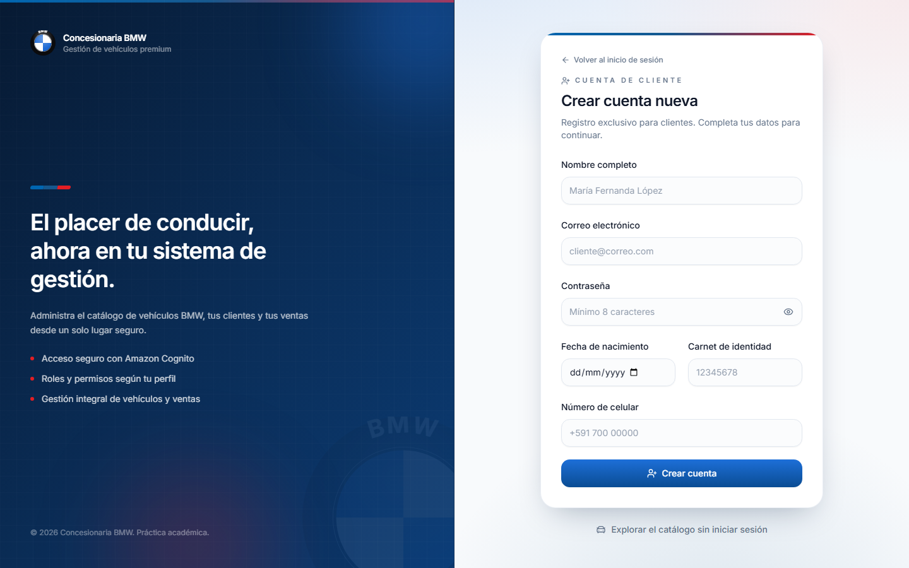
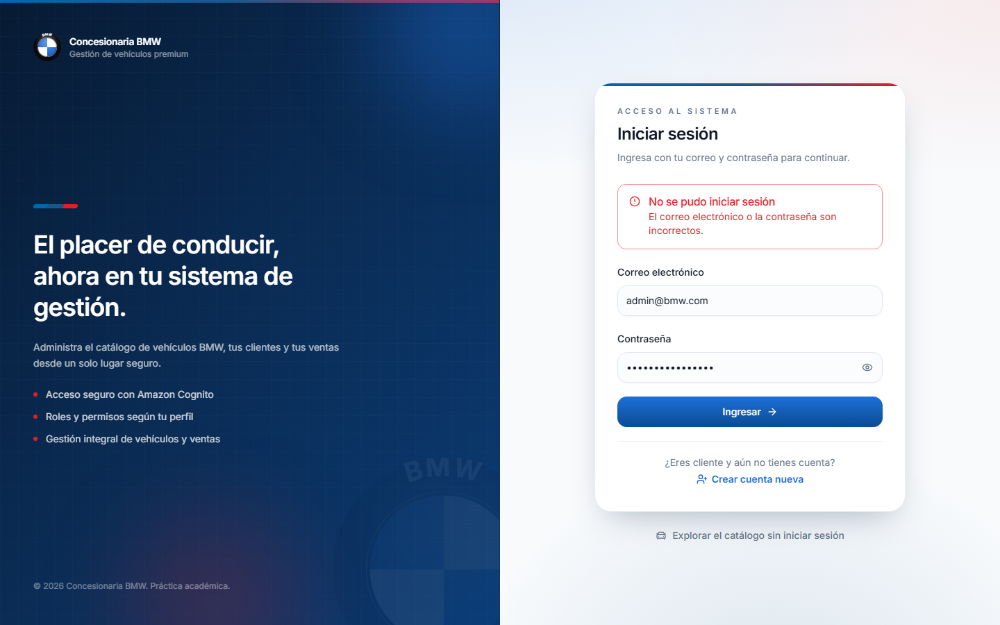
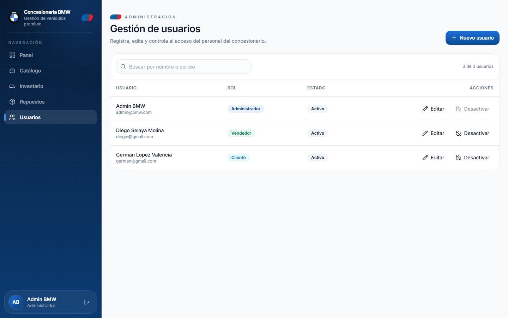

# Documentación del frontend — Concesionaria BMW

Este documento explica, punto por punto, cómo construí el frontend de la
**Concesionaria BMW**: una SPA hecha con **React + Vite + TypeScript**, estilizada con
**Tailwind CSS** y componentes de **shadcn/ui**, que se autentica contra **AWS Cognito**
(Amplify) y consume la **API REST del backend** (Express + DynamoDB). Todo el proyecto se
mantuvo dentro de la **capa gratuita de AWS**.

La aplicación cubre el login con roles (HU01), la gestión de usuarios (HU02), el inventario
de vehículos (HU03), el inventario de repuestos (HU04), el catálogo web público (HU05) y la
gestión de fotografías y documentos (HU06).

## Índice

1. [Configuración del proyecto frontend](#1-configuración-del-proyecto-frontend)
2. [Estructura de componentes](#2-estructura-de-componentes)
3. [Interfaces principales](#3-interfaces-principales)
4. [Gestión de estados](#4-gestión-de-estados)
5. [Navegación](#5-navegación)
6. [Formularios](#6-formularios)
7. [Validación](#7-validación)
8. [Consumo de API REST](#8-consumo-de-api-rest)
9. [Operaciones CRUD desde el frontend](#9-operaciones-crud-desde-el-frontend)
10. [Diseño responsive](#10-diseño-responsive)
11. [Integración frontend-backend](#11-integración-frontend-backend)
12. [Manejo de errores](#12-manejo-de-errores)
13. [Pruebas funcionales](#13-pruebas-funcionales)

---

## 1. Configuración del proyecto frontend

Armé el frontend sobre **Vite** porque es la forma más rápida de levantar un proyecto de
React con recarga en caliente y un build optimizado, sin tener que configurar manualmente
un empaquetador. Elegí **TypeScript** para tener tipado y detectar errores antes de
ejecutar, y sumé **Tailwind CSS** junto con **shadcn/ui** para construir la interfaz con
componentes accesibles y consistentes. Las herramientas de línea de comandos quedan
definidas en `package.json`, y la configuración del proyecto está repartida en unos pocos
archivos: `vite.config.ts`, `tailwind.config.ts`, `postcss.config.js`, `tsconfig.json`,
`index.html` y `components.json` (el archivo que usa shadcn/ui). La API y Cognito se
configuran por variables de entorno con prefijo `VITE_`, que tomo de un `.env` local
(siguiendo el `.env.example`). Para levantar el proyecto copio `.env.example` a `.env`,
completo los valores del despliegue de CDK y ejecuto `npm install` y `npm run dev`, que
publica la app en `http://localhost:5173`.


**Scripts disponibles** (`package.json`):

| Script | Comando | Para qué sirve |
| --- | --- | --- |
| `dev` | `vite` | Servidor de desarrollo en el puerto 5173. |
| `build` | `tsc -b && vite build` | Comprueba tipos y genera el bundle de producción. |
| `preview` | `vite preview` | Sirve el build generado para probarlo. |
| `typecheck` | `tsc --noEmit` | Solo valida los tipos, sin emitir archivos. |
| `lint` | `eslint ...` | Declarado, pero **ESLint no está instalado** (no se usa). |

**Dependencias principales**:

| Dependencia | Versión | Rol |
| --- | --- | --- |
| `react` / `react-dom` | ^18.3.1 | Librería base de la interfaz. |
| `react-router-dom` | ^6.26.2 | Enrutado de la SPA. |
| `aws-amplify` | ^6.7.0 | Autenticación con Cognito (`aws-amplify/auth`). |
| `react-hook-form` | ^7.53.0 | Manejo de formularios. |
| `@hookform/resolvers` | ^3.9.0 | Puente entre react-hook-form y Zod. |
| `zod` | ^3.23.8 | Validación de esquemas en el cliente. |
| `@radix-ui/react-*` | ^1.x/^2.x | Primitivos accesibles (Dialog, Label, Select, Slot). |
| `class-variance-authority`, `clsx`, `tailwind-merge` | — | Variantes y combinación de clases. |
| `lucide-react` | ^0.441.0 | Iconografía. |
| `sonner` | ^1.5.0 | Notificaciones tipo *toast*. |
| `tailwindcss`, `postcss`, `autoprefixer` | — | Estilos (dev). |
| `typescript`, `vite`, `@vitejs/plugin-react` | — | Tooling (dev). |

**Configuración destacada**:

- `vite.config.ts`: plugin de React, alias `@` → `./src` y puerto de desarrollo `5173`.
- `tailwind.config.ts`: `darkMode: 'class'`, escaneo de `index.html` y `src/**/*`, y tokens
  de marca BMW (paleta `brand.*` y `m.*`, sombras `panel`/`card`/`glow`, animaciones y
  degradados `bg-bmw-mesh`, `bg-sidebar-grid`, `bg-m-gradient`) sobre las variables de
  shadcn/ui.
- `postcss.config.js`: `tailwindcss` + `autoprefixer`.
- `tsconfig.app.json`: `strict: true`, `noUnusedLocals`, `noUnusedParameters`,
  `moduleResolution: bundler`, `jsx: react-jsx` y alias `@/*`.
- `index.html`: idioma `es`, tipografía **Inter**, `theme-color` azul BMW y título
  *"Concesionaria BMW | Acceso al sistema"*.
- `components.json`: configuración de shadcn/ui (estilo `default`, `baseColor: zinc`,
  variables CSS activadas y aliases `@/components`, `@/lib`, `@/hooks`).
- `.env.example`: `VITE_AWS_REGION`, `VITE_USER_POOL_ID`, `VITE_USER_POOL_CLIENT_ID` y
  `VITE_API_URL`.

---

## 2. Estructura de componentes

Organicé el código por **dominios funcionales** (auth, catálogo, inventario, usuarios,
layout, marca) en lugar de juntar todo en carpetas genéricas, porque así cada funcionalidad
queda autocontenida y es más fácil ubicar dónde está cada cosa. Los primitivos visuales de
**shadcn/ui** los dejé separados en `components/ui`, y las páginas en `pages/`. Los datos
se acceden a través de `services/` y los *hooks* de `hooks/`, mientras que la lógica
compartida vive en `lib/` y los tipos en `types/`. Los componentes de shadcn/ui los instalé
con su CLI (`shadcn add ...`), que a su vez se apoya en Radix, `class-variance-authority` y
la función `cn()` de `@/lib/utils`.

```text
frontend/src/
├── App.tsx                 # Definición de todas las rutas
├── main.tsx                # Punto de entrada: configura Amplify y monta <App/>
├── index.css               # Variables de tema + utilidades (.glass, .surface-card)
├── components/
│   ├── auth/               # LoginForm, RegisterClienteForm
│   ├── brand/              # BmwRoundel, MStripe
│   ├── catalog/            # CatalogoCard, CatalogoFiltros, CatalogoLayout, CatalogoShell, VehiculoGaleria
│   ├── common/             # ConfirmDialog
│   ├── dashboard/          # InfoTile
│   ├── inventory/          # VehiculoFormDialog, PhotoUploader, DocumentosUploader, tables, filtros, MovimientoDialog
│   ├── layout/             # AppLayout, PageHeader
│   ├── ui/                 # Primitivos shadcn/ui
│   ├── users/              # UserFormDialog, UsersTable
│   └── ProtectedRoute.tsx  # Guard de rutas (auth + roles)
├── context/                # AuthContext
├── hooks/                  # useVehiculos, useRepuestos, useMovimientos, useUsuarios, useCatalogo
├── lib/                    # api.ts, amplify.ts, archivos.ts, roles.ts, vehiculos.ts, utils.ts, ...
├── pages/                  # LoginPage, CatalogoPage, VehiculoDetallePage, DashboardPage,
│                           # InventoryPage, RepuestosPage, UsersPage, UnauthorizedPage
├── services/               # vehiculos, repuestos, movimientos, usuarios, catalogo, clientes
└── types/                  # vehiculo.ts, catalogo.ts, repuesto.ts, usuario.ts
```

**Primitivos de `components/ui`** (shadcn/ui): `button`, `input`, `label`, `select`,
`dialog`, `card`, `alert`, `badge`, `table` y `sonner`. Se generan con la CLI de shadcn y se
componen con `cn()`; muchos envuelven primitivos de Radix (Dialog, Select, Label, Slot) para
conservar la accesibilidad.

**Componentes de dominio principales**:

| Componente | Ubicación | Responsabilidad |
| --- | --- | --- |
| `CatalogoShell` | `components/catalog` | Decide el layout del catálogo: `AppLayout` si hay sesión, `CatalogoLayout` si no. |
| `CatalogoLayout` | `components/catalog` | Layout público del catálogo (cabecera + botón "Iniciar sesión"). |
| `AppLayout` | `components/layout` | Layout autenticado: *sidebar* con navegación por rol + cabecera móvil. |
| `ProtectedRoute` | `components/` | Guard de rutas: exige sesión y, opcionalmente, roles. |
| `VehiculoFormDialog` | `components/inventory` | Alta/edición de vehículos (integra subida de fotos y documentos). |
| `PhotoUploader` / `DocumentosUploader` | `components/inventory` | Subida de archivos a S3 con URL prefirmada. |
| `RepuestoFormDialog` | `components/inventory` | Alta/edición de repuestos. |
| `UserFormDialog` | `components/users` | Alta/edición de personal (no clientes). |
| `MovimientoDialog` | `components/inventory` | Registro de entradas/salidas de repuestos. |
| `ConfirmDialog` | `components/common` | Confirmación reutilizable de acciones destructivas. |


---

## 3. Interfaces principales

Como TypeScript es estricto, definí los tipos que comparto con el backend en la carpeta
`types/`, de manera que el cliente y el servidor trabajen siempre con la misma forma de
datos. Allí describo tanto los *enums* (condición, tipo y estado del vehículo) como los
objetos de lectura (`Vehiculo`, `Repuesto`, `Usuario`) y los de entrada para crear o
actualizar (`CreateVehiculoInput`, `UpdateVehiculoInput`). También tipé las respuestas de la
API (`VehiculosResponse`, `PresignArchivoResponse`) y los archivos (`VehiculoFoto`,
`VehiculoDocumento`). Como complemento, en `lib/` guardo las constantes y funciones de
apoyo: los *enums* con sus etiquetas legibles, los formateadores de precio y kilometraje, y
las reglas de validación de archivos.

**Tipos de vehículo** (`types/vehiculo.ts`, extracto):

```ts
export type CondicionVehiculo = 'nuevo' | 'seminuevo';
export type TipoVehiculo =
  | 'sedan' | 'suv' | 'coupe' | 'cabrio'
  | 'touring' | 'hatchback' | 'deportivo' | 'otros';
export type EstadoVehiculo = 'disponible' | 'reservado' | 'vendido' | 'no_disponible';

export interface VehiculoFoto { key: string; url?: string }
export interface VehiculoDocumento { key: string; nombre: string; url?: string }

export interface Vehiculo {
  vehiculoId: string;
  marca: string; modelo: string; anio: number; version: string;
  kilometraje: number; precio: number; color: string; vin: string;
  condicion: CondicionVehiculo; tipo: TipoVehiculo; estado: EstadoVehiculo;
  descripcion?: string; caracteristicas?: string[];
  publicado: boolean;
  fotos: VehiculoFoto[];
  documentos: VehiculoDocumento[];
  createdAt?: string;
}
```

**Constantes y utilidades** (`lib/`):

- `lib/vehiculos.ts`: `CONDICIONES`, `TIPOS`, `ESTADOS` con sus etiquetas y estilos de
  *badge*, más `formatPrecio` y `formatKilometraje`.
- `lib/catalogo.ts`: tipos y utilidades de la proyección pública del catálogo.
- `lib/repuestos.ts`: etiquetas y ayudas de repuestos (incluye la detección de bajo *stock*).
- `lib/archivos.ts`: `REGLAS_ARCHIVO` (tipos y tamaños permitidos) y `validarArchivo`.
- `lib/roles.ts`: `USER_ROLES`, `STAFF_ROLES`, `DEFAULT_ROLE` y helpers de rol.
- `lib/brand.ts`: nombre de la app, eslogan y textos de roles.
- `lib/utils.ts`: `cn()` para combinar clases de Tailwind.


---

## 4. Gestión de estados

Para el estado global (la sesión del usuario) usé la **API de Contexto de React** a través
de `AuthContext`, porque es un dato que necesitan casi todas las pantallas y no quería
arrastrarlo por *props*. El resto del estado lo manejo **localmente** en cada página y
*hook* con `useState`/`useEffect`/`useCallback`/`useMemo`. A propósito **no incorporé
TanStack Query**: para el volumen de este proyecto me alcanza con *hooks* propios que
encapsulan la llamada a la API, el estado de carga, el error y la recarga. De esta forma
las páginas quedan simples y no dependen de librerías adicionales.

**`AuthContext`** (`context/AuthContext.tsx`):

- Guarda `user: AuthUser | null` y `status: 'loading' | 'authenticated' | 'unauthenticated'`.
- Expone `login(email, password)` y `logout()`.
- Al cargar la app, restaura la sesión: con `getCurrentUser()` de Amplify detecta si hay
  usuario, obtiene el **ID token** con `fetchAuthSession()` y pide el perfil al backend
  (`GET /api/auth/session`). Si el perfil viene con `estado: 'inactivo'` (HU01), cierra la
  sesión y muestra un error. Si el backend no responde, cae en los datos del propio JWT.
- `AuthUser`: `{ sub, email, nombre, roles, rol }`, donde `rol` es el rol principal según la
  precedencia definida.

**Hooks de datos** (`hooks/`):

| Hook | Datos que maneja |
| --- | --- |
| `useAuth` | Acceso al contexto de sesión. |
| `useVehiculos` | Lista + crear/actualizar/cambiar estado/recargar vehículos. |
| `useRepuestos` | Lista + CRUD de repuestos y filtros. |
| `useMovimientos` | Lista y registro de movimientos. |
| `useUsuarios` | Lista + crear/actualizar usuarios. |
| `useCatalogo` / `useCatalogoVehiculo` | Catálogo público (sin autenticación). |

---

## 5. Navegación

La navegación la resolví con **react-router-dom v6** usando `BrowserRouter`, `Routes` y
rutas anidadas. La idea clave es que el **acceso dependa de la sesión y del rol**: las
rutas internas quedan detrás de un `ProtectedRoute`, y dentro de él anidé guards por rol
para las secciones de personal y de administración. Para los layouts uso rutas "contenedor"
que renderizan un `Outlet`, así la barra lateral (o la cabecera pública del catálogo) se
comparte entre páginas sin repetir código.

**Mapa de rutas** (`App.tsx`):

| Ruta | Página | Acceso |
| --- | --- | --- |
| `/login` | `LoginPage` | Público (login y registro de clientes). |
| `/catalogo` | `CatalogoPage` | Público. |
| `/catalogo/:vehiculoId` | `VehiculoDetallePage` | Público. |
| `/dashboard` | `DashboardPage` | Autenticado (cualquier rol). |
| `/inventario` | `InventoryPage` | Staff (`admin`, `vendedor`, `jefe_taller`, `mecanico`). |
| `/repuestos` | `RepuestosPage` | Staff. |
| `/usuarios` | `UsersPage` | Solo `admin`. |
| `/no-autorizado` | `UnauthorizedPage` | Autenticado (acceso denegado). |
| `/` | → `/dashboard` | Redirección. |
| `*` | → `/` | Redirección. |

**Guards y layouts**:

- `ProtectedRoute`: si el estado es `loading` muestra una pantalla de carga (con el *roundel*
  de BMW); si es `unauthenticated` redirige a `/login` guardando el origen; si se le pasan
  roles, exige que el usuario tenga al menos uno y, si no, redirige a `/no-autorizado`.
- `CatalogoShell`: para el catálogo decide entre `AppLayout` (si hay sesión) y
  `CatalogoLayout` (si es un visitante), de modo que el catálogo es público pero mantiene la
  navegación interna cuando el usuario ya inició sesión.
- `AppLayout`: barra lateral en escritorio y cajón deslizante en móvil, con los enlaces
  filtrados según el rol.


---

## 6. Formularios

Todos los formularios los hice con **react-hook-form** y **Zod** (mediante
`zodResolver`), porque esta combinación evita re-renderizados innecesarios, concentra las
reglas en un esquema y me da mensajes de error por campo casi gratis. Cada diálogo
(`VehiculoFormDialog`, `RepuestoFormDialog`, `UserFormDialog`, `MovimientoDialog`) mantiene
su propio estado con el hook `useForm`, muestra los errores debajo de cada campo y, cuando
el backend devuelve errores de validación, los inyecta en el campo correspondiente con
`setError`. Los diálogos se abren y cierran con un estado controlado desde la página
(`open`/`onOpenChange`).

Los casos más completos son el **registro de vehículos** (que además integra la subida de
fotos y documentos) y el **registro de clientes**. Ambos tienen muchos campos, así que los
organicé en una grilla responsive y agrupé lo relacionado (datos del vehículo, archivos,
etc.).


---

## 7. Validación

La validación la hice en dos niveles. En el **cliente**, cada formulario define un esquema
**Zod** que comprueba tipos, longitudes, rangos y valores permitidos, y react-hook-form
muestra el mensaje debajo del campo. En el **servidor**, el backend vuelve a validar con sus
propios esquemas Zod (nunca me fío solo del cliente) y responde con un arreglo
`details: [{ field, message }]`; en el frontend tomo ese arreglo con `getFieldErrors` y
coloco cada mensaje en su campo. Así el usuario ve los errores junto a la casilla incluso
cuando vienen del servidor.

Algunas reglas que definí, por ejemplo:

- **Vehículo**: marca/modelo/versión obligatorios, año entre 1950 y el año siguiente, VIN de
  exactamente 17 caracteres alfanuméricos (sin I, O ni Q), precio mayor a 0 y kilometraje no
  negativo.
- **Repuesto**: código alfanumérico único (mayúsculas, admite punto, guion y guion bajo),
  cantidad y cantidad mínima no negativas, precio mayor a 0.
- **Cliente**: nombre de 3 a 80 caracteres, correo válido, contraseña de al menos 8
  caracteres con mayúscula, minúscula y número, fecha de nacimiento no futura y celular con
  formato válido.



---

## 8. Consumo de API REST

El acceso a los datos lo centralicé en `lib/api.ts`, con dos funciones envoltorio sobre
`fetch`: `apiRequest` (para endpoints autenticados) y `publicRequest` (para los públicos,
como el catálogo y el registro de clientes). No usé Axios porque `fetch` ya viene en el
navegador y el envoltorio era sencillo. Antes de cada petición autenticada obtengo el **ID
token** de Cognito con `fetchAuthSession()` y lo envío en la cabecera
`Authorization: Bearer <token>`; si hay cuerpo, mando `Content-Type: application/json`. La
URL base sale de `VITE_API_URL`. Sobre esa base armé un `services/` con un módulo por
recurso, de modo que las páginas nunca llaman a `fetch` directamente.

**Servicios** (`services/`):

| Servicio | Endpoints que consume | Auth |
| --- | --- | --- |
| `vehiculos.ts` | `/api/vehiculos` (+ `/archivos/presign`) | Sí |
| `repuestos.ts` | `/api/repuestos` | Sí |
| `movimientos.ts` | `/api/movimientos` | Sí |
| `usuarios.ts` | `/api/usuarios` | Sí |
| `catalogo.ts` | `/api/catalogo` | No (público) |
| `clientes.ts` | `/api/clientes/registro` | No (público) |

También tipé el error de la API con una clase `ApiError` que guarda el mensaje, el código de
estado y los `details`, y agregué los ayudantes `getErrorMessage` y `getFieldErrors` para
mostrar los errores de forma uniforme.


---

## 9. Operaciones CRUD desde el frontend

Aunque el backend no expone borrados de vehículos ni de repuestos (para no perder el
histórico), desde la interfaz resolví las cuatro operaciones. La **lectura** la hacen los
*hooks* al montar la página; la **creación** y la **actualización** se hacen desde los
diálogos de formulario, y las actualizaciones parciales (como cambiar solo el estado de un
vehículo o ajustar datos de un repuesto) se envían con `PATCH`. Cuando una operación
termina bien, el *hook* actualiza el estado local y muestro un *toast* de confirmación, sin
necesidad de recargar toda la página.

**Vehículos** (HU03):

- Listar: `useVehiculos()` → `GET /api/vehiculos` (ordenados por fecha de creación).
- Crear: `VehiculoFormDialog` → `POST /api/vehiculos`.
- Actualizar: `PATCH /api/vehiculos/:id` (incluye el cambio rápido de estado).
- Adjuntar fotos/documentos: se suben a S3 y se envían las *keys* al guardar.

**Repuestos** (HU04): `useRepuestos` + `RepuestosTable` + `RepuestoFormDialog`, con
`POST`/`PATCH` sobre `/api/repuestos`.

**Movimientos**: `MovimientoDialog` registra entradas y salidas; las existencias solo
cambian por esta vía (no se editan a mano), lo que mantiene la trazabilidad.

**Usuarios** (HU02, solo `admin`): `UsersTable` + `UserFormDialog` sobre `/api/usuarios`. El
administrador gestiona únicamente al personal; los clientes se autorregistran desde el login.


---

### 9.1 Subida de archivos (HU06)

El flujo de archivos no pasa el binario por el backend: el navegador pide una **URL
prefirmada** al servidor y sube el archivo directamente a **S3** con un `PUT`. Primero
valido el archivo en el cliente con `reglas de archivo` (fotos JPG/PNG/WEBP/GIF hasta 5 MB;
documentos PDF/DOC/XLS/TXT hasta 10 MB); luego `vehiculosService.subirArchivo` solicita la
firma (`POST /api/vehiculos/archivos/presign`), hace el `PUT` a S3 y devuelve la *key*, que
se guarda en el vehículo al confirmar el formulario. Las fotos se previsualizan localmente
mientras se edita. En la lectura, el backend devuelve URLs prefirmadas temporales, y los
**documentos nunca se exponen** en el catálogo público.

---

## 10. Diseño responsive

Pensé la interfaz primero para **escritorio** y después la adapté a móvil usando los
*puntos de corte* de Tailwind (`sm`, `md`, `lg`, `xl`). En el área autenticada, la barra
lateral se muestra fija en pantallas grandes y se convierte en un **cajón deslizante** con
fondo difuminado en móvil. Las grillas de tarjetas y formularios cambian de una a varias
columnas según el ancho, y en el login el panel de marca se oculta en pantallas pequeñas
para dejar todo el espacio al formulario. Con esto la app se usa cómodamente tanto en
computadora como en teléfono.


---

## 11. Integración frontend-backend

La integración la resolví con un **contrato claro** entre ambas partes. El backend expone
REST en JSON bajo `/api`, y el frontend consume esos endpoints desde `services/`; los tipos
de `types/` replican la forma de los datos que devuelve el servidor, de modo que los cambios
se detectan en tiempo de compilación. La autenticación es la pieza que une todo: el
frontend se autentica con **Cognito** (Amplify), obtiene el ID token y lo envía en cada
petición; el backend valida ese token con el **User Pool** y autoriza según el rol. Además,
al arrancar la app el frontend pide el perfil al backend (`/api/auth/session`) para
combinar los datos del token con los de **DynamoDB** (por ejemplo, el estado del usuario).
Las variables de entorno de ambos lados (`VITE_*` en el frontend, `.env` en el backend)
apuntan al mismo despliegue de AWS (región `us-east-2`).

---

## 12. Manejo de errores

Unifiqué el manejo de errores para que el usuario siempre reciba un mensaje claro. En el
cliente, el envoltorio `apiRequest` convierte cualquier respuesta fallida en un `ApiError`
con el mensaje enviado por el backend; los formularios muestran los errores de validación en
su campo correspondiente y, si el error es general, aparece una alerta al inicio del
formulario. Para los avisos puntuales (una operación exitosa o un fallo de red) uso
**toasts** con `sonner`. Además traduje los errores de Cognito a mensajes en español
(credenciales incorrectas, usuario no confirmado, contraseña expirada, etc.) y controlé el
caso de **usuario inactivo** de la HU01. En las listas, cuando la carga falla, muestro una
alerta con un botón para **reintentar**, y cuando no hay resultados muestro un estado vacío
con texto explicativo.



---

## 13. Pruebas funcionales

No incorporé un framework de pruebas automatizadas (ni Jest, Vitest, Testing Library ni
Cypress) porque el alcance del proyecto no lo exigía; la verificación la hago con el
compilador y con pruebas funcionales manuales recorriendo cada flujo. El chequeo estático
que uso es `npm run typecheck` (o directamente `npm run build`, que primero corre `tsc -b`,
y si hay un error de tipos el build no se genera). A nivel funcional, validé:

- **HU01 – Login y roles**: inicio de sesión correcto, credenciales incorrectas, usuario
  inactivo y acceso denegado por rol (`/no-autorizado`).
- **HU02 – Usuarios**: alta y edición de personal, visibles solo para `admin`.
- **HU03 – Vehículos**: alta, edición, cambio de estado y filtros de inventario.
- **HU04 – Repuestos**: CRUD y registro de movimientos de entrada/salida.
- **HU05 – Catálogo público**: el visitante ve solo vehículos publicados y sin datos
  internos (sin VIN ni documentos).
- **HU06 – Fotografías y documentos**: subida con URL prefirmada, validación de tipo y
  tamaño y ocultamiento de documentos en el catálogo público.

Para las pruebas de interfaz me apoyé en la automatización del navegador y dejé como
evidencia las capturas incluidas en este documento.



---

## Galería de capturas

| Archivo | Pantalla |
| --- | --- |
| `capturas/01-login.png` | Inicio de sesión (escritorio). |
| `capturas/02-registro-cliente.png` | Registro de clientes. |
| `capturas/03-catalogo.png` | Catálogo público. |
| `capturas/04-catalogo-detalle.png` | Detalle de vehículo (público). |
| `capturas/05-dashboard.png` | Panel principal (autenticado). |
| `capturas/06-inventario.png` | Inventario de vehículos. |
| `capturas/07-inventario-form.png` | Formulario de vehículo. |
| `capturas/08-repuestos.png` | Gestión de repuestos. |
| `capturas/09-repuesto-form.png` | Formulario de repuesto. |
| `capturas/10-usuarios.png` | Gestión de usuarios. |
| `capturas/11-usuario-form.png` | Formulario de usuario. |
| `capturas/12-login-movil.png` | Login en móvil. |
| `capturas/13-catalogo-movil.png` | Catálogo en móvil. |
| `capturas/14-dashboard-movil.png` | Panel en móvil. |
| `capturas/15-inventario-movil.png` | Inventario en móvil. |
| `capturas/16-login-error.png` | Manejo de error de login. |
