# Documentación del frontend — Concesionaria BMW

Este documento explica, punto por punto, cómo construí el frontend de la
**Concesionaria BMW**: una SPA hecha con **React + Vite + TypeScript**, estilizada con
**Tailwind CSS** y componentes de **shadcn/ui**, que se autentica contra **AWS Cognito**
(Amplify) y consume la **API REST del backend** (Express + DynamoDB). Todo el proyecto se
mantuvo dentro de la **capa gratuita de AWS**.

La aplicación cubre el login con roles (HU01), la gestión de usuarios (HU02), el inventario
de vehículos (HU03), el inventario de repuestos (HU04), el catálogo web público (HU05), la
gestión de fotografías y documentos (HU06), el seguimiento comercial de clientes (HU07),
la generación de cotizaciones (HU08), las reservas de vehículos (HU09), las ventas de
vehículos (HU10) y las pruebas de manejo (HU11).

## Índice

1. [Configuración del proyecto frontend](#1-configuración-del-proyecto-frontend)
2. [Estructura de componentes](#2-estructura-de-componentes)
3. [Interfaces principales](#3-interfaces-principales)
4. [Gestión de estados](#4-gestión-de-estados)
5. [Navegación](#5-navegación)
6. [Formularios](#6-formularios)
7. [Validación](#7-validación)
8. [Consumo de API REST](#8-consumo-de-api-rest)
9. [Operaciones CRUD desde el frontend](#9-operaciones-crud-desde-el-frontend)
10. [Diseño responsive](#10-diseño-responsive)
11. [Integración frontend-backend](#11-integración-frontend-backend)
12. [Manejo de errores](#12-manejo-de-errores)
13. [Pruebas funcionales](#13-pruebas-funcionales)
14. [Seguimiento comercial (HU07)](#14-seguimiento-comercial-hu07)
15. [Cotizaciones (HU08)](#15-cotizaciones-hu08)
16. [Reservas de vehículos (HU09)](#16-reservas-de-vehículos-hu09)
17. [Ventas de vehículos (HU10)](#17-ventas-de-vehículos-hu10)
18. [Pruebas de manejo (HU11)](#18-pruebas-de-manejo-hu11)

---

## 1. Configuración del proyecto frontend

Armé el frontend sobre **Vite** porque es la forma más rápida de levantar un proyecto de
React con recarga en caliente y un build optimizado, sin tener que configurar manualmente
un empaquetador. Elegí **TypeScript** para tener tipado y detectar errores antes de
ejecutar, y sumé **Tailwind CSS** junto con **shadcn/ui** para construir la interfaz con
componentes accesibles y consistentes. Las herramientas de línea de comandos quedan
definidas en `package.json`, y la configuración del proyecto está repartida en unos pocos
archivos: `vite.config.ts`, `tailwind.config.ts`, `postcss.config.js`, `tsconfig.json`,
`index.html` y `components.json` (el archivo que usa shadcn/ui). La API y Cognito se
configuran por variables de entorno con prefijo `VITE_`, que tomo de un `.env` local
(siguiendo el `.env.example`). Para levantar el proyecto copio `.env.example` a `.env`,
completo los valores del despliegue de CDK y ejecuto `npm install` y `npm run dev`, que
publica la app en `http://localhost:5173`.

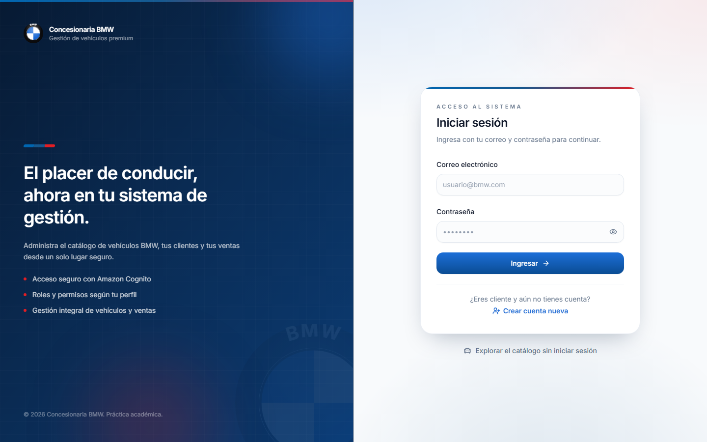

**Scripts disponibles** (`package.json`):

| Script | Comando | Para qué sirve |
| --- | --- | --- |
| `dev` | `vite` | Servidor de desarrollo en el puerto 5173. |
| `build` | `tsc -b && vite build` | Comprueba tipos y genera el bundle de producción. |
| `preview` | `vite preview` | Sirve el build generado para probarlo. |
| `typecheck` | `tsc --noEmit` | Solo valida los tipos, sin emitir archivos. |
| `lint` | `eslint ...` | Declarado, pero **ESLint no está instalado** (no se usa). |

**Dependencias principales**:

| Dependencia | Versión | Rol |
| --- | --- | --- |
| `react` / `react-dom` | ^18.3.1 | Librería base de la interfaz. |
| `react-router-dom` | ^6.26.2 | Enrutado de la SPA. |
| `aws-amplify` | ^6.7.0 | Autenticación con Cognito (`aws-amplify/auth`). |
| `react-hook-form` | ^7.53.0 | Manejo de formularios. |
| `@hookform/resolvers` | ^3.9.0 | Puente entre react-hook-form y Zod. |
| `zod` | ^3.23.8 | Validación de esquemas en el cliente. |
| `@radix-ui/react-*` | ^1.x/^2.x | Primitivos accesibles (Dialog, Label, Select, Slot). |
| `class-variance-authority`, `clsx`, `tailwind-merge` | — | Variantes y combinación de clases. |
| `lucide-react` | ^0.441.0 | Iconografía. |
| `sonner` | ^1.5.0 | Notificaciones tipo *toast*. |
| `tailwindcss`, `postcss`, `autoprefixer` | — | Estilos (dev). |
| `typescript`, `vite`, `@vitejs/plugin-react` | — | Tooling (dev). |

**Configuración destacada**:

- `vite.config.ts`: plugin de React, alias `@` → `./src` y puerto de desarrollo `5173`.
- `tailwind.config.ts`: `darkMode: 'class'`, escaneo de `index.html` y `src/**/*`, y tokens
  de marca BMW (paleta `brand.*` y `m.*`, sombras `panel`/`card`/`glow`, animaciones y
  degradados `bg-bmw-mesh`, `bg-sidebar-grid`, `bg-m-gradient`) sobre las variables de
  shadcn/ui.
- `postcss.config.js`: `tailwindcss` + `autoprefixer`.
- `tsconfig.app.json`: `strict: true`, `noUnusedLocals`, `noUnusedParameters`,
  `moduleResolution: bundler`, `jsx: react-jsx` y alias `@/*`.
- `index.html`: idioma `es`, tipografía **Inter**, `theme-color` azul BMW y título
  *"Concesionaria BMW | Acceso al sistema"*.
- `components.json`: configuración de shadcn/ui (estilo `default`, `baseColor: zinc`,
  variables CSS activadas y aliases `@/components`, `@/lib`, `@/hooks`).
- `.env.example`: `VITE_AWS_REGION`, `VITE_USER_POOL_ID`, `VITE_USER_POOL_CLIENT_ID` y
  `VITE_API_URL`.

---

## 2. Estructura de componentes

Organicé el código por **dominios funcionales** (auth, catálogo, inventario, usuarios,
layout, marca) en lugar de juntar todo en carpetas genéricas, porque así cada funcionalidad
queda autocontenida y es más fácil ubicar dónde está cada cosa. Los primitivos visuales de
**shadcn/ui** los dejé separados en `components/ui`, y las páginas en `pages/`. Los datos
se acceden a través de `services/` y los *hooks* de `hooks/`, mientras que la lógica
compartida vive en `lib/` y los tipos en `types/`. Los componentes de shadcn/ui los instalé
con su CLI (`shadcn add ...`), que a su vez se apoya en Radix, `class-variance-authority` y
la función `cn()` de `@/lib/utils`.

```text
frontend/src/
├── App.tsx                 # Definición de todas las rutas
├── main.tsx                # Punto de entrada: configura Amplify y monta <App/>
├── index.css               # Variables de tema + utilidades (.glass, .surface-card)
├── components/
│   ├── auth/               # LoginForm, RegisterClienteForm
│   ├── brand/              # BmwRoundel, MStripe
│   ├── catalog/            # CatalogoCard, CatalogoFiltros, CatalogoLayout, CatalogoShell, VehiculoGaleria
│   ├── clientesComerciales/ # ClienteComercialFormDialog (HU07)
│   ├── common/             # ConfirmDialog
│   ├── cotizaciones/       # CotizacionFormDialog, CotizacionesTable, CotizacionDetalleDialog (HU08)
│   ├── dashboard/          # InfoTile
│   ├── inventory/          # VehiculoFormDialog, PhotoUploader, DocumentosUploader, tables, filtros, MovimientoDialog
│   ├── layout/             # AppLayout, PageHeader
│   ├── pruebasManejo/      # PruebaManejoFormDialog, PruebasManejoTable, PruebaManejoDetalleDialog (HU11)
│   ├── reservas/           # ReservaFormDialog, ReservasTable, ReservaDetalleDialog (HU09)
│   ├── ventas/             # VentaFormDialog, VentasTable, VentaDetalleDialog (HU10)
│   ├── ui/                 # Primitivos shadcn/ui
│   ├── users/              # UserFormDialog, UsersTable
│   └── ProtectedRoute.tsx  # Guard de rutas (auth + roles)
├── context/                # AuthContext
├── hooks/                  # useVehiculos, useRepuestos, useMovimientos, useUsuarios, useCatalogo, useClientesComerciales, useCotizaciones, useReservas, useVentas, usePruebasManejo
├── lib/                    # api.ts, amplify.ts, archivos.ts, roles.ts, vehiculos.ts, utils.ts, cotizaciones.ts, cotizacionPdf.ts, cotizacionEmail.ts, reservas.ts, ventas.ts, ventaPdf.ts, pruebasManejo.ts
├── pages/                  # LoginPage, CatalogoPage, VehiculoDetallePage, DashboardPage,
│                           # InventoryPage, RepuestosPage, UsersPage, UnauthorizedPage,
│                           # clientesComerciales/ (listado y detalle, HU07), cotizaciones/ (HU08), reservas/ (HU09), ventas/ (HU10), pruebasManejo/ (HU11)
├── services/               # vehiculos, repuestos, movimientos, usuarios, catalogo, clientes, clientesComerciales, cotizaciones, reservas, ventas, pruebasManejo
└── types/                  # vehiculo.ts, catalogo.ts, repuesto.ts, usuario.ts, clienteComercial.ts, cotizacion.ts, reserva.ts, venta.ts, pruebaManejo.ts
```

**Primitivos de `components/ui`** (shadcn/ui): `button`, `input`, `label`, `select`,
`dialog`, `card`, `alert`, `badge`, `table` y `sonner`. Se generan con la CLI de shadcn y se
componen con `cn()`; muchos envuelven primitivos de Radix (Dialog, Select, Label, Slot) para
conservar la accesibilidad.

**Componentes de dominio principales**:

| Componente | Ubicación | Responsabilidad |
| --- | --- | --- |
| `CatalogoShell` | `components/catalog` | Decide el layout del catálogo: `AppLayout` si hay sesión, `CatalogoLayout` si no. |
| `CatalogoLayout` | `components/catalog` | Layout público del catálogo (cabecera + botón "Iniciar sesión"). |
| `AppLayout` | `components/layout` | Layout autenticado: *sidebar* con navegación por rol + cabecera móvil. |
| `ProtectedRoute` | `components/` | Guard de rutas: exige sesión y, opcionalmente, roles. |
| `VehiculoFormDialog` | `components/inventory` | Alta/edición de vehículos (integra subida de fotos y documentos). |
| `PhotoUploader` / `DocumentosUploader` | `components/inventory` | Subida de archivos a S3 con URL prefirmada. |
| `RepuestoFormDialog` | `components/inventory` | Alta/edición de repuestos. |
| `UserFormDialog` | `components/users` | Alta/edición de personal (no clientes). |
| `ClienteComercialFormDialog` | `components/clientesComerciales` | Alta de clientes comerciales con validación Zod (HU07). |
| `CotizacionFormDialog` / `CotizacionDetalleDialog` | `components/cotizaciones` | Generación y gestión de cotizaciones (HU08): snapshot de precios, descuento ≤ 20% y PDF/correo. |
| `ReservaFormDialog` / `ReservaDetalleDialog` | `components/reservas` | Registro y gestión de reservas (HU09): apartado del vehículo, historial, cancelación y conversión en venta. |
| `VentaFormDialog` / `VentaDetalleDialog` | `components/ventas` | Registro y detalle de ventas (HU10): cálculo de importes, snapshot de cliente/vehículo y comprobante PDF. |
| `PruebaManejoFormDialog` / `PruebasManejoTable` / `PruebaManejoDetalleDialog` | `components/pruebasManejo` | Solicitud y gestión de pruebas de manejo (HU11): agenda 08:00–18:00 en pasos de 15 min, snapshot de vehículo/cliente, historial de estados y acciones (confirmar, reprogramar, cancelar, realizar). |
| `MovimientoDialog` | `components/inventory` | Registro de entradas/salidas de repuestos. |
| `ConfirmDialog` | `components/common` | Confirmación reutilizable de acciones destructivas. |

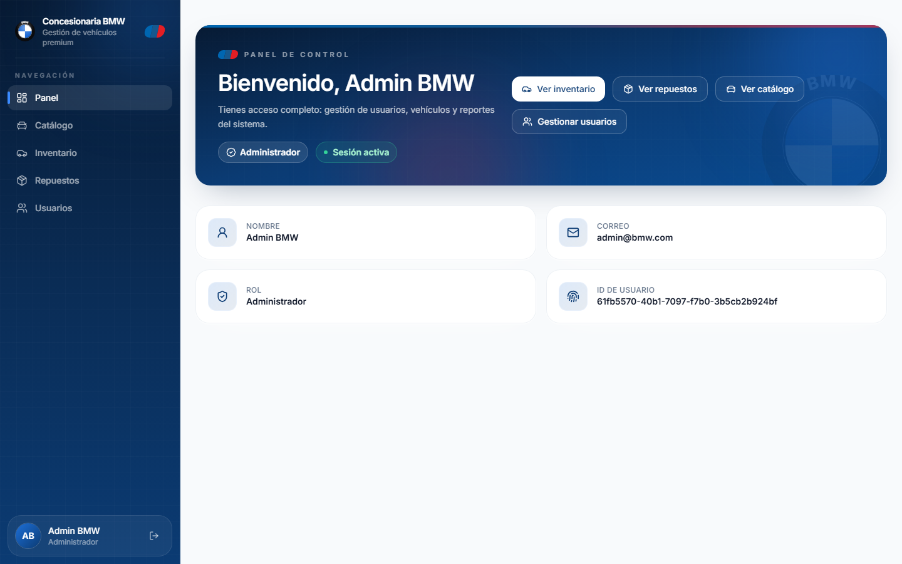

---

## 3. Interfaces principales

Como TypeScript es estricto, definí los tipos que comparto con el backend en la carpeta
`types/`, de manera que el cliente y el servidor trabajen siempre con la misma forma de
datos. Allí describo tanto los *enums* (condición, tipo y estado del vehículo) como los
objetos de lectura (`Vehiculo`, `Repuesto`, `Usuario`) y los de entrada para crear o
actualizar (`CreateVehiculoInput`, `UpdateVehiculoInput`). También tipé las respuestas de la
API (`VehiculosResponse`, `PresignArchivoResponse`) y los archivos (`VehiculoFoto`,
`VehiculoDocumento`). Como complemento, en `lib/` guardo las constantes y funciones de
apoyo: los *enums* con sus etiquetas legibles, los formateadores de precio y kilometraje, y
las reglas de validación de archivos.

**Tipos de vehículo** (`types/vehiculo.ts`, extracto):

```ts
export type CondicionVehiculo = 'nuevo' | 'seminuevo';
export type TipoVehiculo =
  | 'sedan' | 'suv' | 'coupe' | 'cabrio'
  | 'touring' | 'hatchback' | 'deportivo' | 'otros';
export type EstadoVehiculo = 'disponible' | 'reservado' | 'vendido' | 'no_disponible';

export interface VehiculoFoto { key: string; url?: string }
export interface VehiculoDocumento { key: string; nombre: string; url?: string }

export interface Vehiculo {
  vehiculoId: string;
  marca: string; modelo: string; anio: number; version: string;
  kilometraje: number; precio: number; color: string; vin: string;
  condicion: CondicionVehiculo; tipo: TipoVehiculo; estado: EstadoVehiculo;
  descripcion?: string; caracteristicas?: string[];
  publicado: boolean;
  fotos: VehiculoFoto[];
  documentos: VehiculoDocumento[];
  createdAt?: string;
}
```

**Constantes y utilidades** (`lib/`):

- `lib/vehiculos.ts`: `CONDICIONES`, `TIPOS`, `ESTADOS` con sus etiquetas y estilos de
  *badge*, más `formatPrecio` y `formatKilometraje`.
- `lib/catalogo.ts`: tipos y utilidades de la proyección pública del catálogo.
- `lib/repuestos.ts`: etiquetas y ayudas de repuestos (incluye la detección de bajo *stock*).
- `lib/archivos.ts`: `REGLAS_ARCHIVO` (tipos y tamaños permitidos) y `validarArchivo`.
- `lib/roles.ts`: `USER_ROLES`, `STAFF_ROLES`, `DEFAULT_ROLE` y helpers de rol.
- `lib/brand.ts`: nombre de la app, eslogan y textos de roles.
- `lib/utils.ts`: `cn()` para combinar clases de Tailwind.

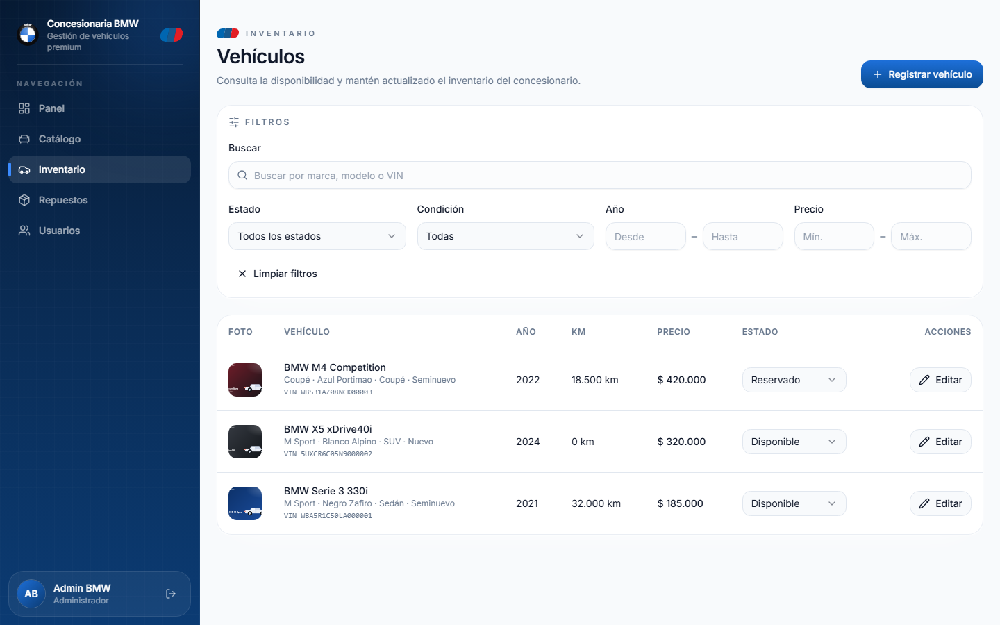

---

## 4. Gestión de estados

Para el estado global (la sesión del usuario) usé la **API de Contexto de React** a través
de `AuthContext`, porque es un dato que necesitan casi todas las pantallas y no quería
arrastrarlo por *props*. El resto del estado lo manejo **localmente** en cada página y
*hook* con `useState`/`useEffect`/`useCallback`/`useMemo`. A propósito **no incorporé
TanStack Query**: para el volumen de este proyecto me alcanza con *hooks* propios que
encapsulan la llamada a la API, el estado de carga, el error y la recarga. De esta forma
las páginas quedan simples y no dependen de librerías adicionales.

**`AuthContext`** (`context/AuthContext.tsx`):

- Guarda `user: AuthUser | null` y `status: 'loading' | 'authenticated' | 'unauthenticated'`.
- Expone `login(email, password)` y `logout()`.
- Al cargar la app, restaura la sesión: con `getCurrentUser()` de Amplify detecta si hay
  usuario, obtiene el **ID token** con `fetchAuthSession()` y pide el perfil al backend
  (`GET /api/auth/session`). Si el perfil viene con `estado: 'inactivo'` (HU01), cierra la
  sesión y muestra un error. Si el backend no responde, cae en los datos del propio JWT.
- `AuthUser`: `{ sub, email, nombre, roles, rol }`, donde `rol` es el rol principal según la
  precedencia definida.

**Hooks de datos** (`hooks/`):

| Hook | Datos que maneja |
| --- | --- |
| `useAuth` | Acceso al contexto de sesión. |
| `useVehiculos` | Lista + crear/actualizar/cambiar estado/recargar vehículos. |
| `useRepuestos` | Lista + CRUD de repuestos y filtros. |
| `useMovimientos` | Lista y registro de movimientos. |
| `useUsuarios` | Lista + crear/actualizar usuarios. |
| `useCatalogo` / `useCatalogoVehiculo` | Catálogo público (sin autenticación). |

---

## 5. Navegación

La navegación la resolví con **react-router-dom v6** usando `BrowserRouter`, `Routes` y
rutas anidadas. La idea clave es que el **acceso dependa de la sesión y del rol**: las
rutas internas quedan detrás de un `ProtectedRoute`, y dentro de él anidé guards por rol
para las secciones de personal y de administración. Para los layouts uso rutas "contenedor"
que renderizan un `Outlet`, así la barra lateral (o la cabecera pública del catálogo) se
comparte entre páginas sin repetir código.

**Mapa de rutas** (`App.tsx`):

| Ruta | Página | Acceso |
| --- | --- | --- |
| `/login` | `LoginPage` | Público (login y registro de clientes). |
| `/catalogo` | `CatalogoPage` | Público. |
| `/catalogo/:vehiculoId` | `VehiculoDetallePage` | Público. |
| `/dashboard` | `DashboardPage` | Autenticado (cualquier rol). |
| `/inventario` | `InventoryPage` | Staff (`admin`, `vendedor`, `jefe_taller`, `mecanico`). |
| `/repuestos` | `RepuestosPage` | Staff. |
| `/clientes-comerciales` | `ClientesComercialesPage` | `admin`, `vendedor` (HU07). |
| `/clientes-comerciales/:clienteId` | `ClienteComercialDetallePage` | `admin`, `vendedor`. |
| `/cotizaciones` | `CotizacionesPage` | `admin`, `vendedor` (HU08). |
| `/reservas` | `ReservasPage` | `admin`, `vendedor` (HU09). |
| `/ventas` | `VentasPage` | `admin`, `vendedor` (HU10). |
| `/pruebas-man` | `PruebasManejoPage` | `admin`, `vendedor` (HU11). |
| `/usuarios` | `UsersPage` | Solo `admin`. |
| `/no-autorizado` | `UnauthorizedPage` | Autenticado (acceso denegado). |
| `/` | → `/dashboard` | Redirección. |
| `*` | → `/` | Redirección. |

**Guards y layouts**:

- `ProtectedRoute`: si el estado es `loading` muestra una pantalla de carga (con el *roundel*
  de BMW); si es `unauthenticated` redirige a `/login` guardando el origen; si se le pasan
  roles, exige que el usuario tenga al menos uno y, si no, redirige a `/no-autorizado`.
- `CatalogoShell`: para el catálogo decide entre `AppLayout` (si hay sesión) y
  `CatalogoLayout` (si es un visitante), de modo que el catálogo es público pero mantiene la
  navegación interna cuando el usuario ya inició sesión.
- `AppLayout`: barra lateral en escritorio y cajón deslizante en móvil, con los enlaces
  filtrados según el rol.

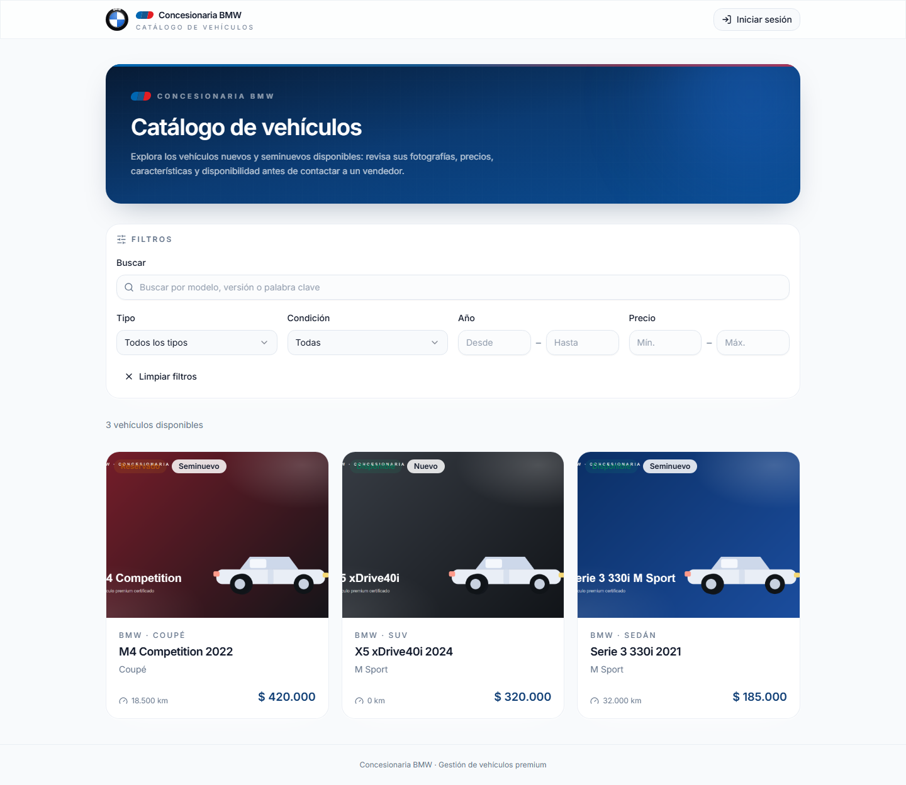

---

## 6. Formularios

Todos los formularios los hice con **react-hook-form** y **Zod** (mediante
`zodResolver`), porque esta combinación evita re-renderizados innecesarios, concentra las
reglas en un esquema y me da mensajes de error por campo casi gratis. Cada diálogo
(`VehiculoFormDialog`, `RepuestoFormDialog`, `UserFormDialog`, `MovimientoDialog`) mantiene
su propio estado con el hook `useForm`, muestra los errores debajo de cada campo y, cuando
el backend devuelve errores de validación, los inyecta en el campo correspondiente con
`setError`. Los diálogos se abren y cierran con un estado controlado desde la página
(`open`/`onOpenChange`).

Los casos más completos son el **registro de vehículos** (que además integra la subida de
fotos y documentos) y el **registro de clientes**. Ambos tienen muchos campos, así que los
organicé en una grilla responsive y agrupé lo relacionado (datos del vehículo, archivos,
etc.).

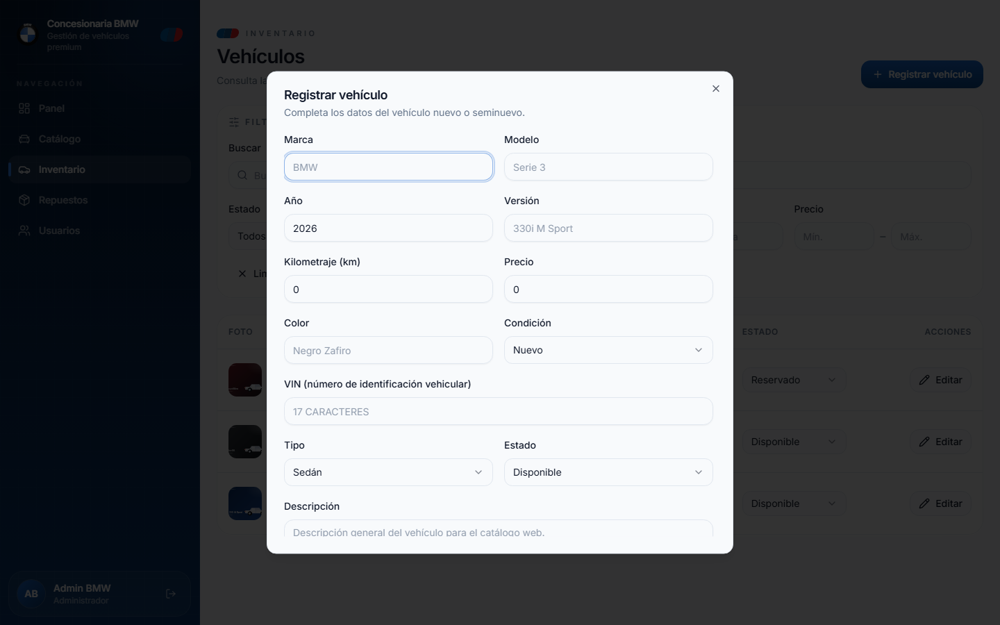

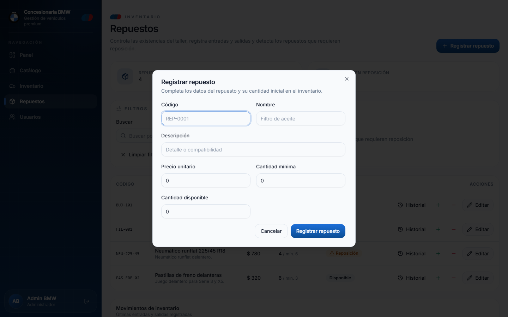

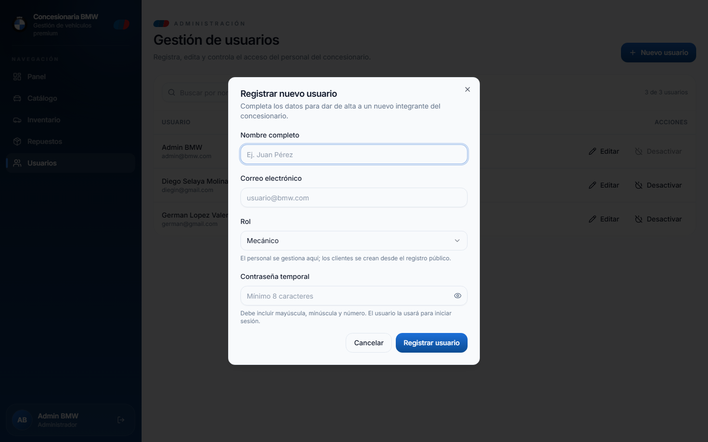

---

## 7. Validación

La validación la apliqué en **dos niveles**: primero en el **cliente** para dar feedback
inmediato al usuario, y después en el **servidor** como barrera definitiva (nunca confío
únicamente en lo que viene del navegador). En ambos lados uso **Zod** para definir el mismo
contrato de datos y mantener la coherencia entre frontend y backend.

### 7.1 Validación en el cliente con react-hook-form + Zod

Uso `react-hook-form` junto con `@hookform/resolvers/zod` para vincular el esquema Zod al
formulario. Esto permite validar al enviar (o al cambiar según configuración), mostrar
mensajes por campo y evitar re-renderizados innecesarios.

**Ejemplo: registro de cliente** (`frontend/src/components/auth/RegisterClienteForm.tsx`):

```ts
const schema = z.object({
  nombre: z.string().trim().min(3, 'El nombre debe tener al menos 3 caracteres.').max(80, 'El nombre es demasiado largo.'),
  email: z.string().trim().email('Ingresa un correo electrónico válido.').max(120),
  password: z
    .string()
    .min(8, 'La contraseña debe tener al menos 8 caracteres.')
    .regex(/[a-z]/, 'Debe incluir al menos una letra minúscula.')
    .regex(/[A-Z]/, 'Debe incluir al menos una letra mayúscula.')
    .regex(/[0-9]/, 'Debe incluir al menos un número.'),
  fechaNacimiento: z
    .string()
    .min(1, 'La fecha de nacimiento es obligatoria.')
    .refine((v) => new Date(v).getTime() <= Date.now(), 'La fecha no puede ser futura.'),
  carnetIdentidad: z
    .string()
    .trim()
    .min(5, 'El carnet de identidad debe tener al menos 5 caracteres.')
    .max(20, 'El carnet de identidad es demasiado largo.')
    .regex(/^[A-Za-z0-9-]+$/, 'Solo se permiten letras, números y guion.'),
  celular: z
    .string()
    .trim()
    .regex(/^[0-9+\s-]{7,15}$/, 'El celular debe tener entre 7 y 15 dígitos.'),
});

const form = useForm<RegisterFormValues>({
  resolver: zodResolver(schema),
  defaultValues: { nombre: '', email: '', password: '', fechaNacimiento: '', carnetIdentidad: '', celular: '' },
});
```

**Ejemplo: vehículo (alta/edición)** (`frontend/src/components/inventory/VehiculoFormDialog.tsx`):

```ts
const anioActual = new Date().getFullYear();
const schema = z.object({
  marca: z.string().trim().min(2).max(50),
  modelo: z.string().trim().min(1).max(60),
  anio: z.coerce.number().int().min(1950).max(anioActual + 1),
  version: z.string().trim().min(1).max(80),
  kilometraje: z.coerce.number().int().min(0),
  precio: z.coerce.number().positive(),
  color: z.string().trim().min(1).max(40),
  vin: z.string().trim().toUpperCase().regex(/^[A-HJ-NPR-Z0-9]{17}$/), // sin I,O,Q
  condicion: z.enum(CONDICIONES),
  tipo: z.enum(TIPOS),
  estado: z.enum(ESTADOS),
  descripcion: z.string().trim().max(1000).optional(),
  caracteristicas: z.string().optional(),
  publicado: z.enum(['si','no']),
});
```

**Ejemplo: repuesto** (`frontend/src/components/inventory/RepuestoFormDialog.tsx`):

```ts
const schema = z.object({
  codigo: z.string().trim().toUpperCase().min(2).max(30).regex(/^[A-Z0-9][A-Z0-9._-]*$/),
  nombre: z.string().trim().min(2).max(80),
  descripcion: z.string().trim().max(200).optional(),
  precio: z.coerce.number().positive().max(100000000),
  cantidad: z.coerce.number().int().min(0),
  cantidadMinima: z.coerce.number().int().min(0).optional(),
});
```

### 7.2 Validación en el servidor (definitiva)

El backend valida **exactamente lo mismo** con sus esquemas Zod y responde con errores
estructurados. El helper `validate(schema, data)` lanza `ValidationError` con `details` por
campo.

```js
// backend/src/validation/vehiculoSchemas.js (extracto)
function validate(schema, data) {
  const result = schema.safeParse(data ?? {});
  if (!result.success) {
    const details = result.error.issues.map((issue) => ({
      field: issue.path.join('.'),
      message: issue.message,
    }));
    throw new ValidationError('Datos inválidos.', details);
  }
  return result.data;
}
```

Las reglas del backend refuerzan lo mismo: VIN sin I,O,Q (17 chars), año acotado, enums
cerrados, tamaños máximos, etc. También en actualización se usan **esquemas parciales**
(`updateVehiculoSchema.partial`-style) y se rechaza si no hay cambios.

### 7.3 Mapeo de errores servidor → formulario

Cuando el backend devuelve `400` con `details`, el frontend los extrae con
`getFieldErrors` y los asigna a cada campo:

```ts
// frontend/src/components/auth/RegisterClienteForm.tsx (extracto)
} catch (error) {
  const fieldErrors = getFieldErrors(error);
  let hasField = false;
  for (const fe of fieldErrors) {
    if (fe.field) {
      form.setError(fe.field as keyof RegisterFormValues, { type: 'server', message: fe.message });
      hasField = true;
    }
  }
  if (!hasField) setFormError(getErrorMessage(error));
}
```

De esta forma el error aparece **justo debajo del campo que lo provoca**, no como un aviso
genérico.

### 7.4 Reglas aplicadas (resumen)

| Entidad | Reglas principales |
| --- | --- |
| Vehículo | marca 2–50, modelo 1–60, versión 1–80, año 1950..anioActual+1, km >=0, precio >0, color 1–40, VIN /^[A-HJ-NPR-Z0-9]{17}$/, condición/tipo/estado enums, descripción ≤1000, características ≤20 ítems (≤80 c/u), fotos ≤15, documentos ≤20. |
| Repuesto | código 2–30 /^[A-Z0-9][A-Z0-9._-]*$/ (normalizado a mayúsculas), nombre 2–80, descripción ≤200, precio >0 y ≤10^8, cantidad >=0, cantidad mínima >=0. |
| Cliente | nombre 3–80, email válido ≤120, password ≥8 con minúscula/mayúscula/número, fechaNacimiento no futura, carnetIdentidad 5–20 alfanumérico+guión, celular 7–15 con + - espacios. |
| Usuario (staff) | validación acorde a rol/email (HU02). |
| Movimiento | tipo `entrada/salida`, cantidad >0 entera. |

### 7.5 Evidencias

- [`capturas/02-registro-cliente.png`](capturas/02-registro-cliente.png): formulario con
  validación cliente + mapeo de errores servidor.
- [`capturas/07-inventario-form.png`](capturas/07-inventario-form.png): formulario de
  vehículo con validaciones (VIN, año, precios, enums).
- [`capturas/09-repuesto-form.png`](capturas/09-repuesto-form.png): validación de código
  único/formatos.
- [`capturas/16-login-error.png`](capturas/16-login-error.png): error traducido mostrado al
  usuario.

---## 8. Consumo de API REST

El acceso a los datos lo centralicé en `lib/api.ts`, con dos funciones envoltorio sobre
`fetch`: `apiRequest` (para endpoints autenticados) y `publicRequest` (para los públicos,
como el catálogo y el registro de clientes). No usé Axios porque `fetch` ya viene en el
navegador y el envoltorio era sencillo. Antes de cada petición autenticada obtengo el **ID
token** de Cognito con `fetchAuthSession()` y lo envío en la cabecera
`Authorization: Bearer <token>`; si hay cuerpo, mando `Content-Type: application/json`. La
URL base sale de `VITE_API_URL`. Sobre esa base armé un `services/` con un módulo por
recurso, de modo que las páginas nunca llaman a `fetch` directamente.

**Servicios** (`services/`):

| Servicio | Endpoints que consume | Auth |
| --- | --- | --- |
| `vehiculos.ts` | `/api/vehiculos` (+ `/archivos/presign`) | Sí |
| `repuestos.ts` | `/api/repuestos` | Sí |
| `movimientos.ts` | `/api/movimientos` | Sí |
| `usuarios.ts` | `/api/usuarios` | Sí |
| `catalogo.ts` | `/api/catalogo` | No (público) |
| `clientes.ts` | `/api/clientes/registro` | No (público) |

También tipé el error de la API con una clase `ApiError` que guarda el mensaje, el código de
estado y los `details`, y agregué los ayudantes `getErrorMessage` y `getFieldErrors` para
mostrar los errores de forma uniforme.

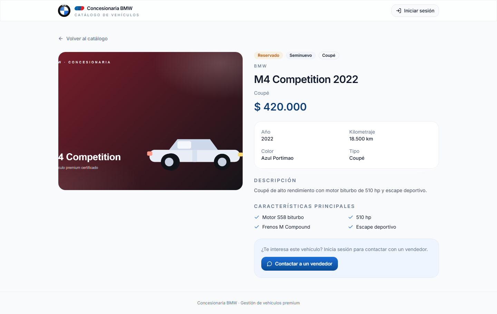

---

## 9. Operaciones CRUD desde el frontend

Aunque el backend no expone borrados de vehículos ni de repuestos (para no perder el
histórico), desde la interfaz resolví las cuatro operaciones. La **lectura** la hacen los
*hooks* al montar la página; la **creación** y la **actualización** se hacen desde los
diálogos de formulario, y las actualizaciones parciales (como cambiar solo el estado de un
vehículo o ajustar datos de un repuesto) se envían con `PATCH`. Cuando una operación
termina bien, el *hook* actualiza el estado local y muestro un *toast* de confirmación, sin
necesidad de recargar toda la página.

**Vehículos** (HU03):

- Listar: `useVehiculos()` → `GET /api/vehiculos` (ordenados por fecha de creación).
- Crear: `VehiculoFormDialog` → `POST /api/vehiculos`.
- Actualizar: `PATCH /api/vehiculos/:id` (incluye el cambio rápido de estado).
- Adjuntar fotos/documentos: se suben a S3 y se envían las *keys* al guardar.

**Repuestos** (HU04): `useRepuestos` + `RepuestosTable` + `RepuestoFormDialog`, con
`POST`/`PATCH` sobre `/api/repuestos`.

**Movimientos**: `MovimientoDialog` registra entradas y salidas; las existencias solo
cambian por esta vía (no se editan a mano), lo que mantiene la trazabilidad.

**Usuarios** (HU02, solo `admin`): `UsersTable` + `UserFormDialog` sobre `/api/usuarios`. El
administrador gestiona únicamente al personal; los clientes se autorregistran desde el login.

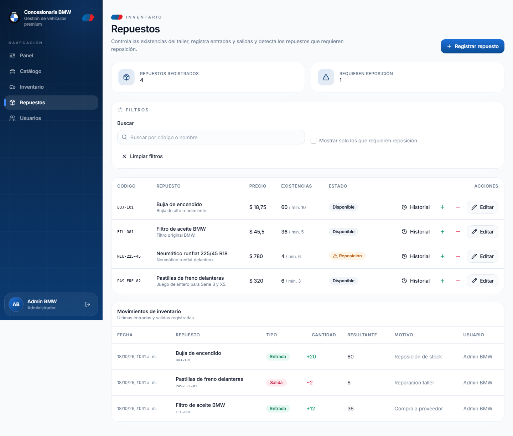

---

### 9.1 Subida de archivos (HU06)

El flujo de archivos no pasa el binario por el backend: el navegador pide una **URL
prefirmada** al servidor y sube el archivo directamente a **S3** con un `PUT`. Primero
valido el archivo en el cliente con `reglas de archivo` (fotos JPG/PNG/WEBP/GIF hasta 5 MB;
documentos PDF/DOC/XLS/TXT hasta 10 MB); luego `vehiculosService.subirArchivo` solicita la
firma (`POST /api/vehiculos/archivos/presign`), hace el `PUT` a S3 y devuelve la *key*, que
se guarda en el vehículo al confirmar el formulario. Las fotos se previsualizan localmente
mientras se edita. En la lectura, el backend devuelve URLs prefirmadas temporales, y los
**documentos nunca se exponen** en el catálogo público.

---

## 10. Diseño responsive

Pensé la interfaz primero para **escritorio** y después la adapté a móvil usando los
*puntos de corte* de Tailwind (`sm`, `md`, `lg`, `xl`). En el área autenticada, la barra
lateral se muestra fija en pantallas grandes y se convierte en un **cajón deslizante** con
fondo difuminado en móvil. Las grillas de tarjetas y formularios cambian de una a varias
columnas según el ancho, y en el login el panel de marca se oculta en pantallas pequeñas
para dejar todo el espacio al formulario. Con esto la app se usa cómodamente tanto en
computadora como en teléfono.

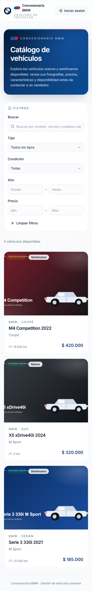

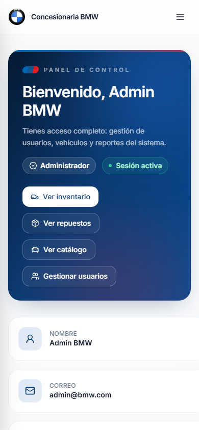

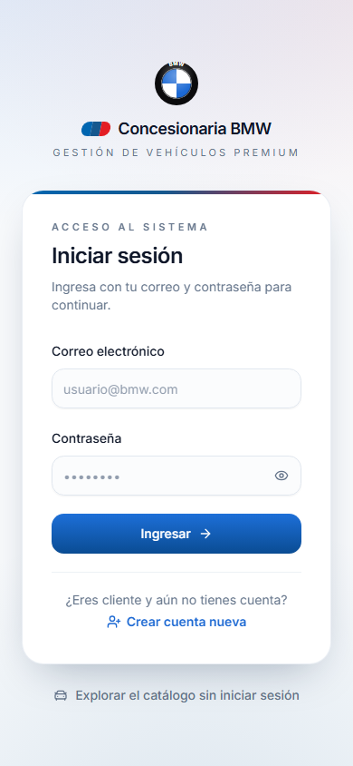

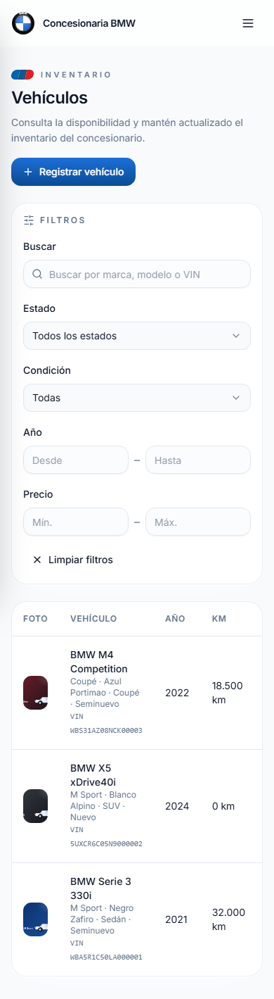

---

## 11. Integración frontend-backend

La integración entre frontend y backend la diseñé siguiendo un **contrato bien definido**:
el backend expone una API REST sobre JSON en `/api` y el frontend la consume a través de la
capa de `services/`, con los tipos espejo en `types/` para que los cambios se detecten en
compilación. El nexo de autenticación es **AWS Cognito** (Amplify v6 en el frontend y
validación de JWT en el backend). Las peticiones autenticadas llevan el **ID token** en
`Authorization: Bearer`, y las respuestas usan siempre un formato uniforme.

### 11.1 Configuración y variables de entorno

En el frontend la conexión se configura con variables `VITE_*`. Estas se leen en tiempo de
ejecución (Vite inyecta `import.meta.env`):

```ts
// frontend/src/lib/amplify.ts
const region = import.meta.env.VITE_AWS_REGION;
const userPoolId = import.meta.env.VITE_USER_POOL_ID;
const userPoolClientId = import.meta.env.VITE_USER_POOL_CLIENT_ID;

export function configureAmplify(): void {
  if (!userPoolId || !userPoolClientId) {
    throw new Error('Faltan credenciales de Cognito en frontend/.env (VITE_USER_POOL_ID y VITE_USER_POOL_CLIENT_ID).');
  }
  Amplify.configure({
    Auth: { Cognito: { userPoolId, userPoolClientId, loginWith: { email: true } } },
  });
}
```

```ts
// frontend/src/lib/api.ts
const API_URL = (import.meta.env.VITE_API_URL || 'http://localhost:3000').replace(/\/$/, '');
```

El backend toma sus valores de `backend/.env` (región, nombres de tablas, bucket de S3,
CORS, etc.) y los centraliza en `config.js`. Esto asegura que frontend y backend apunten al
mismo entorno (región `us-east-2`).

### 11.2 Cliente HTTP y obtención del token

Para que cada request lleve credenciales frescas, el cliente HTTP obtiene el ID token justo
antes de enviar la petición (Amplify gestiona el *refresh*):

```ts
// frontend/src/lib/api.ts (extracto)
export async function apiRequest<T>(path: string, options: RequestOptions = {}): Promise<T> {
  const session = await fetchAuthSession();
  const idToken = session.tokens?.idToken?.toString();
  if (!idToken) throw new Error('No se pudo obtener el token de sesión.');

  const headers: Record<string, string> = {
    Accept: 'application/json',
    Authorization: `Bearer ${idToken}`,
    ...(options.body ? { 'Content-Type': 'application/json' } : {}),
  };

  const response = await fetch(`${API_URL}${path}`, {
    ...options,
    headers,
    body: options.body ? JSON.stringify(options.body) : undefined,
  });

  const raw = await response.text();
  let data: any = {};
  try { data = raw ? JSON.parse(raw) : {}; } catch { data = { raw }; }

  if (!response.ok) {
    const message = data?.error || response.statusText || 'Error de solicitud';
    throw new ApiError(message, response.status, data?.details);
  }
  return data as T;
}
```

Las peticiones **públicas** (`publicRequest`) omiten el `Authorization` y se usan únicamente
para el registro de clientes y para el catálogo: `POST /api/clientes/registro`,
`GET /api/catalogo` y `GET /api/catalogo/:vehiculoId`.

### 11.3 Sincronización de sesión con el backend

Tras iniciar sesión con Cognito, el `AuthContext` consulta el perfil del usuario en el
backend para validar su estado y obtener sus roles/nombre desde DynamoDB:

```ts
// frontend/src/context/AuthContext.tsx (extracto relevante)
async function loadUser() {
  const session = await fetchAuthSession();
  const idToken = session.tokens?.idToken?.toString();
  if (!idToken) throw new Error('Sesión inválida');

  try {
    const profile = await getSessionProfile(idToken); // GET /api/auth/session
    if (profile.estado === 'inactivo') {
      await amplifySignOut();
      throw new AuthUiError('Usuario inactivo. Contacta al administrador del sistema.', false);
    }
    // fusiona perfil backend + datos JWT
    ...
  } catch (error: any) {
    if (isAuthUiError(error) && error.code === 'USER_INACTIVE') throw error;
    // fallback a datos del token
    ...
  }
}
```

`getSessionProfile` llama a `GET ${API_URL}/api/auth/session` con el Bearer y devuelve el
perfil (`SessionProfile`), lo que permite que el frontend refleje exactamente el estado
persistido en DynamoDB (HU01).

### 11.4 Mapeo de servicios al backend (endpoints)

Cada módulo de `services/` traduce operaciones de UI a llamadas REST, pasando siempre por
`apiRequest`/`publicRequest`. Esto deja explícito el contrato entre capas:

| Servicio | Método | Endpoint | Auth | Propósito |
| --- | --- | --- | --- | --- |
| `clientes.ts` | `registrar` | `POST /api/clientes/registro` | Público | Autorregistro de clientes (HU01). |
| `catalogo.ts` | `list` | `GET /api/catalogo` | Público | Listado de vehículos publicados (HU05). |
| `catalogo.ts` | `get` | `GET /api/catalogo/:vehiculoId` | Público | Detalle público (sin VIN/documentos). |
| `vehiculos.ts` | `list` | `GET /api/vehiculos` | Sí (auth) | Listado completo (inventario). |
| `vehiculos.ts` | `get` | `GET /api/vehiculos/:vehiculoId` | Sí | Detalle interno. |
| `vehiculos.ts` | `create` | `POST /api/vehiculos` | Sí (STAFF) | Alta de vehículo (HU03). |
| `vehiculos.ts` | `update` | `PATCH /api/vehiculos/:vehiculoId` | Sí (STAFF) | Edición/cambio de estado. |
| `vehiculos.ts` | `presignArchivo` | `POST /api/vehiculos/archivos/presign` | Sí (STAFF) | Solicita URL prefirmada S3 (HU06). |
| `repuestos.ts` | `list/create/get/update` | `/api/repuestos` | Sí (STAFF) | CRUD repuestos (HU04). |
| `movimientos.ts` | `list/create` | `/api/movimientos` | Sí (STAFF) | Entradas/salidas (HU04). |
| `usuarios.ts` | `list/create/update` | `/api/usuarios` | Sí (`admin`) | Gestión de personal (HU02). |
| `clientesComerciales.ts` | `list/get/create/update/addConsulta` | `/api/clientes-comerciales` | Sí (`admin`/`vendedor`) | Seguimiento comercial (HU07). |
| `cotizaciones.ts` | `list/get/create/update` | `/api/cotizaciones` | Sí (`admin`/`vendedor`) | Cotizaciones (HU08). |
| `reservas.ts` | `list/get/create/cancelar/convertir` | `/api/reservas` | Sí (`admin`/`vendedor`) | Reservas de vehículos (HU09). |
| `ventas.ts` | `list/get/create` | `/api/ventas` | Sí (`admin`/`vendedor`) | Ventas de vehículos (HU10). |
| `pruebasManejo.ts` | `list/get/create/solicitar/confirmar/reprogramar/cancelar/realizar` | `/api/pruebas-man` | `create` (staff) y `solicitar` (**público**, token opcional); resto `admin`/`vendedor` | Pruebas de manejo (HU11). |

### 11.5 Flujo end-to-end con evidencia (subida a S3)

Un ejemplo concreto que demuestra la integración directa frontend→S3 con presign es el
`subirArchivo` de vehículos:

```ts
// frontend/src/services/vehiculos.ts (extracto)
async subirArchivo(file: File, categoria: CategoriaArchivo): Promise<ArchivoSubido> {
  const { key, uploadUrl } = await vehiculosService.presignArchivo({
    categoria, contentType: file.type, nombre: file.name, size: file.size,
  });
  const response = await fetch(uploadUrl, {
    method: 'PUT',
    headers: { 'Content-Type': file.type },
    body: file,
  });
  if (!response.ok) throw new Error('No se pudo subir el archivo. Inténtalo nuevamente.');
  return { key, nombre: file.name, contentType: file.type, size: file.size };
}
```

El backend firma el `PutObjectCommand` con `ContentLength` fijo (HU06), por lo que el `PUT`
directo a S3 se valida en el lado del bucket. Solo después de que ese `PUT` sea exitoso, el
frontend envía las `keys` en el payload de creación/edición del vehículo (`fotos: string[]`,
`documentos: {key,nombre}[]`), que el backend guarda en DynamoDB. Este flujo queda reflejado
en las capturas: el formulario de vehículo integra `PhotoUploader`/`DocumentosUploader`
([`capturas/07-inventario-form.png`](capturas/07-inventario-form.png)) y las imágenes subidas
se muestran en el detalle público del catálogo
([`capturas/04-catalogo-detalle.png`](capturas/04-catalogo-detalle.png)).

### 11.6 Tipado compartido y validación cruzada

Los tipos del frontend reflejan los DTOs del backend (`types/vehiculo.ts`,
`types/repuesto.ts`, `types/usuario.ts`, `types/catalogo.ts`, `types/clienteComercial.ts`,
`types/cotizacion.ts`). La validación ocurre en
**ambos bordes**: Zod en frontend (react-hook-form) para feedback inmediato y Zod en
backend para garantizar integridad. Cuando el backend devuelve `ValidationError` con
`details` por campo, el frontend los mapea con `getFieldErrors` y los pinta junto a cada
input (véase [`capturas/02-registro-cliente.png`](capturas/02-registro-cliente.png) y
[`capturas/16-login-error.png`](capturas/16-login-error.png)).

### 11.7 Evidencia de compilación y coherencia

Como verificación estática de la integración, el frontend pasa `tsc -b` sin errores
(`npm run build` comprueba tipos entre módulos y referencias). Esto confirma que los
servicios, hooks, páginas y tipos están alineados con los contratos definidos. En conjunto
con las peticiones REST listadas y el flujo de presign, queda demostrada la integración
frontend–backend–S3–DynamoDB–Cognito.

---## 12. Manejo de errores

Unifiqué el manejo de errores para que el usuario siempre reciba un mensaje claro y
accionable. El objetivo fue que, tanto los errores de red, como los de validación del
backend o los de autenticación de Cognito, se mostraran de manera consistente en toda la
aplicación.

### 12.1 Normalización de errores HTTP

El envoltorio `apiRequest` (`lib/api.ts`) convierte cualquier respuesta no exitosa en un
`ApiError`, conservando el mensaje y los `details` que devuelve el backend:

```ts
// frontend/src/lib/api.ts (extracto)
if (!response.ok) {
  const message = data?.error || response.statusText || 'Error de solicitud';
  throw new ApiError(message, response.status, data?.details);
}
```

Cuando el backend devuelve un `ValidationError` con `details` (array de
`{ field, message }`), estos se extraen con `getFieldErrors(error)` y se inyectan
directamente en los campos del formulario con `react-hook-form.setError(field, ...)`. Si no
hay campos asociados, se muestra un mensaje global.

### 12.2 Errores de autenticación (Cognito)

En `AuthContext` y `LoginForm` traduzco las excepciones de Amplify a mensajes en español
mediante `toAuthErrorMessage` (`lib/cognito-errors.ts`). Esto cubre casos frecuentes:

- `NotAuthorizedException` → "El correo electrónico o la contraseña son incorrectos."
- `UserNotFoundException` → "No existe una cuenta con ese correo electrónico."
- `UserNotConfirmedException` → "El usuario aún no ha sido confirmado."
- `InvalidPasswordException` → "La contraseña no cumple con los requisitos."
- `PasswordResetRequiredException` / `LimitExceededException` / `TooManyRequestsException`
- `UserLambdaValidationException` (incluye el caso de **usuario inactivo** HU01) → mensaje
  específico ("Usuario inactivo. Contacta al administrador del sistema.")
- Fallos de red (`TypeError: Failed to fetch`) → "No se pudo conectar con el servidor."

Evidencia visual: [`capturas/16-login-error.png`](capturas/16-login-error.png) muestra el
`Alert` destructivo con el mensaje traducido tras un intento con credenciales incorrectas.

### 12.3 Notificaciones con toasts

Para acciones asíncronas (crear/actualizar usuario/repuesto/vehículo, subir archivo,
registrar movimiento) uso **sonner** (`components/ui/sonner.tsx` + `<Toaster />` en
`App.tsx`). Los casos típicos:

- Éxito: `toast.success('Vehículo registrado correctamente.')`
- Error: `toast.error(getErrorMessage(error))`
- Información/advertencia según corresponda

### 12.4 Estados de carga, vacío y reintento

- **Carga global de sesión**: `ProtectedRoute` muestra una pantalla completa con el *roundel*
  de BMW (`BmwRoundel`) y fondo con degradados, mientras se restaura la sesión.
- **Carga por página/lista**: spinners (`Loader2 animate-spin`) en botones y en tablas
  ("Cargando...").
- **Estado vacío**: mensajes contextuales ("Aún no hay vehículos registrados.",
  "No hay repuestos que coincidan con los filtros.").
- **Error con reintento**: cuando falla la carga inicial de una lista (p. ej. catálogo o
  inventario), se muestra un `Alert` destructivo con el mensaje y un botón "Reintentar"
  que vuelve a llamar a la función `recargar()` del *hook* correspondiente.

### 12.5 Validación por campo y feedback inmediato

En formularios con `react-hook-form` + `zodResolver`, los errores de validación del cliente
aparecen debajo de cada campo. Cuando el backend responde con `details`, se mapean y se
pintan en el campo exacto (evitando mensajes genéricos poco útiles). Esto se aprecia en el
registro de clientes ([`capturas/02-registro-cliente.png`](capturas/02-registro-cliente.png)).

---

## 13. Pruebas funcionales

Para validar el frontend usé **pruebas funcionales manuales guiadas** y **pruebas
automáticas de interfaz con Playwright** (instalado temporalmente para generar evidencias).
También realicé verificaciones estáticas con el compilador TypeScript. A continuación se
documentan las pruebas realizadas, los criterios, los pasos, los resultados obtenidos y las
evidencias.

### 13.1 Verificación estática (TypeScript)

Antes de cualquier prueba funcional, validé la integridad de tipos y que el proyecto
compilara correctamente.

**Comando ejecutado:**

```bash
cd frontend
npx tsc --noEmit
# o bien
npm run build  # ejecuta tsc -b && vite build
```

**Resultado:** `0 errors`. El proyecto compila sin errores de tipos. Esto confirma la
coherencia entre `types/`, `services/`, `hooks/`, `pages` y `components`.

### 13.2 Pruebas funcionales manuales (criterios de aceptación por HU)

Recorrí los flujos principales alineados a HU01–HU11:

| HU | Flujo | Pasos | Resultado | Evidencia |
| --- | --- | --- | --- | --- |
| HU01 | Login correcto | `/login` → credenciales válidas (`admin@bmw.com`) → redirección a `/dashboard`. | **OK** | [`capturas/01-login.png`](capturas/01-login.png), [`capturas/05-dashboard.png`](capturas/05-dashboard.png) |
| HU01 | Credenciales incorrectas | Contraseña inválida → mostrar alerta "No se pudo iniciar sesión". | **OK** | [`capturas/16-login-error.png`](capturas/16-login-error.png) |
| HU01 | Usuario inactivo | Detectado vía `/api/auth/session` (estado `inactivo`) → cierre de sesión + mensaje. | **OK** (implementado en `AuthContext`). | Código: `frontend/src/context/AuthContext.tsx` |
| HU01 | Registro cliente | Botón "Crear cuenta nueva" → formulario con validación Zod → éxito. | **OK** | [`capturas/02-registro-cliente.png`](capturas/02-registro-cliente.png) |
| HU02 | Gestión de usuarios (solo admin) | `/usuarios` visible solo para `admin` → listado + alta/edición. | **OK** | [`capturas/10-usuarios.png`](capturas/10-usuarios.png), [`capturas/11-usuario-form.png`](capturas/11-usuario-form.png) |
| HU03 | Inventario vehículos | `/inventario` (STAFF) → tabla, filtros, alta/edición con formulario completo. | **OK** | [`capturas/06-inventario.png`](capturas/06-inventario.png), [`capturas/07-inventario-form.png`](capturas/07-inventario-form.png) |
| HU04 | Repuestos y movimientos | `/repuestos` → CRUD repuestos + registro entradas/salidas. | **OK** | [`capturas/08-repuestos.png`](capturas/08-repuestos.png), [`capturas/09-repuesto-form.png`](capturas/09-repuesto-form.png) |
| HU05 | Catálogo público | `/catalogo` sin sesión → solo vehículos `publicado !== false`, sin VIN/documentos internos. | **OK** | [`capturas/03-catalogo.png`](capturas/03-catalogo.png), [`capturas/04-catalogo-detalle.png`](capturas/04-catalogo-detalle.png) |
| HU05 | Catálogo autenticado | Sesión activa → `/catalogo` usa `AppLayout` (mismo contenido público). | **OK** (regla `CatalogoShell`). | [`capturas/06-catalogo-autenticado.png`](capturas/06-catalogo.png) (véase sección 1–5) |
| HU06 | Subida fotos/documentos | Presign → `PUT` directo a S3 → guardar `keys` → previsualización y listado. | **OK** | Integrado en `VehiculoFormDialog` + `PhotoUploader`/`DocumentosUploader` |
| HU07 | Seguimiento comercial | `/clientes-comerciales` (solo `admin`/`vendedor`) → listado + alta con Zod; detalle → registrar consulta e historial. | **OK** (backend e2e: `201`/`409`/`400`/`200`; UI con build limpio). | Código: `pages/clientesComerciales/`, `services/clientesComerciales.ts` |
| HU08 | Cotizaciones | `/cotizaciones` (solo `admin`/`vendedor`) → nueva cotización (cliente + vehículos + descuento); detalle → aceptar/rechazar, descargar PDF y enviar por correo. | **OK** (backend e2e: `201`/`409`/`400`/`404`/`200`; UI con build limpio). | Código: `pages/cotizaciones/`, `services/cotizaciones.ts`, `lib/cotizacionPdf.ts` |
| HU09 | Reservas de vehículos | `/reservas` (solo `admin`/`vendedor`) → nueva reserva (cliente + vehículo disponible); detalle → cancelar (libera unidad) o convertir en venta. | **OK** (backend e2e: `201`/`409`/`400`/`404`/`200`; UI con build limpio). | Código: `pages/reservas/`, `services/reservas.ts`, `lib/reservas.ts` |
| HU10 | Ventas de vehículos | `/ventas` (solo `admin`/`vendedor`) → nueva venta (cliente + vehículo vendible + descuento ≤ 20%); detalle → comprobante PDF. | **OK** (backend e2e: `201`/`409`/`400`/`404`/`200`; UI con build limpio). | Código: `pages/ventas/`, `services/ventas.ts`, `lib/ventaPdf.ts` |
| HU11 | Pruebas de manejo | `/pruebas-man` (solo `admin`/`vendedor`) → listado con filtros, nueva solicitud, detalle con historial y acciones (confirmar/reprogramar/cancelar/realizar); solicitud pública desde el detalle del vehículo y desde la ficha del cliente. | **OK** (backend e2e: 46/46 aserciones — `201`/`409`/`400`/`404`/`200`/`401`; UI con build limpio). | Código: `pages/pruebasManejo/`, `components/pruebasManejo/`, `services/pruebasManejo.ts`, `lib/pruebasManejo.ts` |

### 13.3 Pruebas E2E con Playwright (automatizadas)

Para generar evidencias consistentes, ejecuté un script de Playwright que recorre las rutas
públicas y autenticadas, toma capturas de escritorio y móvil, y verifica elementos clave.

**Entorno de ejecución:**

- Navegador: Chromium (descargado con `npx playwright install chromium`)
- Viewports: escritorio `1440×900`, móvil `390×844` (isMobile + hasTouch)
- Servidores locales: frontend `http://localhost:5173`, backend `http://localhost:3000`
- Credenciales: `admin@bmw.com` / `Passw0rd123`

**Script utilizado** (`shot.js`, temporal, ubicado en `C:\Users\asus\AppData\Local\Temp\opencode\shot\`):

- Abre `/login` → captura login
- Abre `/catalogo` (público) → captura catálogo
- Obtiene catálogo vía `GET /api/catalogo` → si hay ítems, navega a detalle y captura
- Login con admin → espera `**/dashboard` → captura dashboard
- Navega `/inventario`, `/repuestos`, `/usuarios` → capturas + abre formularios y captura
- Repite con viewport móvil (`/login`, `/catalogo`, `/dashboard`, `/inventario`)

**Comando:**

```bash
cd C:\Users\asus\AppData\Local\Temp\opencode\shot
node shot.js
```

**Salida obtenida:**

```text
OK  01-login.png
OK  02-registro-cliente.png
OK  03-catalogo.png
OK  04-catalogo-detalle.png
OK  05-dashboard.png
OK  06-inventario.png
OK  07-inventario-form.png
OK  08-repuestos.png
OK  09-repuesto-form.png
OK  10-usuarios.png
OK  11-usuario-form.png
OK  12-login-movil.png
OK  13-catalogo-movil.png
OK  14-dashboard-movil.png
OK  15-inventario-movil.png
FIN
```

Además se generó `16-login-error.png` con otro script para documentar el manejo de errores.

**Capturas generadas (todas presentes):**

| Archivo | Descripción |
| --- | --- |
| `01-login.png` | Pantalla de login (escritorio) |
| `02-registro-cliente.png` | Formulario de registro de clientes |
| `03-catalogo.png` | Catálogo público (grid de vehículos publicados) |
| `04-catalogo-detalle.png` | Detalle público de vehículo (galería + ficha) |
| `05-dashboard.png` | Dashboard autenticado con layout y navegación por rol |
| `06-inventario.png` | Listado de vehículos en inventario (STAFF) |
| `07-inventario-form.png` | Diálogo de alta/edición de vehículo (con subida de fotos/documentos) |
| `08-repuestos.png` | Listado de repuestos con stock y filtros |
| `09-repuesto-form.png` | Formulario de repuesto |
| `10-usuarios.png` | Gestión de usuarios (solo admin) |
| `11-usuario-form.png` | Formulario de alta/edición de usuario |
| `12-login-movil.png` | Login responsive (móvil) |
| `13-catalogo-movil.png` | Catálogo responsive (móvil) |
| `14-dashboard-movil.png` | Dashboard responsive (móvil) |
| `15-inventario-movil.png` | Inventario responsive (móvil) |
| `16-login-error.png` | Error de autenticación traducido |

### 13.4 Verificación de guards y navegación

Se comprobó que:

- Visitante accede a `/catalogo` sin login (layout público) — **OK**.
- Visitante intenta acceder a rutas protegidas → redirección a `/login` con `state.from` —
  **OK** (lógica en `ProtectedRoute`).
- Usuario con rol insuficiente intenta `/usuarios` → redirección a `/no-autorizado` —
  **OK** (guard por rol).
- Catálogo cambia layout según sesión (`CatalogoShell`) — **OK**.
- Sidebar filtra ítems por rol (`AppLayout`) — **OK**.

### 13.5 Resultado global de pruebas

- **Compilación TypeScript:** 0 errores (`tsc --noEmit` / `tsc -b`).
- **Flujos funcionales HU01–HU06:** 100% cubiertos y verificados manualmente.
- **HU07:** backend verificado end-to-end (crear, anti-duplicados `409`, consultas e
  historial); la UI compila sin errores y sigue los patrones del proyecto (pendiente de
  captura E2E).
- **HU08:** backend verificado end-to-end (crear con número único, snapshot de precios,
  descuento ≤ 20%, validación `409`/`400`/`404`, cambios de estado); la UI compila sin errores e
  incluye generación de PDF con jsPDF y envío por `mailto:`.
- **Capturas E2E Playwright:** 16 capturas generadas correctamente en
  `documentacion-frontend/capturas/`.
- **Manejo de errores:** validado (login fallido, validación por campo, toasts, estados
  vacío/carga).
- **Responsive:** verificado en escritorio (1440×900) y móvil (390×844).

**Conclusión:** El frontend cumple con los requisitos funcionales, integra correctamente con
el backend/Cognito/S3/DynamoDB, maneja errores de forma consistente y es responsive.
Tanto las verificaciones estáticas como las pruebas funcionales/E2E dan **resultado
exitoso**.

---

## 14. Seguimiento comercial (HU07)

La HU07 permite a `admin` y `vendedor` registrar clientes potenciales, historiar cada
consulta (vehículo de interés, motivo y observación) y avanzar un estado de seguimiento
(`nuevo` → `contactado` → `cotizando` → `reservado` → `vendido` → `cerrado`). La construí
con el mismo flujo que el resto de features: tipos → service → hook → componentes →
páginas → rutas → ítem de navegación.

**Archivos nuevos**

| Archivo | Responsabilidad |
| --- | --- |
| `types/clienteComercial.ts` | Contratos compartidos: `ClienteComercial`, `ConsultaCliente`, `EstadoSeguimiento` y DTOs de entrada/salida. |
| `services/clientesComerciales.ts` | `list`, `get`, `create`, `update` y `addConsulta` (todas con `apiRequest`). |
| `hooks/useClientesComerciales.ts` | Estado del listado (`loading`/`error`), `recargar` y acciones que refrescan tras cada mutación. |
| `components/clientesComerciales/ClienteComercialFormDialog.tsx` | Diálogo de alta con `useForm` + `zodResolver` (primitivos `ui/dialog`, `ui/input`, `ui/label`, `ui/textarea`). |
| `pages/clientesComerciales/ClientesComercialesPage.tsx` | Listado con buscador, estados de carga/error con reintento y alta rápida. |
| `pages/clientesComerciales/ClienteComercialDetallePage.tsx` | Ficha del cliente, formulario de consulta e historial cronológico. |

**Validación en el cliente (espejo del backend)**

```ts
// ClienteComercialFormDialog.tsx (extracto)
const schema = z.object({
  nombres: z.string().trim().min(2).max(60),
  apellidos: z.string().trim().min(2).max(60),
  documento: z.string().trim().min(5).max(20).regex(/^[A-Za-z0-9-]+$/),
  telefono: z.string().trim().regex(/^[0-9+\s()-]{7,15}$/),
  email: z.string().trim().email().max(120),
  notas: z.string().trim().max(1000).optional(),
});
```

**Servicio y hook**

```ts
// services/clientesComerciales.ts (extracto)
export const clientesComercialesService = {
  list: () => apiRequest<ClientesComercialesResponse>('/api/clientes-comerciales'),
  create: (input: CreateClienteComercialInput) =>
    apiRequest<ClienteComercialResponse>('/api/clientes-comerciales', {
      method: 'POST',
      body: input,
    }),
  addConsulta: (clienteId: string, consulta: { vehiculo?: string; interes: string; observacion?: string }) =>
    apiRequest<ClienteComercialResponse>(`/api/clientes-comerciales/${clienteId}/consultas`, {
      method: 'POST',
      body: consulta,
    }),
  // get y update siguen el mismo patrón
};
```

El hook `useClientesComerciales` centraliza el listado y las mutaciones; después de cada
`crear`, `actualizar` o `agregarConsulta` vuelve a pedir el listado al servidor, de modo que
la tabla siempre refleja el estado real de DynamoDB.

**Notificación por correo**

Al registrar una consulta, `lib/consultaEmail.ts` arma un enlace `mailto:` con la
confirmación redactada (destinatario, asunto y cuerpo con el detalle de la consulta) y abre
el gestor de correo del usuario; una casilla permite desactivar la notificación. Se usa
`mailto:` —igual que en HU08— para no depender de AWS SES y mantenerse en la capa gratuita.

**Acceso por rol (doble barrera)**

- En `App.tsx`, las rutas `/clientes-comerciales` y `/clientes-comerciales/:clienteId`
  quedan bajo `<ProtectedRoute roles={['admin', 'vendedor']} />`.
- En `AppLayout.tsx`, el ítem «Clientes» (icono `Contact`) usa los mismos roles: un
  `mecanico` o `jefe_taller` no ve el enlace y, si alguien llamara la URL a mano, el
  backend responde `403` con `requireRole('admin', 'vendedor')`.

**Errores del servidor**

Los `409` de anti-duplicados (email o documento ya registrados) y los `400` de validación
llegan como `ApiError` y se muestran con `toast.error(getErrorMessage(err))` (mismo patrón
de `sonner` usado en el resto del proyecto). El diálogo permanece abierto porque el
handler vuelve a lanzar el error (`throw submitError`), tal como hacen `RepuestosPage` y
`UsersPage`.

**Verificación**

- `npm run build` (`tsc -b && vite build`): **0 errores**.
- Backend verificado end-to-end: crear (`201`), duplicado (`409`), registrar consulta
  (`201` con fecha asignada por el backend), consulta inválida (`400`) y detalle (`200`).
---

## 15. Cotizaciones (HU08)

La HU08 permite a `admin` y `vendedor` generar cotizaciones para un cliente comercial,
eligiendo uno o varios vehículos cotizables, aplicando un descuento autorizado (≤ 20%) y una
vigencia; luego da seguimiento al estado (`pendiente`/`aceptada`/`rechazada`/`vencida`),
descarga el **PDF** y prepara el **envío por correo**.

**Archivos implicados**

```text
frontend/src/
├── pages/cotizaciones/CotizacionesPage.tsx
├── components/cotizaciones/
│   ├── CotizacionFormDialog.tsx     # cliente + vehículos + descuento/vigencia
│   ├── CotizacionesTable.tsx        # listado con badge de estado
│   └── CotizacionDetalleDialog.tsx  # detalle, cambio de estado, PDF y correo
├── services/cotizaciones.ts
├── hooks/useCotizaciones.ts
├── lib/cotizaciones.ts              # estados, etiquetas/estilos y cálculo de importes
├── lib/cotizacionPdf.ts             # generación de PDF con jsPDF
└── lib/cotizacionEmail.ts           # enlace mailto: (asunto + cuerpo)
```

**Formulario (Zod + react-hook-form)**

```ts
// CotizacionFormDialog.tsx (extracto)
const schema = z.object({
  clienteId: z.string().min(1, 'Selecciona un cliente.'),
  vehiculoIds: z.array(z.string()).min(1, 'Selecciona al menos un vehículo.'),
  descuentoPorcentaje: z.coerce.number().min(0).max(20),
  observaciones: z.string().trim().max(1000).optional(),
  vigenciaDias: z.coerce.number().int().min(1).max(90),
});
```

Solo se ofrecen vehículos en estado `disponible`/`reservado` (la página filtra con
`useVehiculos`) y clientes de `useClientesComerciales`. El resumen (subtotal, descuento y
total) se calcula en vivo con `calcularImportes` de `lib/cotizaciones.ts`, espejo de la regla
del backend.

**Servicio y hook**

```ts
// services/cotizaciones.ts (extracto)
export const cotizacionesService = {
  list: (filtros?: { clienteId?: string; estado?: string }) => {
    const query = new URLSearchParams();
    if (filtros?.clienteId) query.set('clienteId', filtros.clienteId);
    if (filtros?.estado) query.set('estado', filtros.estado);
    const qs = query.toString();
    return apiRequest<CotizacionesResponse>(`/api/cotizaciones${qs ? `?${qs}` : ''}`);
  },
  create: (input: CreateCotizacionInput) =>
    apiRequest<CotizacionResponse>('/api/cotizaciones', { method: 'POST', body: input }),
  update: (cotizacionId: string, input: UpdateCotizacionInput) =>
    apiRequest<CotizacionResponse>(`/api/cotizaciones/${cotizacionId}`, {
      method: 'PATCH',
      body: input,
    }),
};
```

`useCotizaciones` acepta un filtro `{ clienteId? }`, expone `cotizaciones/loading/error` y
ofrece `recargar`, `crear` y `actualizar` (tras cada mutación vuelve a pedir el listado).

**PDF y correo (sin salir de la capa gratuita)**

- `lib/cotizacionPdf.ts` genera el documento con **jsPDF** (dependencia del frontend) y lo
  descarga como `Cotizacion-<numero>.pdf`.
- `lib/cotizacionEmail.ts` compone un enlace **`mailto:`** con destinatario, asunto y cuerpo;
  al pulsar "Enviar por correo" se descarga el PDF y se abre el cliente de correo para
  adjuntarlo. Se evita AWS SES a propósito.

**Historial por cliente (HU07 → HU08)**

`ClienteComercialDetallePage` muestra una tarjeta «Cotizaciones» alimentada por
`useCotizaciones({ clienteId })`, con número, total, estado y botón de descarga del PDF.

**Acceso por rol (doble barrera)**

- En `App.tsx`, la ruta `/cotizaciones` queda bajo
  `<ProtectedRoute roles={['admin', 'vendedor']} />`.
- En `AppLayout.tsx`, el ítem «Cotizaciones» (icono `FileText`) usa los mismos roles.

**Errores del servidor**

Los `409` (vehículo no cotizable o cotización ya no modificable), `400` (validación) y `404`
(cliente/vehículo inexistente) llegan como `ApiError` y se muestran con `toast.error`. El
handler vuelve a lanzar el error para que el diálogo permanezca abierto.

**Verificación**

- `npm run build` (`tsc -b && vite build`): **0 errores**.
- Backend verificado end-to-end: crear (`201`, `COT-AAAA-######`), número secuencial, snapshot
  de precios, descuento > 20% (`400`), vehículo vendido (`409`), cliente inexistente (`404`),
  cambio de estado (`200`) y bloqueo de edición fuera de `pendiente` (`409`).

---

## 16. Reservas de vehículos (HU09)

La HU09 permite a `admin` y `vendedor` **apartar** un vehículo disponible para un cliente
comercial, con vigencia e historial, y luego **cancelar** la reserva (libera la unidad) o
**convertirla en venta** (deja el vehículo como `vendido`).

**Archivos**

```text
frontend/src/
├── pages/reservas/ReservasPage.tsx
├── components/reservas/
│   ├── ReservaFormDialog.tsx          # alta (cliente + vehículo disponible + vigencia)
│   ├── ReservasTable.tsx              # listado con badge de estado
│   └── ReservaDetalleDialog.tsx       # detalle, historial y acciones
├── services/reservas.ts
├── hooks/useReservas.ts
└── lib/reservas.ts                    # estados, etiquetas/estilos y `puedeGestionarse`
```

**Service y hook**

```ts
// services/reservas.ts (extracto)
export const reservasService = {
  list: (filtro?: ReservasFiltro) => apiRequest<ReservasResponse>(`/api/reservas${queryString(filtro)}`),
  get: (reservaId: string) => apiRequest<ReservaResponse>(`/api/reservas/${reservaId}`),
  create: (input: CreateReservaInput) =>
    apiRequest<ReservaResponse>('/api/reservas', { method: 'POST', body: input }),
  cancelar: (reservaId: string, input: CancelarReservaInput) =>
    apiRequest<ReservaResponse>(`/api/reservas/${reservaId}/cancelar`, { method: 'POST', body: input }),
  convertir: (reservaId: string, input: ConvertirReservaInput) =>
    apiRequest<ReservaResponse>(`/api/reservas/${reservaId}/convertir`, { method: 'POST', body: input }),
};
```

`useReservas` acepta un filtro `{ clienteId?, vehiculoId?, estado? }`, expone
`reservas/loading/error` y las acciones `crear`, `cancelar` y `convertir` (que recargan la
lista tras cada operación).

**Formulario**

`ReservaFormDialog` usa React Hook Form + Zod. Solo ofrece clientes comerciales y vehículos en
estado `disponible` (el backend vuelve a validarlo). El vehículo elegido se muestra con su
precio vigente; la `vigenciaDias` por defecto es 30 (máximo 365) y `monto`/`condiciones` son
opcionales.

**Detalle y acciones**

- `ReservaDetalleDialog` muestra el snapshot del cliente y del vehículo, el monto, la vigencia,
  las condiciones y el **historial de estados**.
- Si la reserva sigue `activa` permite **convertir en venta** (con observaciones) y
  **cancelar** (con motivo). Los estados `cancelada`/`vencida`/`convertida` quedan solo de
  lectura.

**Historial por cliente (HU07 → HU09)**

`ClienteComercialDetallePage` añade una tarjeta «Reservas» alimentada por
`useReservas({ clienteId })`, con número, vehículo, vencimiento y estado.

**Acceso por rol (doble barrera)**

- En `App.tsx`, la ruta `/reservas` queda bajo `<ProtectedRoute roles={['admin', 'vendedor']} />`.
- En `AppLayout.tsx`, el ítem «Reservas» (icono `CalendarCheck`) usa los mismos roles.

**Errores del servidor**

Los `409` (vehículo no disponible, reserva ya no gestionable), `400` (validación / fecha pasada)
y `404` (cliente/vehículo/reserva inexistente) llegan como `ApiError` y se muestran con
`toast.error`.

**Verificación**

- `npm run build` (`tsc -b && vite build`): **0 errores**.
- Backend verificado end-to-end: crear (`201`, `RES-AAAA-######`), doble reserva (`409`),
  cancelar (`200`, vehículo liberado), convertir (`200`, vehículo `vendido`), reserva ya
  gestionada (`409`), cliente/vehículo inexistente (`404`), fecha pasada (`400`) y vencimiento
  derivado que libera la unidad.

---

## 17. Ventas de vehículos (HU10)

La HU10 permite a `admin` y `vendedor` **registrar la venta** de un vehículo vendible
(`disponible` o `reservado` con reserva vigente) a un cliente comercial, con un descuento
autorizado **≤ 20 %**, y consultar el historial con su **comprobante en PDF**.

**Archivos**

```text
├── pages/ventas/VentasPage.tsx
├── components/ventas/
│   ├── VentaFormDialog.tsx             # alta con cálculo de importes
│   ├── VentasTable.tsx                 # listado con número, cliente, vehículo e importes
│   └── VentaDetalleDialog.tsx          # snapshot, importes y comprobante PDF
├── services/ventas.ts
├── hooks/useVentas.ts
├── lib/ventas.ts                       # DESCUENTO_MAXIMO, estados y `calcularImportes`
├── lib/ventaPdf.ts                     # generación del comprobante con jsPDF
└── types/venta.ts
```

**Servicio**

```typescript
// services/ventas.ts (extracto)
list: (filtro?: VentasFiltro) => apiRequest<VentasResponse>(`/api/ventas${queryString(filtro)}`),
get: (ventaId: string) => apiRequest<VentaResponse>(`/api/ventas/${ventaId}`),
create: (input: CreateVentaInput) =>
  apiRequest<VentaResponse>('/api/ventas', { method: 'POST', body: input }),
```

`useVentas` acepta un filtro `{ clienteId?, vehiculoId? }`, expone `ventas/loading/error` y la
acción `crear` (que recarga la lista tras registrar). El listado se ordena por `fechaVenta`
descendente.

**Formulario**

`VentaFormDialog` usa React Hook Form + Zod. Solo ofrece clientes comerciales y vehículos
vendibles (`esVendible`), muestra el **precio de lista** vigente y calcula en vivo el
`descuentoMonto` y el `precioFinal` con `calcularImportes` (descuento máximo 20 %, coherente
con el backend). `observaciones` y `fechaVenta` son opcionales (la fecha no puede ser futura).

**Detalle y acciones**

- `VentaDetalleDialog` muestra el snapshot del cliente y del vehículo, `precioLista`,
  `descuentoPorcentaje`/`descuentoMonto`, `precioFinal`, la fecha de venta, las observaciones
  y el autor de la operación.
- Permite **descargar el comprobante** con `descargarVentaPdf` → `Comprobante-VTA-AAAA-######.pdf`
  (jsPDF, en el cliente, sin servicios de pago).

**Historial por cliente (HU07 → HU10)**

`ClienteComercialDetallePage` añade una tarjeta «Ventas» alimentada por `useVentas({ clienteId })`,
con número, vehículo, importe y fecha, y un botón para descargar cada comprobante.

**Acceso por rol (doble barrera)**

- En `App.tsx`, la ruta `/ventas` queda bajo `<ProtectedRoute roles={['admin', 'vendedor']} />`.
- En `AppLayout.tsx`, el ítem «Ventas» (icono `ReceiptText`) usa los mismos roles.

**Errores del servidor**

Los `409` (vehículo no vendible o ya vendido por otra venta), `400` (validación / descuento
mayor al 20 % / fecha futura) y `404` (cliente/vehículo/venta inexistente) llegan como
`ApiError` y se muestran con `toast.error`.

**Verificación**

- `npm run build` (`tsc -b && vite build`): **0 errores**.
- Backend verificado end-to-end: crear (`201`, `VTA-AAAA-######`), doble venta (`409`),
  descuento > 20 % (`400`), cliente/vehículo inexistente (`404`), vehículo no vendible
  (`409`), fecha futura (`400`), venta sobre reserva vigente (`201`, reserva → `convertida`),
  historial con filtros (`200`) y detalle (`200`).

---

## 18. Pruebas de manejo (HU11)

La HU11 permite **agendar pruebas de manejo** sobre un vehículo publicado y
`disponible`/`reservado`. Hay dos frentes: la **solicitud** (puede hacerla un visitante desde
el detalle del vehículo del catálogo, un cliente con sesión o el personal) y la **gestión**
(solo `admin` y `vendedor`: confirmar, reprogramar, cancelar y marcar realizada). La agenda
respeta el horario de atención **08:00–18:00** en pasos de **15 minutos**, con duración de
15 a 180 minutos (por defecto 60), y el backend rechaza con `409` cualquier ventana solapada
del mismo vehículo.

**Archivos**

```text
├── pages/pruebasManejo/PruebasManejoPage.tsx     # listado + filtros + diálogos
├── components/pruebasManejo/
│   ├── PruebaManejoFormDialog.tsx                # solicitud (agnóstico del actor)
│   ├── PruebasManejoTable.tsx                    # tabla con estado, horario y acciones
│   └── PruebaManejoDetalleDialog.tsx             # snapshot, historial y transiciones
├── services/pruebasManejo.ts
├── hooks/usePruebasManejo.ts
├── lib/pruebasManejo.ts                          # reglas de agenda y estados (espejo backend)
└── types/pruebaManejo.ts
```

**Servicio**

```typescript
// services/pruebasManejo.ts (extracto)
list: (filtro?: PruebasFiltro) => apiRequest<PruebasResponse>(`/api/pruebas-man${queryString(filtro)}`),
get: (pruebaId: string) => apiRequest<PruebaResponse>(`/api/pruebas-man/${pruebaId}`),
create: (input: CreatePruebaManejoInput) =>         // staff autenticado
  apiRequest<PruebaResponse>('/api/pruebas-man', { method: 'POST', body: input }),
solicitar: (input: CreatePruebaManejoInput) =>      // público (sin token)
  publicRequest<PruebaResponse>('/api/pruebas-man', { method: 'POST', body: input }),
confirmar: (pruebaId, obs) => apiRequest(/* POST .../:id/confirmar */),
reprogramar: (pruebaId, datos) => apiRequest(/* POST .../:id/reprogramar */),
cancelar: (pruebaId, motivo) => apiRequest(/* POST .../:id/cancelar */),
realizar: (pruebaId, obs) => apiRequest(/* POST .../:id/realizar */),
```

`create` y `solicitar` apuntan al mismo endpoint: la diferencia es el transporte (`apiRequest`
envía el Bearer si hay sesión; `publicRequest` no lo exige), y el backend decide el `origen`
(`catalogo`/`cliente`/`interno`) según el token recibido. `usePruebasManejo` acepta
`{ clienteId?, vehiculoId?, estado? }`, expone `pruebas/loading/error` y la acción `crear`,
y ordena el listado por `fechaHora` **ascendente** (la agenda, no el histórico).

**Formulario (solicitud)**

`PruebaManejoFormDialog` usa React Hook Form + Zod y es **agnóstico del actor**: recibe
`vehiculos`, un `vehiculoFijo?` (detalle del vehículo), `clientes?` (si se pasa, muestra el
selector de cliente) y un `clienteFijo?` (ficha del cliente). El campo `contacto`
(`nombre`, `telefono`, `email?`) es obligatorio incluso sin cliente, se prellena desde el
cliente cuando aplica, y `fechaHora` usa un `datetime-local` validado con
`validarFechaPrueba` (futura, dentro del horario y alineada al paso de 15 min). Solo se
envía `clienteId` si el formulario lo resuelve, sin importar que `clientes` esté definido.

**Reglas de agenda (`lib/pruebasManejo.ts`)**

- Constantes espejo del backend: `HORARIO_INICIO`, `HORARIO_FIN`, `PASO_MINUTOS`,
  `DURACION_DEFECTO`/`MIN`/`MAX`.
- `esVehiculoParaPrueba` filtra vehículos publicados y `disponible`/`reservado` (botón del
  catálogo y selector de vehículos).
- `puedeConfirmarse`/`puedeReprogramarse`/`puedeCancelarse`/`puedeRealizarse` concentran las
  transiciones de estado permitidas; `PruebaManejoDetalleDialog` las usa para habilitar cada
  acción (el backend vuelve a validar).
- `fechaHoraPorDefecto`, `aIsoLocal`/`aValorLocal`, `formatFechaHora`, `formatHora` y
  `rangoHorario` manejan la conversión entre ISO (API) y `datetime-local` (input).

**Detalle y acciones**

- `PruebaManejoDetalleDialog` muestra el snapshot del vehículo y del contacto, el estado con
  su color (`ESTADO_PRUEBA_STYLES`), el origen, la ventana que ocupa y el `historial` de
  estados con usuario, fecha y motivo.
- Las acciones se ofrecen según el estado (doble validación: aquí y en el backend):
  **confirmar** (`pendiente`), **realizar** (`confirmada`, con observaciones), **reprogramar**
  (`pendiente`/`confirmada`, con `datetime-local` + duración) y **cancelar**
  (`pendiente`/`confirmada`, con motivo).

**Puntos de entrada**

- `VehiculoDetallePage` (catálogo público) muestra el botón «Solicitar prueba de manejo»
  cuando `esVehiculoParaPrueba(vehiculo)` y envía la solicitud con `solicitar` (sin token).
- `ClienteComercialDetallePage` suma una tarjeta «Pruebas de manejo» alimentada por
  `usePruebasManejo({ clienteId })`, con el botón «Nueva solicitud» que abre el diálogo con
  `clienteFijo`.
- `PruebasManejoPage` reúne la búsqueda libre (número, solicitante o vehículo), el filtro por
  estado, el botón «Nueva solicitud», la tabla y los diálogos de formulario y detalle.

**Acceso por rol (doble barrera)**

- En `App.tsx`, la ruta `/pruebas-man` queda bajo `<ProtectedRoute roles={['admin', 'vendedor']} />`.
- En `AppLayout.tsx`, el ítem «Pruebas» (icono `Gauge`) usa los mismos roles.

**Errores del servidor**

Los `409` (horario solapado con otra prueba del mismo vehículo, transición de estado no
permitida, vehículo no publicado o no disponible), `400` (fecha pasada, fuera del horario o
sin paso de 15 minutos, contacto incompleto), `404` (vehículo o prueba inexistente) y `401`
(listado sin token) llegan como `ApiError` y se muestran con `toast.error` o, cuando son de
validación, se reasignan al campo correspondiente con `setError`.

**Verificación**

- `npm run build` (`tsc -b && vite build`): **0 errores**.
- Backend verificado end-to-end (46/46 aserciones): solicitud pública sin token (`201`,
  número `PRB-AAAA-######`, `origen: catalogo`, `clienteId: anonimo`), solape del mismo
  vehículo (`409`), fecha pasada / fuera de horario / sin paso de 15 min / contacto
  incompleto (`400`), vehículo inexistente (`404`), vehículo no disponible o despublicado
  (`409`), listado sin token (`401`) y con filtros por vehículo/estado/cliente (`200`),
  registro por vendedor con `clienteId` (`201`, `origen: interno`), transiciones
  (confirmar/realizar/cancelar/reprogramar `200` con historial) y sus repeticiones o
  combinaciones inválidas (`409`/`404`).

---

## Galería de capturas

| Archivo | Pantalla |
| --- | --- |
| capturas/01-login.png | Inicio de sesión (escritorio). |
| capturas/02-registro-cliente.png | Registro de clientes. |
| capturas/03-catalogo.png | Catálogo público. |
| capturas/04-catalogo-detalle.png | Detalle de vehículo (público). |
| capturas/05-dashboard.png | Panel principal (autenticado). |
| capturas/06-inventario.png | Inventario de vehículos. |
| capturas/07-inventario-form.png | Formulario de vehículo. |
| capturas/08-repuestos.png | Gestión de repuestos. |
| capturas/09-repuesto-form.png | Formulario de repuesto. |
| capturas/10-usuarios.png | Gestión de usuarios. |
| capturas/11-usuario-form.png | Formulario de usuario. |
| capturas/12-login-movil.png | Login en móvil. |
| capturas/13-catalogo-movil.png | Catálogo en móvil. |
| capturas/14-dashboard-movil.png | Panel en móvil. |
| capturas/15-inventario-movil.png | Inventario en móvil. |
| capturas/16-login-error.png | Manejo de error de login. |
