# Diagramas PlantUML — Concesionaria BMW

Colección de diagramas del backend listos para **copiar y pegar** en un renderizador
PlantUML online (<https://www.plantuml.com/plantuml>), VS Code (extensión *PlantUML*) o
cualquier editor compatible.

## Cómo generar las imágenes

1. Copia el bloque completo, **incluyendo** `@startuml` y `@enduml`.
2. Pégalo en <https://www.plantuml.com/plantuml>.
3. Pulsa **Submit** y luego descarga el PNG/SVG.
4. Inserta la imagen en tu informe.

## Índice de diagramas

| # | Diagrama | Tipo |
| --- | --- | --- |
| 1 | Arquitectura del backend (MVC por capas) | Componentes |
| 2 | Despliegue en AWS (capa gratuita) | Despliegue |
| 3 | Casos de uso por rol | Casos de uso |
| 4 | Modelo de datos en DynamoDB | Entidad-Relación |
| 5 | Validación de datos (Zod) | Secuencia |
| 6 | Manejo de errores | Secuencia |
| 7 | Autenticación (login + JWT) | Secuencia |
| 8 | Crear vehículo con archivos (S3) | Secuencia |
| 9 | Movimiento de inventario (stock condicional) | Secuencia |
| 10 | Seguimiento comercial de clientes (HU07) | Secuencia |

---

## Diagrama 1 — Arquitectura del backend (MVC por capas)

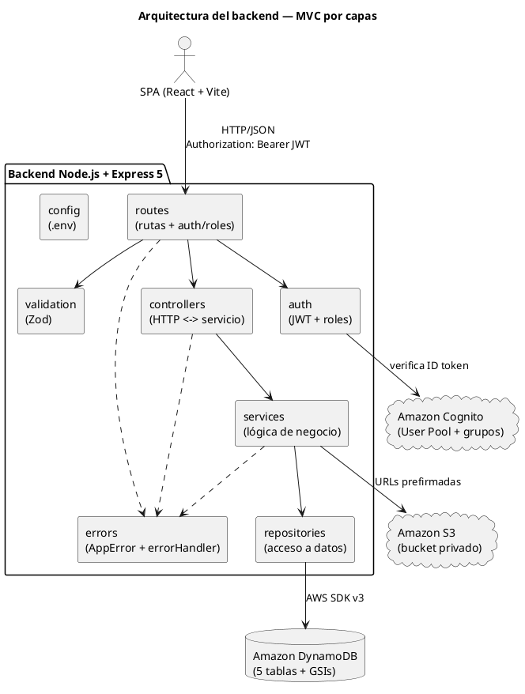

---

## Diagrama 2 — Despliegue en AWS (capa gratuita)

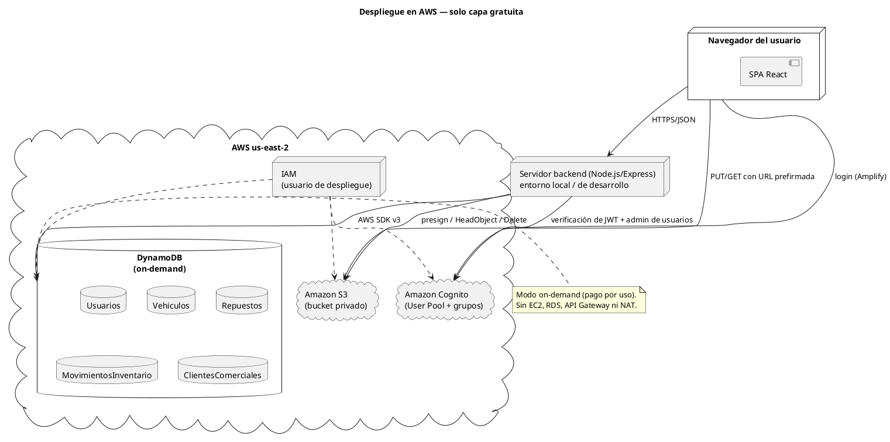

---

## Diagrama 3 — Casos de uso por rol

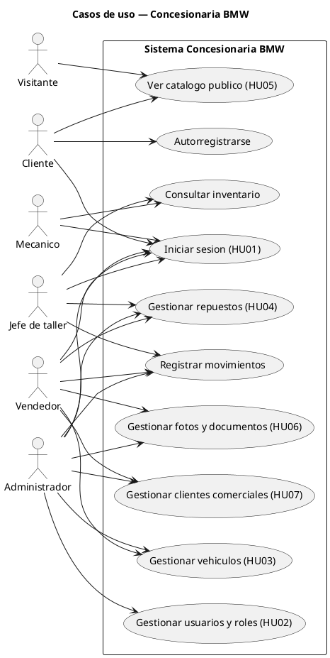

> **Nota:** se evitan acentos en las etiquetas para máxima compatibilidad con cualquier
> renderizador. Si el tuyo los admite, puedes escribirlos con normalidad.

---

## Diagrama 4 — Modelo de datos en DynamoDB

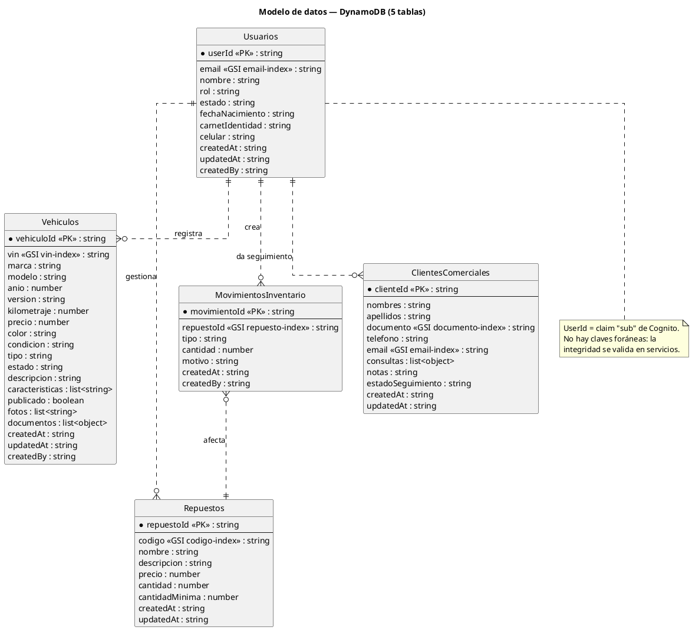

---

## Diagrama 5 — Validación de datos (Zod)

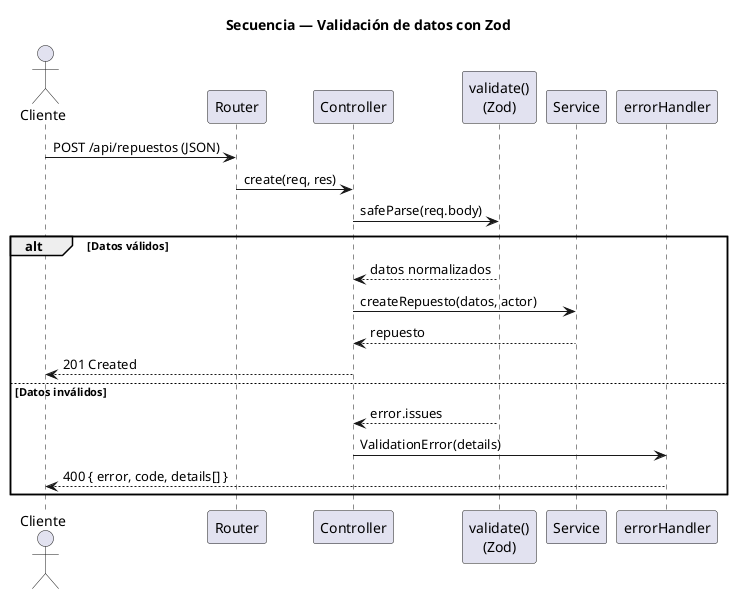

---

## Diagrama 6 — Manejo de errores

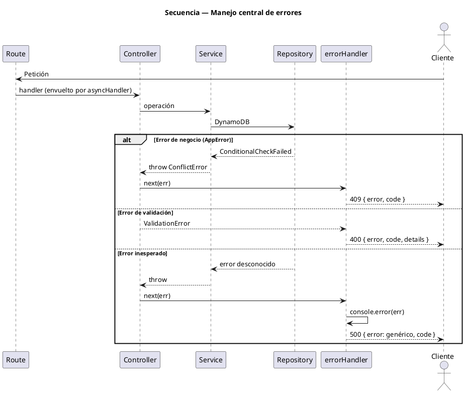

---

## Diagrama 7 — Autenticación (login + JWT)

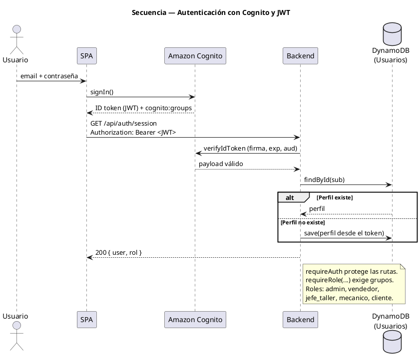

---

## Diagrama 8 — Crear vehículo con archivos (S3)

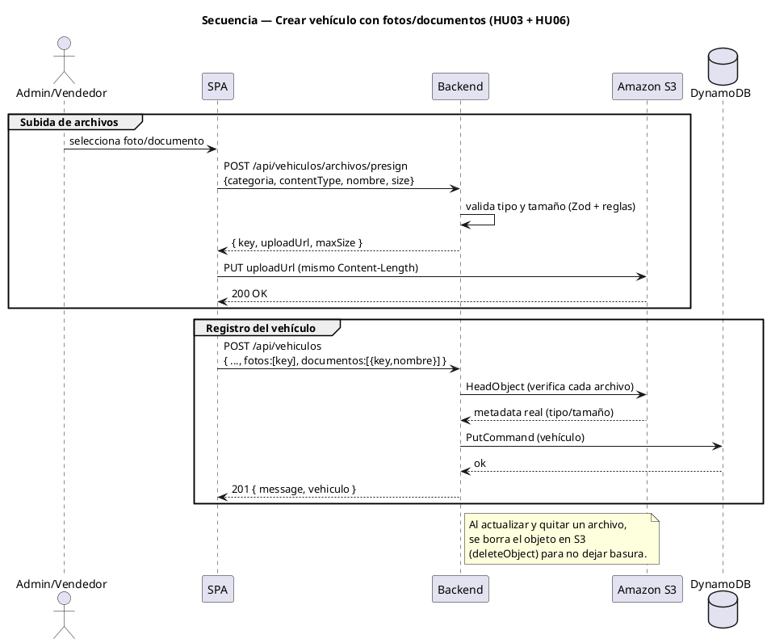

---

## Diagrama 9 — Movimiento de inventario (stock condicional)

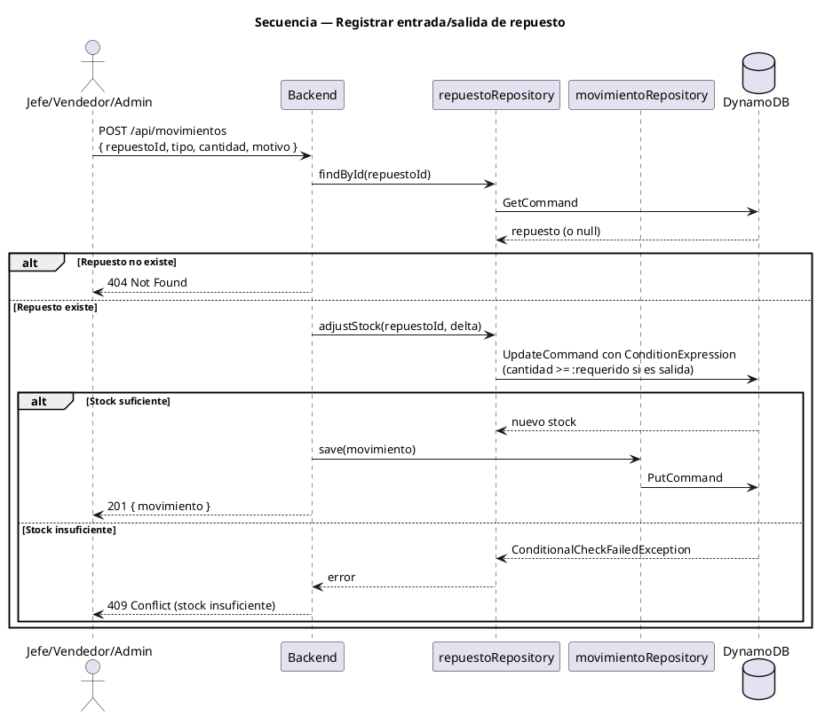

---

## Diagrama 10 — Seguimiento comercial de clientes (HU07)

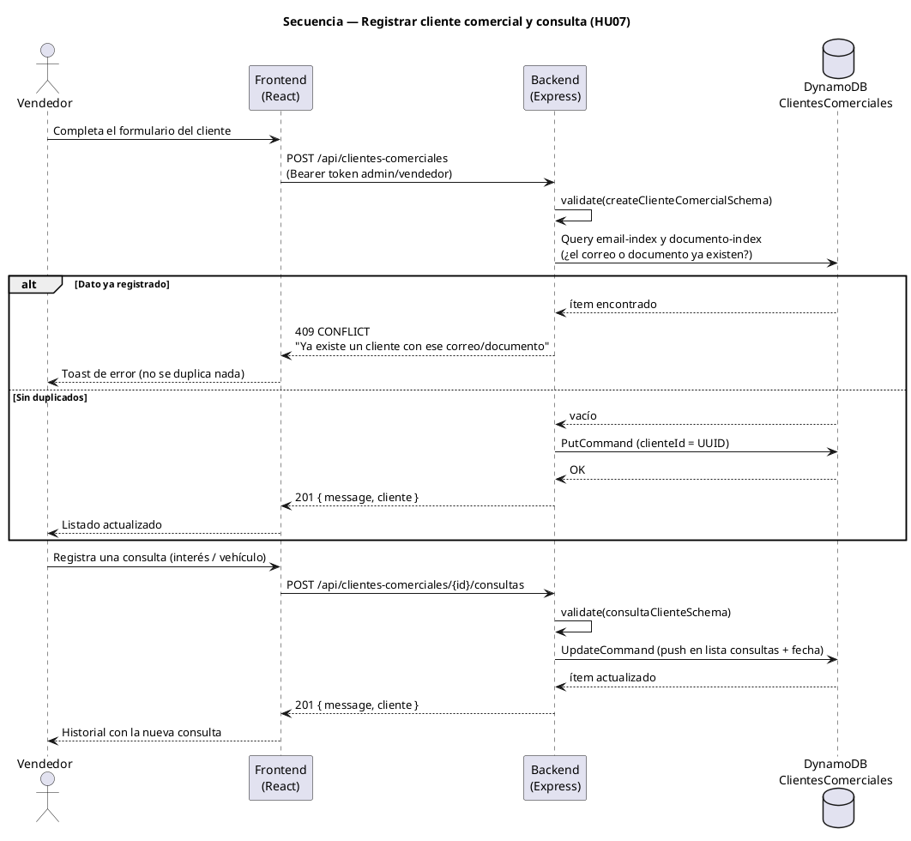

---

## Diagrama extra — Flujo general de una petición (resumen)

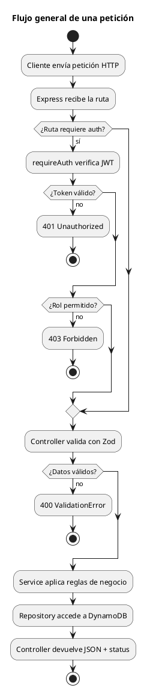
