# Diagramas PlantUML — Concesionaria BMW

Colección de diagramas del backend listos para **copiar y pegar** en un renderizador
PlantUML online (<https://www.plantuml.com/plantuml>), VS Code (extensión *PlantUML*) o
cualquier editor compatible.

## Cómo generar las imágenes

1. Copia el bloque completo, **incluyendo** `@startuml` y `@enduml`.
2. Pégalo en <https://www.plantuml.com/plantuml>.
3. Pulsa **Submit** y luego descarga el PNG/SVG.
4. Inserta la imagen en tu informe.

## Índice de diagramas

| # | Diagrama | Tipo |
| --- | --- | --- |
| 1 | Arquitectura del backend (MVC por capas) | Componentes |
| 2 | Despliegue en AWS (capa gratuita) | Despliegue |
| 3 | Casos de uso por rol | Casos de uso |
| 4 | Modelo de datos en DynamoDB | Entidad-Relación |
| 5 | Validación de datos (Zod) | Secuencia |
| 6 | Manejo de errores | Secuencia |
| 7 | Autenticación (login + JWT) | Secuencia |
| 8 | Crear vehículo con archivos (S3) | Secuencia |
| 9 | Movimiento de inventario (stock condicional) | Secuencia |
| 10 | Seguimiento comercial de clientes (HU07) | Secuencia |
| 11 | Generación de cotización (HU08) | Secuencia |
| 12 | Reserva de vehículo y conversión en venta (HU09) | Secuencia |
| 13 | Registro de venta de vehículo (HU10) | Secuencia |
| 14 | Prueba de manejo: solicitud y gestión (HU11) | Secuencia |
| 15 | Notificaciones por correo (HU12) | Secuencia |
| 16 | Citas del taller (HU13) | Secuencia |
| 17 | Asignar trabajos a los mecánicos (HU14) | Secuencia |

---

## Diagrama 1 — Arquitectura del backend (MVC por capas)


---

## Diagrama 2 — Despliegue en AWS (capa gratuita)

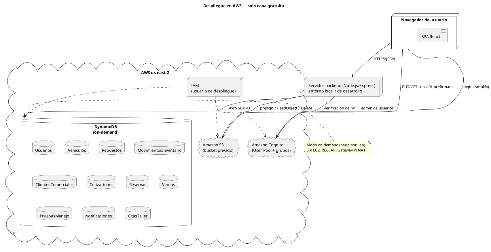

---

## Diagrama 3 — Casos de uso por rol

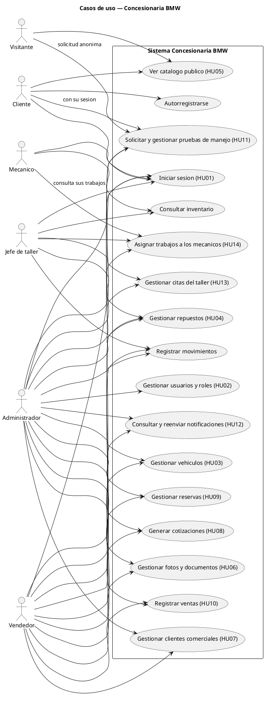

> **Nota:** se evitan acentos en las etiquetas para máxima compatibilidad con cualquier
> renderizador. Si el tuyo los admite, puedes escribirlos con normalidad.

---

## Diagrama 4 — Modelo de datos en DynamoDB

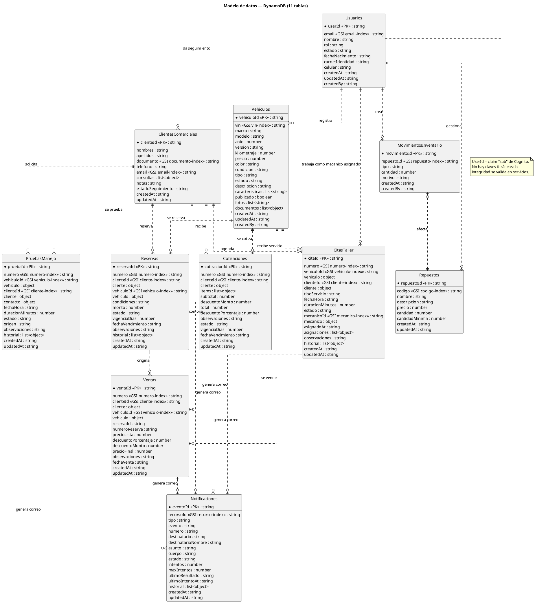

---

## Diagrama 5 — Validación de datos (Zod)

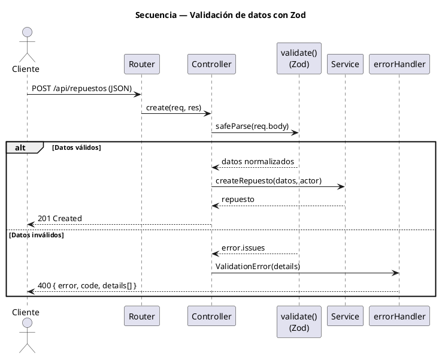

---

## Diagrama 6 — Manejo de errores

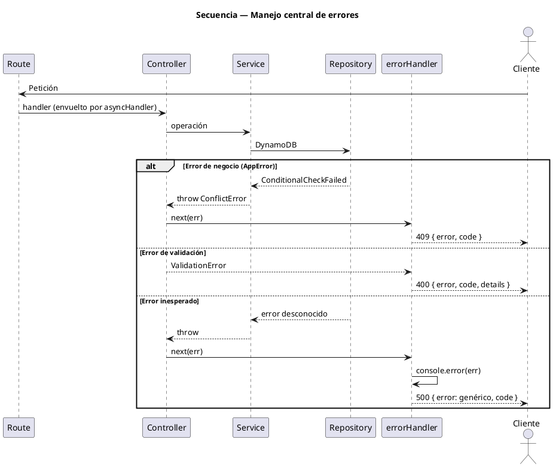

---

## Diagrama 7 — Autenticación (login + JWT)

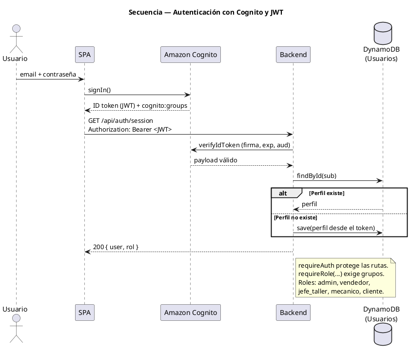

---

## Diagrama 8 — Crear vehículo con archivos (S3)

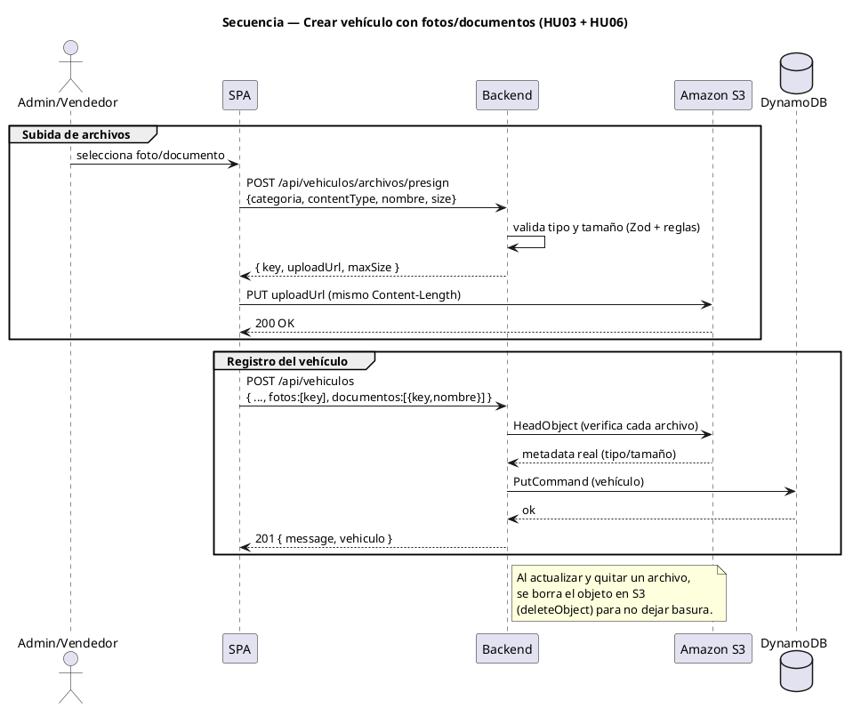

---

## Diagrama 9 — Movimiento de inventario (stock condicional)

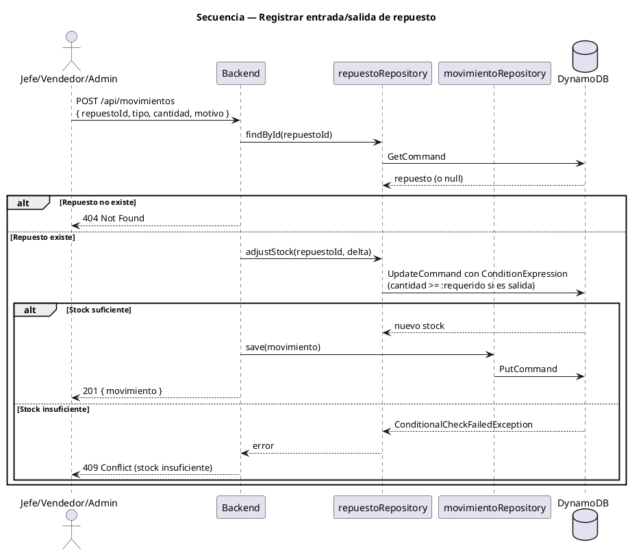

---

## Diagrama 10 — Seguimiento comercial de clientes (HU07)

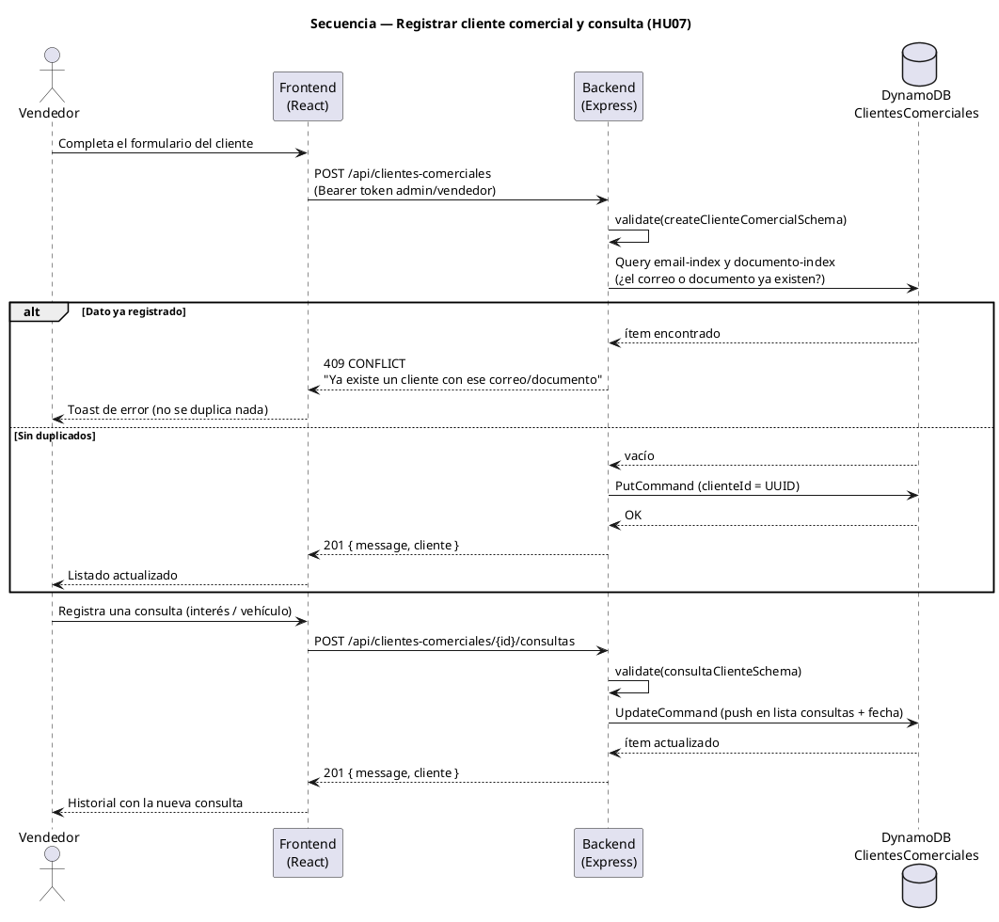

---

## Diagrama 11 — Generación de cotización (HU08)

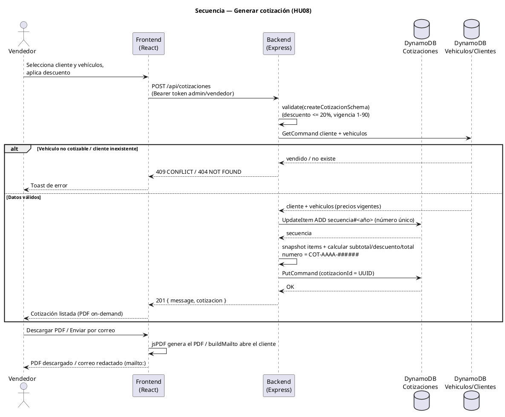

---

## Diagrama 12 — Reserva de vehículo y conversión en venta (HU09)

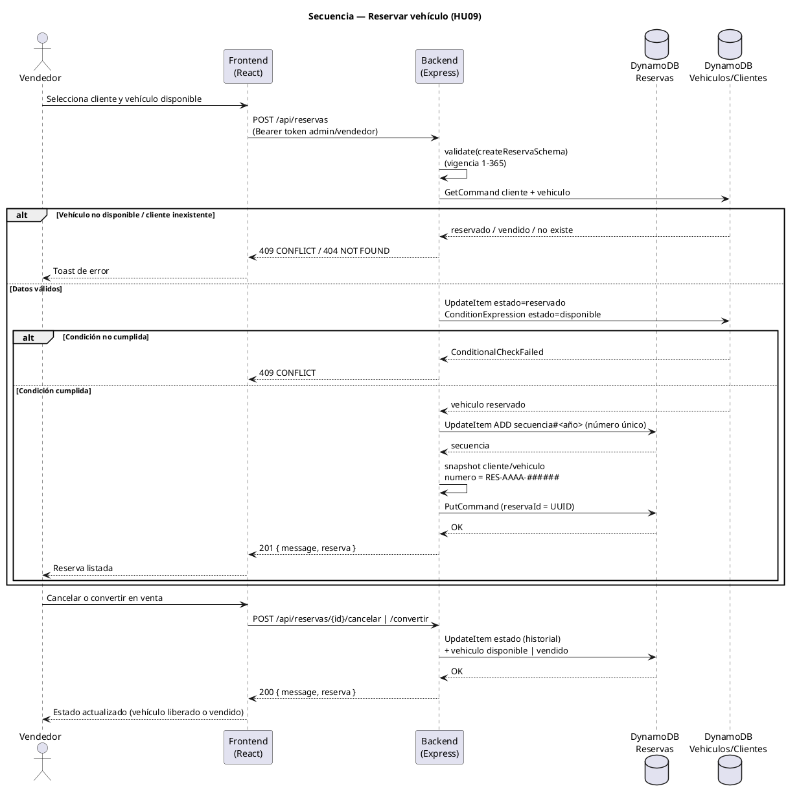

---

## Diagrama 13 — Registro de venta de vehículo (HU10)

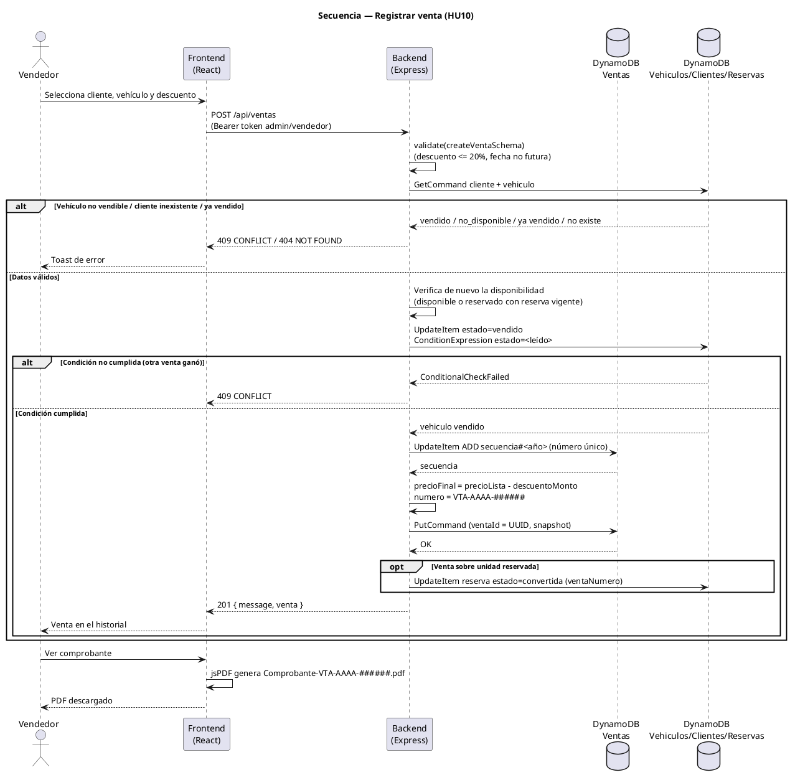

---

## Diagrama 14 — Prueba de manejo: solicitud y gestión (HU11)

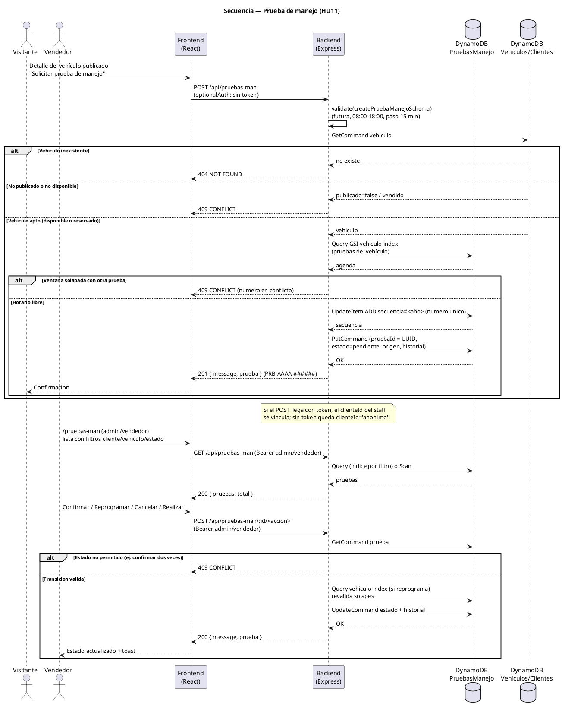

---

## Diagrama 15 — Notificaciones por correo (HU12)

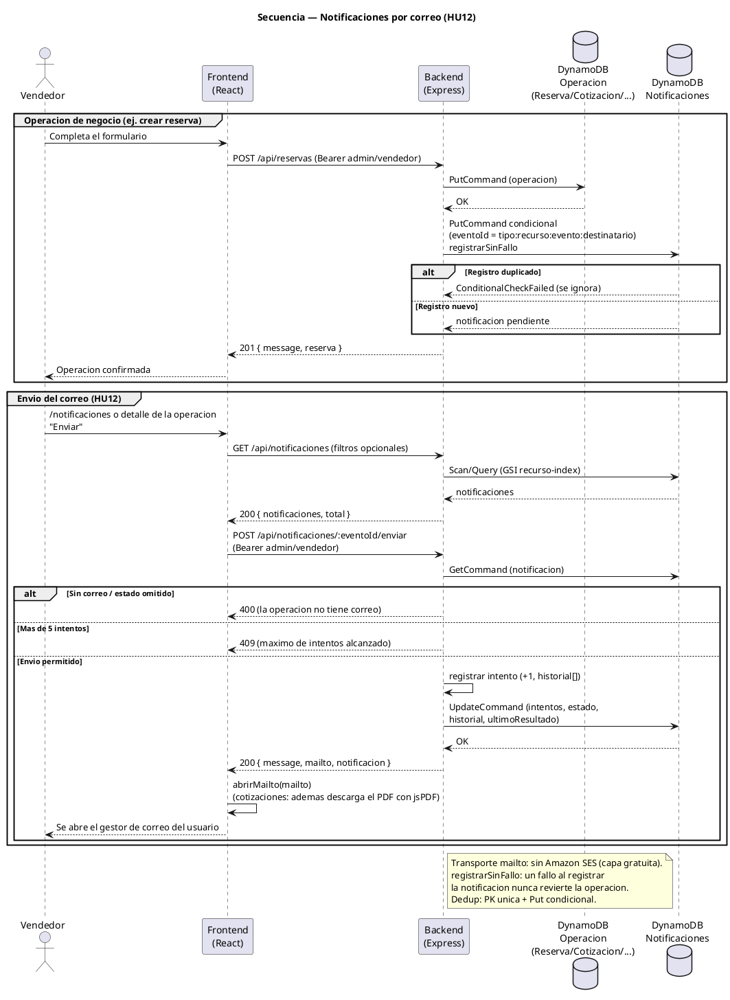

---

## Diagrama 16 — Citas del taller (HU13)

```plantuml
@startuml
title Secuencia — Citas del taller (HU13)
skinparam shadowing false

actor "Jefe de taller" as jefe
participant "Frontend\n/citas" as fe
participant "API\n/api/citas-taller" as api
participant "citaTaller\nController" as ctrl
participant "citaTaller\nService" as svc
participant "citaTaller\nRepository" as repo
database "DynamoDB\nCitasTaller" as db
database "DynamoDB\nVehiculos/Clientes" as db2
database "DynamoDB\nNotificaciones" as ddb

group Alta de una cita
  jefe -> fe : /citas "Nueva cita"\n(vehiculo, cliente, tipoServicio, fecha)
  fe -> api : POST /api/citas-taller\n(Bearer admin/jefe_taller)
  api -> ctrl : asyncHandler(create)
  ctrl -> ctrl : validate(createCitaTallerSchema)
  ctrl -> svc : createCita(datos, actor)
  svc -> db2 : GetCommand vehiculo / cliente
  alt Vehiculo o cliente inexistente
    db2 --> svc : no existe
    svc --> api : 404 NOT FOUND
  else Recursos ok
    db2 --> svc : vehiculo + cliente (snapshots)
    svc -> repo : findByVehiculo (GSI vehiculo-index)
    repo -> db : Query (citas del vehiculo)
    db --> repo : agenda
    repo --> svc : citas
    svc -> svc : valida fecha futura 08:00-18:00,\npaso 15 min y duracion 15-480
    alt Ventana solapada (solicitada/confirmada/en_atencion)
      svc --> api : 409 CONFLICT (cita en conflicto)
    else Horario libre
      svc -> repo : siguienteSecuencia(anio)
      repo -> db : UpdateItem ADD secuencia#<año> (numero unico)
      db --> repo : secuencia
      repo --> svc : CIT-AAAA-######
      svc -> repo : save (citaId UUID, estado=solicitada,\nsnapshots, historial)
      repo -> db : PutCommand
      db --> repo : OK
      svc -> ddb : notificarCita 'cita_solicitada'\nregistrarSinFallo (dedup eventoId)
      ddb --> svc : pendiente (un fallo no revierte el alta)
      svc --> api : cita
      api --> fe : 201 { message, cita }
      fe --> jefe : Confirmacion + badge "solicitada"
    end
  end
end

group Gestion de la cita (confirmar, iniciar, finalizar, reprogramar, cancelar)
  jefe -> fe : Detalle de la cita "Confirmar"
  fe -> api : POST /api/citas-taller/:citaId/confirmar\n(Bearer admin/jefe_taller)
  api -> ctrl : asyncHandler(confirmar)
  ctrl -> svc : confirmarCita(citaId, datos, actor)
  svc -> repo : findById (GetCommand)
  repo -> db : GetCommand cita
  db --> repo : cita
  repo --> svc : cita
  alt Estado distinto de "solicitada"
    svc --> api : 409 CONFLICT (transicion invalida)
  else Transicion valida
    svc -> repo : update (estado=confirmada + historial)
    repo -> db : UpdateCommand
    db --> repo : OK
    svc -> ddb : notificarCita 'cita_confirmada'\nregistrarSinFallo
    ddb --> svc : pendiente
    svc --> api : cita actualizada
    api --> fe : 200 { message, cita }
    fe --> jefe : Estado actualizado + toast
  end
end

note right of svc
  Reprogramar conserva el estado y revalida
  horario y solapes; iniciar pasa
  confirmada -> en_atencion (sin notificacion);
  finalizar en_atencion -> finalizada;
  cancelar solicitada/confirmada -> cancelada
  con motivo (<= 500). Cualquier otra
  combinacion responde 409 (assertEstado).
end note

note bottom of ddb
  Tipo cita_taller, destinatario = email del
  cliente (snapshot), transporte mailto: sin
  Amazon SES (capa gratuita).
  registrarSinFallo: un fallo al notificar
  nunca revierte la operacion del taller.
end note
@enduml
```

---

## Diagrama 17 — Asignar trabajos a los mecánicos (HU14)

```plantuml
@startuml
title Secuencia — Asignar trabajos a los mecanicos (HU14)
skinparam shadowing false

actor "Jefe de taller" as jefe
actor "Mecanico" as mecanico
participant "Frontend\n/citas" as fe
participant "API\n/api/citas-taller\n/api/usuarios/mecanicos" as api
participant "citaTaller\nController" as ctrl
participant "citaTaller\nService" as svc
participant "citaTaller\nRepository" as repo
database "DynamoDB\nCitasTaller\n(GSI mecanico-index)" as db
database "DynamoDB\nUsuarios" as dbu
database "DynamoDB\nNotificaciones" as ddb

group Listar mecanicos activos
  jefe -> fe : /citas, detalle de la cita "Asignar mecanico"
  fe -> api : GET /api/usuarios/mecanicos\n(Bearer admin/jefe_taller)
  api -> ctrl : asyncHandler(listMecanicos)
  ctrl -> svc : (usuarioService.listMecanicos)
  svc -> dbu : Scan/Query usuarios\n(rol=mecanico, estado=activo)
  dbu --> svc : mecanicos
  svc --> api : { total, mecanicos } (orden por nombre)
  api --> fe : 200 { total, mecanicos }
  fe --> jefe : Selector de mecanicos activos
end

group Asignar o reasignar el mecanico responsable
  jefe -> fe : Elige mecanico (+ observaciones opcionales)
  fe -> api : POST /api/citas-taller/:citaId/asignar\n(Bearer admin/jefe_taller)\n{ mecanicoId, observaciones? }
  api -> ctrl : asyncHandler(asignar)
  ctrl -> ctrl : validate(asignarCitaSchema)
  ctrl -> svc : asignarMecanico(citaId, datos, actor)
  svc -> repo : findById (GetCommand)
  repo -> db : GetCommand cita
  db --> repo : cita
  repo --> svc : cita
  svc -> dbu : GetCommand usuario
  dbu --> svc : usuario
  alt Usuario inexistente
    svc --> api : 404 NOT FOUND
  else Rol distinto de "mecanico"
    svc --> api : 409 CONFLICT (no es mecanico)
  else Mecanico inactivo
    svc --> api : 409 CONFLICT (inactivo)
  else Estado fuera de confirmada/en_atencion
    svc --> api : 409 CONFLICT (asignacion no permitida)
  else Ya asignada al mismo mecanico
    svc --> api : 409 CONFLICT (ya asignada)
  else Asignacion valida
    svc -> svc : guarda mecanicoId, mecanico (snapshot),\nasignadoAt y agrega a asignaciones[]\n(tipo "asignada" o "reasignada")
    svc -> repo : update (asignacion + historial)
    repo -> db : UpdateCommand
    db --> repo : OK
    svc -> ddb : notificarMecanico\n'cita_asignada' / 'cita_reasignada'\nregistrarSinFallo (destinatario = email\ndel mecanico, transporte mailto:)
    ddb --> svc : pendiente
    svc --> api : cita actualizada
    api --> fe : 200 { message, cita }
    fe --> jefe : Mecanico asignado + historial
  end
end

group El mecanico consulta sus trabajos
  mecanico -> fe : /citas (rol mecanico)
  fe -> api : GET /api/citas-taller?mecanicoId=<sub del token>\n(Bearer mecanico)
  api -> ctrl : asyncHandler(list) (fuerza\nmecanicoId = req.auth.sub)
  ctrl -> svc : listCitas(filtro del mecanico)
  svc -> repo : findByMecanico (GSI mecanico-index)
  repo -> db : Query mecanico-index
  db --> repo : citas del mecanico
  repo --> svc : citas
  svc --> api : { total, citas }
  api --> fe : 200 { total, citas }
  fe --> mecanico : Solo sus trabajos asignados
end

note right of svc
  La HU14 reutiliza la tabla CitasTaller de la
  HU13 como ordenes de trabajo: no crea tabla
  nueva, solo anade el GSI mecanico-index
  (mecanicoId + fechaHora). El detalle de una
  cita ajena responde 403 al rol mecanico.
end note

note bottom of ddb
  Tipo cita_taller, eventos cita_asignada y
  cita_reasignada, destinatario = email del
  mecanico asignado, transporte mailto: sin
  Amazon SES (capa gratuita).
  registrarSinFallo: un fallo al notificar
  nunca revierte la asignacion.
end note
@enduml
```

---

## Diagrama extra — Flujo general de una petición (resumen)

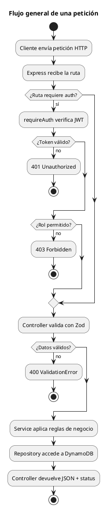
